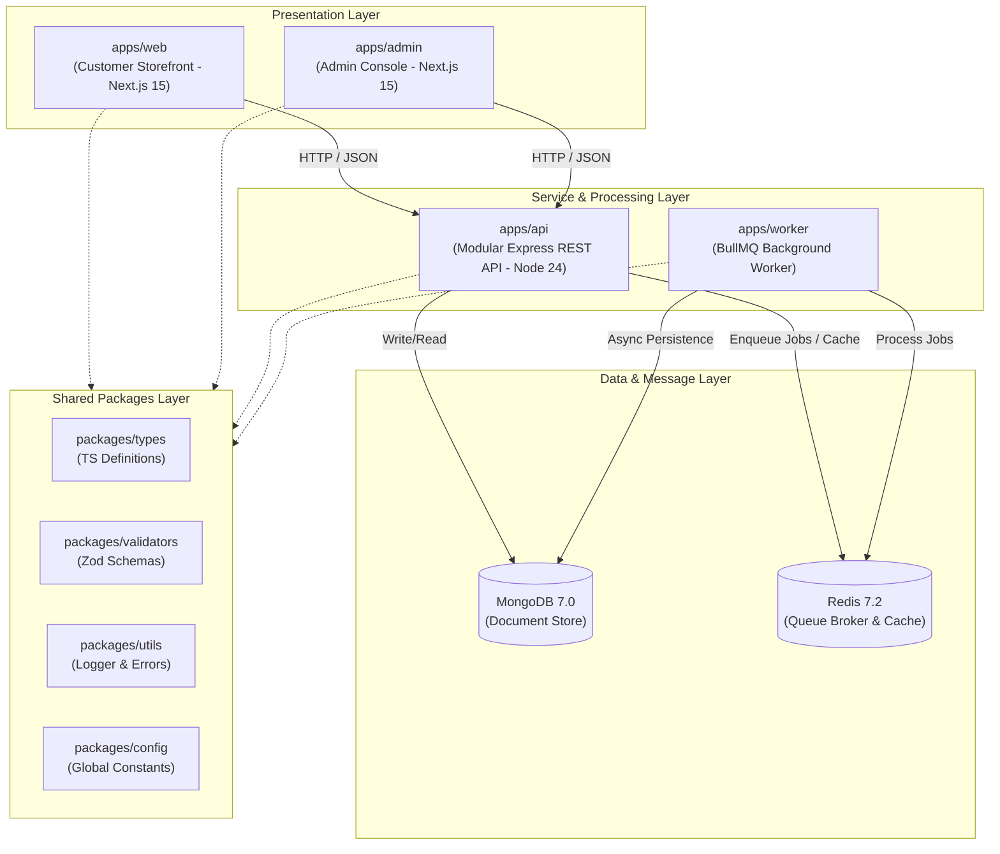
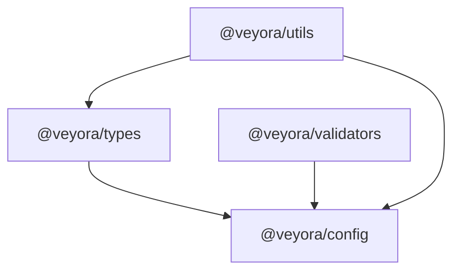

# Veyora Architecture Overview

## 1. System Vision

Veyora is engineered as an enterprise-grade e-commerce platform designed for horizontal scalability, zero-downtime deployments, strict type safety, and clean separation of concerns.

The architecture isolates user-facing client applications, administrative consoles, core business APIs, and asynchronous background workers into dedicated, decoupled services sharing a common set of foundational packages.



---

## 2. Core Applications

### `apps/web` (Customer Storefront)

- **Framework**: Next.js 15 App Router, React 19.
- **Styling**: Tailwind CSS v4 with modern CSS variables.
- **Components**: shadcn/ui foundation with Class Variance Authority (CVA) and Radix primitives.
- **Responsibilities**: Fast, SEO-optimized, accessible customer shopping interface. Utilizes Server Components for data hydration and client components for interactive UI.

### `apps/admin` (Administration Application)

- **Framework**: Next.js 15 App Router, React 19.
- **Styling**: Tailwind CSS v4 dark-mode enterprise theme.
- **Components**: shadcn/ui component system.
- **Responsibilities**: Platform administration, system monitoring, order tracking, catalog management, and tenant settings.

### `apps/api` (Core Express API)

- **Runtime**: Node.js 24 with TypeScript Strict Mode.
- **Framework**: Express 4.21 with modular architecture.
- **Security**: Helmet HTTP headers, CORS whitelisting, centralized error handling.
- **Observability**: Structured JSON logging, `/health` and `/ready` probes, system information endpoint `/system/info`.
- **Graceful Lifecycle**: Handles `SIGTERM` and `SIGINT` signals with configurable connection drain windows.

### `apps/worker` (BullMQ Background Worker)

- **Runtime**: Node.js 24 with TypeScript Strict Mode.
- **Queue Engine**: BullMQ 5.41 backed by Redis 7.2.
- **Features**: Exponential backoff retries, concurrency controls, decoupled job processor registry, structured lifecycle management with graceful shutdown.

---

## 3. Shared Packages Architecture

To prevent duplication and guarantee contract consistency across all applications, common domain primitives and configurations reside in dedicated packages:

```
packages/
├── config/          # Central system constants, default ports, base tsconfigs & eslint rules
├── types/           # Canonical TypeScript interfaces (API payloads, Jobs, Errors, Pagination)
├── validators/      # Zod validation schemas for request parameters, payloads, and env vars
└── utils/           # Centralized AppError hierarchy, structured JSON logger, text utilities
```

### Dependency Hierarchy



---

## 4. Key Architectural Patterns

1. **Strict Type Safety**: All TypeScript configurations enforce `strict: true`, `noImplicitAny: true`, and `noUncheckedIndexedAccess: true`. Types flow seamlessly from shared packages to API routes, worker payloads, and UI components.
2. **Modular API Architecture**: Express endpoints are structured into self-contained feature modules containing dedicated controller, service, and router files (`src/modules/*`).
3. **Fail-Fast Environment Validation**: Each application validates its runtime environment variables on startup using Zod schemas (`@veyora/validators`).
4. **Structured JSON Logging**: Standardized log format across API and worker instances ensures smooth ingestion by log aggregators (e.g. Datadog, CloudWatch, Loki).
5. **Operational Resiliency**: Graceful shutdown handles in-flight HTTP connections and active queue jobs cleanly during deployments or container termination.
