# 13 — Veyora Admin Cache Architecture & Policy

## Architectural Policy: Zero Shared Server Cache

The administrative back-office portal (`@veyora/admin`) enforces a strict **Zero Shared Server Cache Policy**.

In `apps/admin/next.config.mjs`, Next.js Cache Components are explicitly not enabled (`cacheComponents: false`):

```javascript
/** @type {import('next').NextConfig} */
const nextConfig = {
  transpilePackages: ["@veyora/types", "@veyora/utils", "@veyora/validators", "@veyora/config"],
  // NOTE [Task 13 - Cache Architecture Policy]:
  // Next.js Cache Components are intentionally NOT enabled in @veyora/admin (cacheComponents: false).
  // The Admin application is an authenticated multi-operator back-office environment where:
  // 1. All routes require request-time authorization and dynamic session headers.
  // 2. Shared server-side caching presents security risks of cross-operator tenant/dossier leakage.
  // 3. Inventory stock adjustments, orders, shipments, customer dossiers, staff roles, and audit logs
  //    require strictly dynamic, real-time consistency with the MongoDB/Redis backend.
  // 4. Client-side caching and invalidations are exclusively managed via TanStack Query and WebSockets.
  cacheComponents: false,
  images: {/* ... */},
};

export default nextConfig;
```

---

## Security & Concurrency Rationale

### 1. Multi-Operator RBAC Isolation

The Admin portal is operated concurrently by staff members across multiple discrete permission tiers:

- `SUPER_ADMIN`: Unrestricted platform access, staff provisioning, audit trails.
- `OPERATIONS_MANAGER`: Fulfillment, logistics, inventory allocation, carrier dispatch.
- `CATALOG_MANAGER`: Product editorial, pricing, seasonal lookbooks, discounts.
- `SUPPORT_AGENT`: Customer ticket triage, order lookups, return processing.

Shared server-side caching in a multi-tenant or multi-role administrative system introduces severe security hazards:

- **Permission Bleed**: Operator A (with customer PII view rights) fetching a dossier could inadvertently populate a shared cache accessed subsequently by Operator B (without PII permissions).
- **Session Bleed**: Dynamic session headers, CSRF tokens, and operator identities could become entangled in server cache keys.

### 2. Zero Tolerance for Stale Operational State

In retail operations, stale cached data causes critical real-world errors:

- **Inventory Overselling / Allocation Clashes**: If an inventory count is cached on the server for even 60 seconds, two fulfillment operators could double-allocate the last units of a handcrafted garment.
- **Order State Divergence**: If an order cancellation occurs, the shipping department must immediately observe the cancellation before dispatching courier shipments.
- **Audit Log Authenticity**: Compliance and security audit logs must reflect the exact, tamper-evident chronological sequence in MongoDB.

```mermaid
flowchart TD
    subgraph AdminPortal["Admin Portal Execution Model"]
        OpReq["Operator Request"] --> AuthVerify["Verify Operator Session & RBAC"]
        AuthVerify --> ServerComp["Server Component (Request-Time Dynamic)"]
        ServerComp --> ServerAPI["serverAdminApi with Cookie Forwarding"]
        ServerAPI --> Backend["Express API Backend + MongoDB/Redis"]
        Backend --> FreshData["Real-Time Canonical State"]
        FreshData --> Render["Direct Render (Zero Server Cache)"]
    end

    subgraph ClientSync["Client-Side Freshness Layer"]
        TQ["TanStack Query Cache"] --> UI["Interactive Table / Form"]
        WS["WebSocket Event Gateway"] -->|"inventory:adjusted<br/>order:status_changed"| Invalidate["QueryClient.invalidateQueries()"]
        Invalidate --> TQ
    end
```



---

## Dynamic Execution Model in Admin

All Server Components in `apps/admin/src/app` execute strictly at request time:

1. **Session Forwarding**: Incoming operator HTTP cookies (`access_token`, `refresh_token`) are forwarded to the Express backend via `serverAdminApi` in [server-api-client.ts](file:///c:/Users/Sanjay/Desktop/veyora/apps/admin/src/lib/api/server-api-client.ts).
2. **Metadata Generation**: Dynamic metadata (e.g. in `/products/[id]/page.tsx`) queries the database live per request:
   ```typescript
   export async function generateMetadata({ params }: PageProps): Promise<Metadata> {
     const { id } = await params;
     const product = await serverAdminApi.getProduct(id);
     return {
       title: product ? `Edit ${product.title} | Veyora Console` : "Product | Veyora Console",
     };
   }
   ```
3. **No Cache Tags or CacheLife**: No `cacheLife()` or `cacheTag()` calls exist in `@veyora/admin`. Every page hit produces fresh, authoritative output.

---

## Client-Side Freshness Architecture

While server caching is strictly disabled, administrative client responsiveness is maintained using **TanStack Query v5** paired with **Socket.IO**:

### 1. Standardized Query Keys

As established in Task 12, all administrative queries utilize rigid factory objects from [query-keys.ts](file:///c:/Users/Sanjay/Desktop/veyora/apps/admin/src/lib/api/query-keys.ts):

- `adminProductKeys.list(params)`
- `adminInventoryKeys.list(params)`
- `adminCustomerKeys.list(params)`
- `adminAnalyticsKeys.summary()`

### 2. Real-Time Push Invalidation

When changes occur across the cluster (e.g. a worker completes inventory adjustments or an API mutation completes), Socket.IO broadcasts events:

- `inventory:adjusted` -> triggers `queryClient.invalidateQueries({ queryKey: adminInventoryKeys.all })`
- `catalog:updated` -> triggers `queryClient.invalidateQueries({ queryKey: adminProductKeys.all })`
- `order:status_changed` -> triggers `queryClient.invalidateQueries({ queryKey: adminOrderKeys.all })`

### 3. Immediate Optimistic UI

Administrative actions (such as product status toggles, stock adjustments, and customer tag updates) update the client query cache immediately with automatic snapshot rollbacks if an error occurs.
