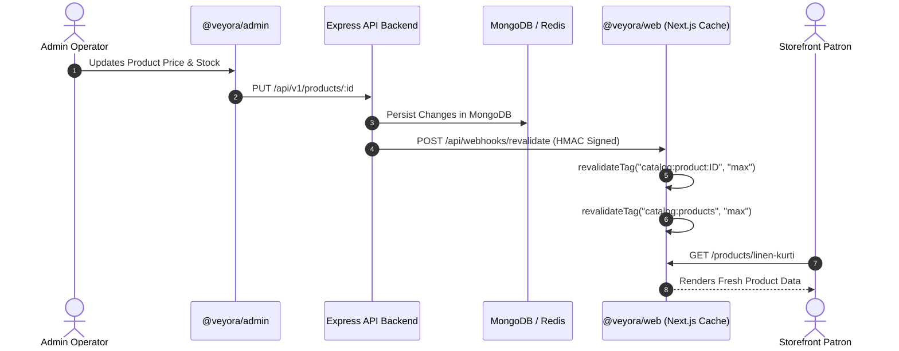

# 13 — Veyora CacheLife, CacheTag & Invalidation Architecture

## Overview

A high-performance caching layer requires a precise invalidation system. Stale product information, outdated pricing, or phantom inventory erodes customer trust.

Veyora implements a tag-based cache architecture utilizing **Next.js 16.4.6 Cache Components**, providing fine-grained invalidation without clearing unaffected catalog branches.



---

## Standardized Cache Tag Taxonomy

Every cached resource in `@veyora/web` is tagged using a hierarchical, colon-delimited naming scheme defined in [catalog-cache.ts](file:///c:/Users/Sanjay/Desktop/veyora/apps/web/src/lib/cache/catalog-cache.ts):

| Resource              | Broad Tag                   | Slug-Specific Tag                | ID-Specific Tag           | Example Tag                                |
| :-------------------- | :-------------------------- | :------------------------------- | :------------------------ | :----------------------------------------- |
| **Products**          | `catalog:products`          | `catalog:product-slug:<slug>`    | `catalog:product:<id>`    | `catalog:product-slug:chanderi-silk-kurti` |
| **Featured Products** | `catalog:products:featured` | —                                | —                         | `catalog:products:featured`                |
| **Categories**        | `catalog:categories`        | `catalog:category-slug:<slug>`   | `catalog:category:<id>`   | `catalog:category-slug:ethnic-wear`        |
| **Collections**       | `catalog:collections`       | `catalog:collection-slug:<slug>` | `catalog:collection:<id>` | `catalog:collection-slug:royal-festive`    |
| **Brands**            | `catalog:brands`            | —                                | —                         | `catalog:brands`                           |

### Tag Hierarchy & Cascading Rules

When an entity is modified:

1. **Specific Tag**: Targeted to only the modified resource (e.g., `catalog:product-slug:silk-saree`).
2. **Entity Broad Tag**: Targeted to collections or lists containing the resource (e.g., `catalog:products`).
3. **Showcase Tag**: If the product is featured, also invalidate `catalog:products:featured`.

This prevents catastrophic cache-busting where updating one garment description wipes out all category trees and navigation lookups.

---

## Next.js 16 Invalidation Primitives: `revalidateTag` vs `updateTag`

Next.js 16.4.6 distinguishes between background tag purging and mutation-driven cache updates:

### 1. `revalidateTag(tag, profile)`

- **Execution Context**: Route Handlers (`/api/*`), Webhooks, and background worker handlers.
- **Next.js 16 Signature**: `revalidateTag(tag: string, profile: string | { expire?: number })`
- **Deprecation Note**: In Next.js 16, invoking `revalidateTag(tag)` without a second argument issues a deprecation warning. Pass `"max"` or `{ expire: 0 }` to specify eviction semantics:
  ```typescript
  import { revalidateTag } from "next/cache";

  // Purge catalog tags with max eviction
  revalidateTag("catalog:products", "max");
  revalidateTag(`catalog:product-slug:${slug}`, "max");
  ```
- **Behavior**: Marks cached entries matching the tag as stale across server instances. Next request triggers background recomputation (Stale-While-Revalidate).

### 2. `updateTag(tag)`

- **Execution Context**: **Strictly inside Server Actions** (Task 14).
- **Semantics**: Read-Your-Own-Writes immediate cache update.
- **Constraint**: Next.js 16 throws an invariant error if `updateTag` is called outside an active Server Action:
  ```
  Error: updateTag can only be called from within a Server Action.
  To invalidate cache tags in Route Handlers or other contexts, use revalidateTag instead.
  ```
- **Usage**: When a customer performs an action (e.g. submitting a review or updating customer settings via a Server Action), `updateTag` immediately updates the active user's view while updating the underlying cache.

### 3. Comparison Matrix

| Feature               | `revalidateTag(tag, profile)`           | `updateTag(tag)`               | `revalidatePath(path)`    |
| :-------------------- | :-------------------------------------- | :----------------------------- | :------------------------ |
| **Context**           | Route Handlers, Webhooks, Scripts       | Server Actions only            | Route Handlers or Actions |
| **Timing**            | Background SWR across all clients       | Immediate read-your-own-writes | Background SWR            |
| **Granularity**       | Precise tag-based targeting             | Precise tag-based targeting    | Coarse URL route path     |
| **Next.js 16 Status** | Requires profile (`"max"` / `{expire}`) | Modern Action primitive        | Supported                 |

---

## Invalidation Helper Implementation

Centralized invalidation methods are provided in [catalog-cache.ts](file:///c:/Users/Sanjay/Desktop/veyora/apps/web/src/lib/cache/catalog-cache.ts):

```typescript
import { revalidateTag } from "next/cache";
import { CACHE_TAGS } from "./catalog-cache";

/**
 * Invalidate product cache tags across broad and specific scopes.
 */
export async function revalidateProductCache(options: { slug?: string; id?: string }) {
  revalidateTag(CACHE_TAGS.products, "max");
  revalidateTag(CACHE_TAGS.featuredProducts, "max");
  if (options.slug) {
    revalidateTag(CACHE_TAGS.product(options.slug), "max");
  }
  if (options.id) {
    revalidateTag(CACHE_TAGS.productId(options.id), "max");
  }
}

/**
 * Invalidate category cache tags.
 */
export async function revalidateCategoryCache(options: { slug?: string; id?: string }) {
  revalidateTag(CACHE_TAGS.categories, "max");
  if (options.slug) {
    revalidateTag(CACHE_TAGS.category(options.slug), "max");
  }
  if (options.id) {
    revalidateTag(CACHE_TAGS.categoryId(options.id), "max");
  }
}

/**
 * Invalidate collection and seasonal lookbook cache tags.
 */
export async function revalidateCollectionCache(options: { slug?: string; id?: string }) {
  revalidateTag(CACHE_TAGS.collections, "max");
  if (options.slug) {
    revalidateTag(CACHE_TAGS.collection(options.slug), "max");
  }
  if (options.id) {
    revalidateTag(CACHE_TAGS.collectionId(options.id), "max");
  }
}
```

---

## Safety Guarantees & Edge Cases

1. **Cold-Start Resilience**: When the upstream API is restarting, cached entries inside their `expire` window continue serving stale content gracefully rather than throwing 500 errors to storefront visitors.
2. **Customer Isolation**: `cookies()` or `headers()` are never accessed inside `"use cache"` functions, guaranteeing that personalized customer tokens are never persisted in public edge or server cache entries.
3. **No Dynamic Data Poisoning**: Cart totals, inventory quantities, and customer authentication states are verified via dynamic client requests and never routed through the cache components layer.
