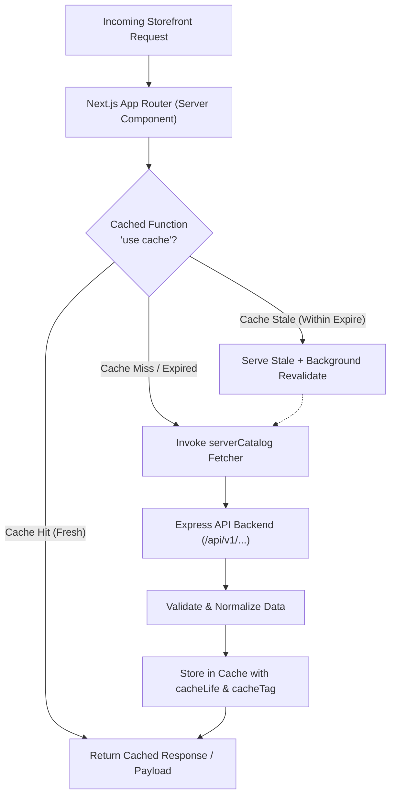
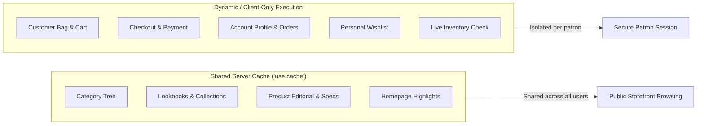

# 13 — Veyora Web Cache Components Architecture

## Overview & Next.js 16.4.6 Paradigm

Veyora's customer-facing storefront (`@veyora/web`) leverages **Next.js 16.4.6 Cache Components** to deliver high-performance, edge-cacheable ecommerce rendering.

By enabling `cacheComponents: true` in `apps/web/next.config.mjs`, Next.js 16 introduces a compiler-level model where caching is granular, component/function-level, and declarative via the `"use cache"` directive. This replaces coarse page-level ISR and unstable caching wrappers with a composable primitives framework consisting of:

1. `"use cache"` directive at function or component scope.
2. `cacheLife(profile)` defining client freshness (`stale`), background server revalidation (`revalidate`), and hard cache purge (`expire`).
3. `cacheTag(...tags)` establishing declarative invalidation handles.
4. Compiler-enforced isolation ensuring personalized request state (cookies, authorization headers) is never baked into shared public cache entries.



---

## Configuration & CacheLife Profiles

In `apps/web/next.config.mjs`, cache life profiles are registered at the top level of the Next.js configuration:

```javascript
/** @type {import('next').NextConfig} */
const nextConfig = {
  transpilePackages: ["@veyora/types", "@veyora/utils", "@veyora/validators", "@veyora/config"],
  cacheComponents: true,
  cacheLife: {
    taxonomy: {
      stale: 3600, // 1 hour: Fresh on client
      revalidate: 86400, // 24 hours: Server background revalidation threshold
      expire: 604800, // 7 days: Maximum lifetime before hard recomputation
    },
    lookbook: {
      stale: 1800, // 30 minutes: Fresh on client
      revalidate: 43200, // 12 hours: Server background revalidation
      expire: 259200, // 3 days: Maximum lifetime
    },
    garment: {
      stale: 300, // 5 minutes: Fresh on client
      revalidate: 3600, // 1 hour: Server background revalidation
      expire: 86400, // 24 hours: Maximum lifetime
    },
    showcase: {
      stale: 600, // 10 minutes: Fresh on client
      revalidate: 7200, // 2 hours: Server background revalidation
      expire: 86400, // 24 hours: Maximum lifetime
    },
  },
  images: {
    formats: ["image/avif", "image/webp"],
    minimumCacheTTL: 86400,
    remotePatterns: [/* ... */],
  },
};

export default nextConfig;
```

### Profile Semantics

| Profile    | Target Resources                              | `stale` (Client TTL) | `revalidate` (SWR Window) | `expire` (Hard Eviction) | Rationale                                                                                                        |
| :--------- | :-------------------------------------------- | :------------------- | :------------------------ | :----------------------- | :--------------------------------------------------------------------------------------------------------------- |
| `taxonomy` | Categories, Hierarchy, Brand Catalog          | 3600s (1 hr)         | 86400s (24 hrs)           | 604800s (7 days)         | Product categories and taxonomy change infrequently; changes are pushed via administrative webhook invalidation. |
| `lookbook` | Seasonal Collections, Curated Edits           | 1800s (30 min)       | 43200s (12 hrs)           | 259200s (3 days)         | Curated collections are curated periodically; editorial banners and featured lookbooks change seasonally.        |
| `garment`  | Product Details, Specifications, Descriptions | 300s (5 min)         | 3600s (1 hr)              | 86400s (24 hrs)          | Balances fast product page loads with timely updates when pricing or variant availability shifts.                |
| `showcase` | Homepage Highlights, Featured Badges          | 600s (10 min)        | 7200s (2 hrs)             | 86400s (24 hrs)          | High-traffic entry points benefit from aggressive caching without sacrificing merchandising updates.             |

---

## Architectural Boundaries: What is Cached vs Uncached

A strict security boundary is maintained in `@veyora/web` between public catalog data and customer-specific state:

### 1. Cached (Public Catalog Data)

- **Category Navigations & Trees**: Root categories (`/category/[slug]`, navigation mega-menus).
- **Curated Collections**: Seasonal lookbooks, editorial campaigns (`/collections`, `/collections/[slug]`).
- **Product Descriptions & Specifications**: Title, story, fabric specifications, craftsmanship notes (`/products/[slug]`).
- **Showcase & Homepage Catalog**: Curated highlights and featured grids (`/`).

### 2. Strictly NOT Cached (Personalized / Dynamic State)

- **Cart & Bag Contents**: Cart lines, subtotal calculations, coupon deductions (`/cart`, slide-over bag).
- **Checkout Flows**: Shipping address forms, payment tokenization, order reviews (`/checkout`).
- **Customer Account & Profile**: Patron dossier, saved shipping addresses, order histories (`/account/*`).
- **Customer Wishlist**: Patron-specific saved garments. Managed client-side via TanStack Query and Zustand.
- **Stock Availability & Live Inventory**: Accurate real-time SKU stock is verified dynamically during cart addition and checkout review.
- **Authentication Credentials**: JWT tokens, session cookies, and authorization headers are never referenced inside `"use cache"` functions.



---

## Cached Data Service Implementation

The cached data access layer is centralized in [catalog-cache.ts](file:///c:/Users/Sanjay/Desktop/veyora/apps/web/src/lib/cache/catalog-cache.ts):

```typescript
import { cacheLife, cacheTag, revalidateTag } from "next/cache";
import { serverCatalog } from "@/lib/api/server-api-client";
import type { Category, Collection, Product } from "@veyora/types";
import type { ProductQueryInput } from "@veyora/validators";

export const CACHE_TAGS = {
  categories: "catalog:categories",
  category: (slug: string) => `catalog:category-slug:${slug}`,
  categoryId: (id: string) => `catalog:category:${id}`,
  collections: "catalog:collections",
  collection: (slug: string) => `catalog:collection-slug:${slug}`,
  collectionId: (id: string) => `catalog:collection:${id}`,
  products: "catalog:products",
  featuredProducts: "catalog:products:featured",
  product: (slug: string) => `catalog:product-slug:${slug}`,
  productId: (id: string) => `catalog:product:${id}`,
  brands: "catalog:brands",
} as const;

export async function getCachedCategories(): Promise<Category[]> {
  "use cache";
  cacheLife("taxonomy");
  cacheTag(CACHE_TAGS.categories);
  return serverCatalog.getCategories();
}

export async function getCachedCategoryBySlug(slug: string): Promise<Category | null> {
  "use cache";
  cacheLife("taxonomy");
  cacheTag(CACHE_TAGS.categories, CACHE_TAGS.category(slug));
  return serverCatalog.getCategoryBySlug(slug);
}

export async function getCachedCollections(): Promise<Collection[]> {
  "use cache";
  cacheLife("lookbook");
  cacheTag(CACHE_TAGS.collections);
  return serverCatalog.getCollections();
}

export async function getCachedCollectionBySlug(slug: string): Promise<Collection | null> {
  "use cache";
  cacheLife("lookbook");
  cacheTag(CACHE_TAGS.collections, CACHE_TAGS.collection(slug));
  return serverCatalog.getCollectionBySlug(slug);
}

export async function getCachedProductBySlug(slug: string): Promise<Product | null> {
  "use cache";
  cacheLife("garment");
  cacheTag(CACHE_TAGS.products, CACHE_TAGS.product(slug));
  return serverCatalog.getProductBySlug(slug);
}

export async function getCachedFeaturedProducts(limit = 4): Promise<Product[]> {
  "use cache";
  cacheLife("showcase");
  cacheTag(CACHE_TAGS.products, CACHE_TAGS.featuredProducts);
  return serverCatalog.getFeaturedProducts(limit);
}
```

---

## Server Component Integration

Server Components seamlessly consume these cached functions without knowing the caching backend. Because `"use cache"` integrates with React's cache pipeline:

1. **Deduplication Across Component Trees**: If `generateMetadata` and `Page` both call `getCachedProductBySlug(slug)`, only one cache lookup or background revalidation occurs.
2. **Partial Prerendering (PPR) Readiness**: Static shells are produced at build time; dynamic holes stream in upon request.
3. **No Network Waterfalls**: Cached responses resolve synchronously from server memory/cache stores.

### Example: Product Page Integration (`apps/web/src/app/products/[slug]/page.tsx`)

```tsx
import { Metadata } from "next";
import { notFound } from "next/navigation";
import { ServerApiClientError } from "@/lib/api/server-api-client";
import { getCachedProductBySlug } from "@/lib/cache/catalog-cache";
import { ProductDetailsClient } from "./product-details-client";

export async function generateMetadata({ params }: PageProps): Promise<Metadata> {
  const { slug } = await params;
  try {
    const product = await getCachedProductBySlug(slug);
    if (!product) return { title: "Product Not Found | Veyora" };
    return {
      title: `${product.title} | Veyora Atelier`,
      description: product.description.slice(0, 160),
    };
  } catch {
    return { title: "Product Details | Veyora Atelier" };
  }
}

export default async function ProductDetailPage({ params }: PageProps) {
  const { slug } = await params;
  let product;
  try {
    product = await getCachedProductBySlug(slug);
  } catch (err: unknown) {
    if (err instanceof ServerApiClientError && err.isNotFound()) notFound();
    throw err;
  }
  if (!product) notFound();

  return <ProductDetailsClient product={product} />;
}
```
