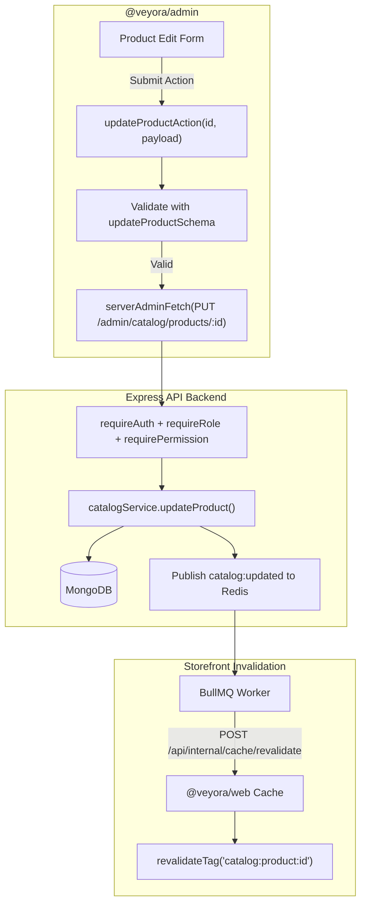

# 14 — Veyora Admin Server Actions & Mutation Architecture

## Overview & Administrative Design Principles

The back-office console (`@veyora/admin`) utilizes **Next.js 16.4.6 Server Actions** for core record-level administration workflows (catalog management, customer status modifications, order status transitions) while preserving **TanStack Query v5** for interactive, multi-operator tables, live inventory adjustments, and real-time dashboard analytics.

### Principles:

1. **Authoritative Express API**: Every administrative Server Action acts as an authenticated proxy to the Express API backend. Server Actions do not query MongoDB or execute ledger logic directly.
2. **RBAC Enforcement**: The Express backend enforces granular role and permission checks (`requireRole("admin", "superadmin")`, `requirePermission("products:write")`). Server Actions do not bypass these gates.
3. **Audit Trail Integrity**: Administrative mutations produce audit records in MongoDB via existing backend services.
4. **Cross-Application Invalidation**: When catalog entities are updated in the Admin Console, invalidation signals are dispatched to ensure the `@veyora/web` public cache reflects the changes immediately.



---

## Administrative Mutation Inventory

| Domain        | Action / Mutation | Implementation                                   | Target Endpoint                      | RBAC Permission   | Revalidation Scope                                      |
| :------------ | :---------------- | :----------------------------------------------- | :----------------------------------- | :---------------- | :------------------------------------------------------ |
| **Catalog**   | Create Product    | **Server Action** (`createProductAction`)        | `POST /admin/catalog/products`       | `products:write`  | `revalidatePath("/products")`, `catalog:products`       |
| **Catalog**   | Update Product    | **Server Action** (`updateProductAction`)        | `PUT /admin/catalog/products/:id`    | `products:write`  | `revalidatePath("/products/:id")`, `catalog:product:id` |
| **Catalog**   | Delete Product    | **Server Action** (`deleteProductAction`)        | `DELETE /admin/catalog/products/:id` | `products:write`  | `revalidatePath("/products")`, `catalog:products`       |
| **Customers** | Update Status     | **Server Action** (`updateCustomerStatusAction`) | `PATCH /admin/customers/:id/status`  | `customers:write` | `revalidatePath("/customers/:id")`                      |
| **Customers** | Update Notes      | **Server Action** (`updateCustomerNotesAction`)  | `PATCH /admin/customers/:id/notes`   | `customers:write` | `revalidatePath("/customers/:id")`                      |
| **Orders**    | Update Status     | **Server Action** (`updateOrderStatusAction`)    | `PATCH /admin/orders/:id/status`     | `orders:write`    | `revalidatePath("/orders/:id")`                         |
| **Inventory** | Stock Adjustment  | **TanStack Query** (`useAdjustStock`)            | `POST /admin/inventory/adjust`       | `inventory:write` | WebSocket `inventory:adjusted` broadcast                |
| **Inventory** | Low-Stock Alerts  | **TanStack Query**                               | `GET /admin/inventory/low-stock`     | `inventory:read`  | Real-time query cache                                   |
| **Analytics** | Dashboard KPIs    | **TanStack Query**                               | `GET /admin/analytics/summary`       | `analytics:read`  | Dynamic polling / WebSocket                             |

---

## Server Action Implementation in Admin

Administrative actions are organized in `apps/admin/src/actions/`:

### 1. Catalog Actions ([catalog.actions.ts](file:///c:/Users/Sanjay/Desktop/veyora/apps/admin/src/actions/catalog.actions.ts))

```typescript
"use server";

import { revalidatePath } from "next/cache";
import { serverAdminFetch, ServerApiClientError } from "@/lib/api/server-api-client";
import {
  createProductSchema,
  updateProductSchema,
  CreateProductInput,
  UpdateProductInput,
} from "@veyora/validators";
import type { ActionResult, Product } from "@veyora/types";

export async function createProductAction(
  input: CreateProductInput,
  auth?: { token?: string }
): Promise<ActionResult<Product>> {
  const validation = createProductSchema.safeParse(input);
  if (!validation.success) {
    return {
      success: false,
      error: "Product validation failed: check required fields.",
      code: "VALIDATION_ERROR",
      fieldErrors: validation.error.flatten().fieldErrors as Record<string, string[]>,
      timestamp: new Date().toISOString(),
    };
  }

  try {
    const product = await serverAdminFetch<Product>("/admin/catalog/products", {
      method: "POST",
      body: validation.data,
      token: auth?.token,
      requireAuth: true,
    });

    revalidatePath("/products");
    revalidatePath("/catalog");

    return {
      success: true,
      data: product,
      timestamp: new Date().toISOString(),
    };
  } catch (error: unknown) {
    if (error instanceof ServerApiClientError) {
      return {
        success: false,
        error: error.message,
        code: error.code,
        timestamp: new Date().toISOString(),
      };
    }
    return {
      success: false,
      error: "Failed to create product in catalog.",
      code: "INTERNAL_ERROR",
      timestamp: new Date().toISOString(),
    };
  }
}
```

### 2. Customer Governance Actions ([customer.actions.ts](file:///c:/Users/Sanjay/Desktop/veyora/apps/admin/src/actions/customer.actions.ts))

Provides:

- `updateCustomerStatusAction(customerId: string, input: UpdateCustomerStatusInput, auth?)`: Updates customer activation or suspension status with audit justification.
- `updateCustomerNotesAction(customerId: string, input: UpdateCustomerNotesInput, auth?)`: Appends staff CRM notes and operational alerts to the customer profile.

### 3. Order Governance Actions ([order.actions.ts](file:///c:/Users/Sanjay/Desktop/veyora/apps/admin/src/actions/order.actions.ts))

Provides:

- `updateOrderStatusAction(orderId: string, input: UpdateOrderStatusInput, auth?)`: Transitions order states (`confirmed`, `processing`, `shipped`, `delivered`, `cancelled`) with RBAC enforcement and tracking history recording.

---

## Why Inventory Mutations Remain in TanStack Query

Inventory stock adjustments (`adjustStock`) are intentionally retained as **TanStack Query client mutations**:

1. **Interactive Modal Workflows**: Stock adjustments occur inside high-density interactive inventory tables with batch SKU selection and rapid correction inputs.
2. **WebSocket Integration**: Inventory changes broadcast `inventory:adjusted` events over Socket.IO to all open operator consoles. TanStack Query automatically reconciles active table caches upon receiving the WebSocket event.
3. **No Form Redirect Lag**: Inventory operators require immediate feedback in the active grid without App Router server page transitions.
