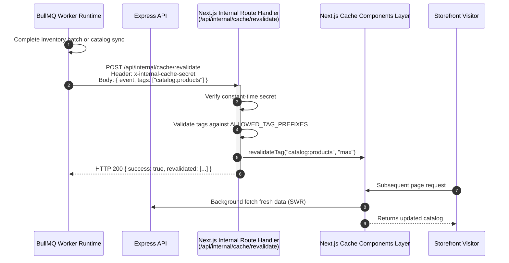

# 14 — Veyora Cache Revalidation & Worker Integration Architecture

## The Architectural Challenge: Process Isolation

In the Veyora monorepo, the background job processor (`@veyora/worker`) executes in a dedicated Node.js runtime decoupled from the Next.js storefront deployment (`@veyora/web`).

Because Next.js 16 Cache Component APIs (`revalidateTag()`, `updateTag()`, `revalidatePath()`) rely on internal Next.js request and server stores (`workAsyncStorage`), **they cannot be imported or executed directly by background worker processes**.

Directly importing `next/cache` into a BullMQ processor results in runtime invariant crashes:

```
Error: Invariant: static generation store missing in revalidateTag
```

To resolve this architectural boundary securely, Veyora establishes an **Authenticated Internal Revalidation Bridge**.



---

## Internal Revalidation Route Handler

Implemented in [apps/web/src/app/api/internal/cache/revalidate/route.ts](file:///c:/Users/Sanjay/Desktop/veyora/apps/web/src/app/api/internal/cache/revalidate/route.ts):

### Security & Hardening Controls:

1. **Constant-Time Secret Verification**: Prevents timing side-channel attacks by comparing secrets via `node:crypto.timingSafeEqual` with byte-length normalization.
2. **Strict Tag Prefix Allowlist**: Only predefined catalog tags can be purged. External callers cannot inject arbitrary tags or execute wildcard cache purging:
   ```typescript
   const ALLOWED_TAG_PREFIXES = [
     "catalog:products",
     "catalog:product:",
     "catalog:product-slug:",
     "catalog:categories",
     "catalog:category:",
     "catalog:category-slug:",
     "catalog:collections",
     "catalog:collection:",
     "catalog:collection-slug:",
     "catalog:brands",
   ] as const;
   ```
3. **Payload Size Guard**: Incoming requests exceeding 64KB are rejected immediately with HTTP 413.
4. **Structured Schema Validation**: Validated via Zod (`internalRevalidationSchema`). Maximum 50 tags per request.
5. **No Secret Leakage**: Secrets are never echoed in logs or response payloads.

---

## Mutation-to-Cache Tag Dependency Matrix

| Mutation Event                           | Triggering Source      | Invalidation Targets                                                               | Next.js API & Profile                |
| :--------------------------------------- | :--------------------- | :--------------------------------------------------------------------------------- | :----------------------------------- |
| **Product Created**                      | Admin Console / Worker | `catalog:products`, `catalog:products:featured`                                    | `revalidateTag(..., "max")`          |
| **Product Updated** (Title, Desc, Price) | Admin Console / Worker | `catalog:products`, `catalog:product:<id>`, `catalog:product-slug:<slug>`          | `revalidateTag(..., "max")`          |
| **Product Featured Status**              | Admin Console          | `catalog:products:featured`, `catalog:products`                                    | `revalidateTag(..., "max")`          |
| **Inventory Stock Level Adjusted**       | BullMQ Worker / Admin  | `catalog:products`, `catalog:product:<id>`                                         | `revalidateTag(..., "max")`          |
| **Category Created / Updated**           | Admin Console          | `catalog:categories`, `catalog:category:<id>`, `catalog:category-slug:<slug>`      | `revalidateTag(..., "max")`          |
| **Collection / Lookbook Updated**        | Admin Console          | `catalog:collections`, `catalog:collection:<id>`, `catalog:collection-slug:<slug>` | `revalidateTag(..., "max")`          |
| **Customer Profile Updated**             | Web Server Action      | `/account/profile`                                                                 | `revalidatePath("/account/profile")` |
| **Customer Address Modified**            | Web Server Action      | `/account/addresses`, `/checkout`                                                  | `revalidatePath(...)`                |

---

## Worker Client Implementation

BullMQ processors trigger revalidation using the resilient client utility in [cache-revalidator.ts](file:///c:/Users/Sanjay/Desktop/veyora/apps/worker/src/infrastructure/cache/cache-revalidator.ts):

```typescript
import { logger } from "@veyora/utils";

export async function triggerStorefrontRevalidation(
  options: RevalidateStorefrontCacheOptions
): Promise<{ success: boolean; revalidated?: string[]; error?: string }> {
  const {
    event,
    tags,
    profile = "max",
    storefrontUrl = process.env.STOREFRONT_INTERNAL_URL || "http://localhost:3000",
    secret = process.env.INTERNAL_CACHE_SECRET || "veyora_internal_revalidation_secret_dev",
    maxRetries = 3,
  } = options;

  const endpoint = `${storefrontUrl.replace(/\/+$/, "")}/api/internal/cache/revalidate`;
  const payload = {
    event,
    tags,
    profile,
    source: "bullmq-worker",
    timestamp: new Date().toISOString(),
  };

  let lastError: Error | null = null;
  for (let attempt = 1; attempt <= maxRetries; attempt++) {
    try {
      const response = await fetch(endpoint, {
        method: "POST",
        headers: {
          "Content-Type": "application/json",
          "x-internal-cache-secret": secret,
        },
        body: JSON.stringify(payload),
        signal: AbortSignal.timeout(5000),
      });

      if (!response.ok) {
        throw new Error(`HTTP ${response.status}: ${await response.text()}`);
      }

      const result = await response.json();
      return { success: true, revalidated: result.revalidated };
    } catch (err: unknown) {
      lastError = err instanceof Error ? err : new Error(String(err));
      if (attempt < maxRetries) {
        await new Promise((resolve) => setTimeout(resolve, attempt * 200));
      }
    }
  }

  return { success: false, error: lastError?.message };
}
```

---

## Reliability, Idempotency & Failure Handling

1. **Decoupled Business Success**: A failure in the cache revalidation network call never rolls back an already committed MongoDB database transaction. Invalidation failure is logged and retried independently.
2. **BullMQ Retry Policy**: When cache revalidation is executed within a BullMQ job, worker retries leverage exponential backoff without repeating payments or duplicate state writes.
3. **Idempotent Invalidation**: Calling `revalidateTag` multiple times for the same tag is strictly idempotent in Next.js; it merely updates the tag's stale timestamp.
