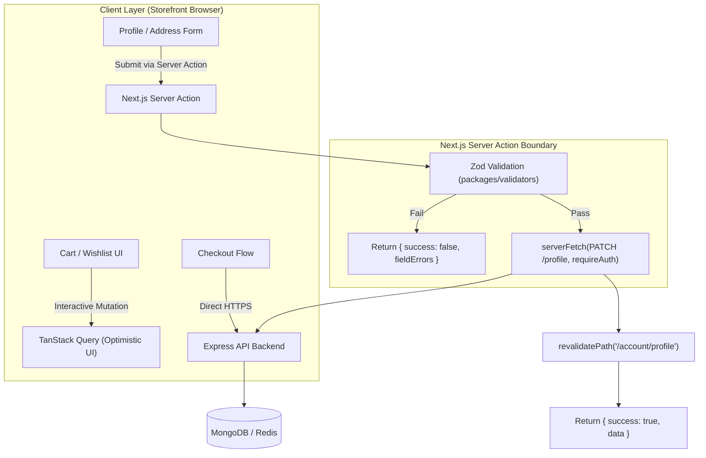

# 14 — Veyora Web Server Actions & Mutation Architecture

## Overview & Design Principles

Veyora Storefront (`@veyora/web`) adopts a hybrid mutation architecture combining **Next.js 16.4.6 Server Actions** for form-based, document-level mutations and **TanStack Query v5** for high-frequency, optimistic, and client-interactive state updates.

### Core Architecture Rules:

1. **API Authority**: The Express API backend and MongoDB remain the sole source of truth for business logic, validation, pricing calculations, inventory reservations, and payment processing.
2. **No Database Direct Access**: Server Actions never connect directly to MongoDB. All data access flows through `serverFetch` in [server-api-client.ts](file:///c:/Users/Sanjay/Desktop/veyora/apps/web/src/lib/api/server-api-client.ts).
3. **No Financial Mutations in Server Actions**: Checkout submission, Razorpay order generation, payment signature verification, and coupon redemption remain strictly executed through authoritative API endpoints.
4. **Predictable Result Contracts**: All Server Actions return a typed `ActionResult<T>` contract with explicit error codes and field-level validation errors.



---

## Mutation Inventory & Strategy Classification

| Mutation Domain   | Operation               | Implementation                                       | Rationale                                            | Revalidation Strategy                                                 |
| :---------------- | :---------------------- | :--------------------------------------------------- | :--------------------------------------------------- | :-------------------------------------------------------------------- |
| **Profile**       | Update Profile          | **Server Action** (`updateProfileAction`)            | Standard form submission, self-contained user fields | `revalidatePath("/account/profile")`                                  |
| **Address**       | Create Address          | **Server Action** (`createAddressAction`)            | Form workflow; updates saved checkout address list   | `revalidatePath("/account/addresses")`, `revalidatePath("/checkout")` |
| **Address**       | Update Address          | **Server Action** (`updateAddressAction`)            | Form edit; immediate persistence                     | `revalidatePath("/account/addresses")`                                |
| **Address**       | Delete Address          | **Server Action** (`deleteAddressAction`)            | Explicit deletion confirmation                       | `revalidatePath("/account/addresses")`                                |
| **Address**       | Set Default Address     | **Server Action** (`setDefaultAddressAction`)        | Preference update                                    | `revalidatePath("/account/addresses")`                                |
| **Notifications** | Mark as Read            | **Server Action** (`markNotificationReadAction`)     | Non-blocking user preference                         | Client optimistic update                                              |
| **Notifications** | Mark All Read           | **Server Action** (`markAllNotificationsReadAction`) | Bulk state transition                                | Client query cache invalidation                                       |
| **Cart**          | Add / Update / Remove   | **TanStack Query** (`useCart`)                       | High-frequency interaction; requires zero route-lag  | Client-side cache; uncached server                                    |
| **Wishlist**      | Toggle Wishlist         | **TanStack Query** (`useWishlist`)                   | Instant tactile UI feedback with snapshot rollback   | Client-side cache; uncached server                                    |
| **Checkout**      | Validate / Submit Order | **Express API** (`/checkout/orders`)                 | Authoritative transaction, stock verification        | Server dynamic execution                                              |
| **Payments**      | Razorpay Verification   | **Express API** (`/payments/verify`)                 | Cryptographic signature verification, ledger commit  | Background BullMQ processor                                           |

---

## Server Action Implementation Structure

Server Actions reside in `apps/web/src/actions/`:

### 1. Standard Return Contract (`ActionResult<T>`)

Defined in `@veyora/types` ([api.ts](file:///c:/Users/Sanjay/Desktop/veyora/packages/types/src/api.ts)):

```typescript
export interface ActionResult<T = unknown> {
  success: boolean;
  data?: T;
  error?: string;
  code?: string;
  fieldErrors?: Record<string, string[]>;
  timestamp?: string;
}
```

### 2. Profile Actions ([profile.actions.ts](file:///c:/Users/Sanjay/Desktop/veyora/apps/web/src/actions/profile.actions.ts))

```typescript
"use server";

import { revalidatePath } from "next/cache";
import { serverFetch, ServerApiClientError } from "@/lib/api/server-api-client";
import { updateProfileSchema, UpdateProfileInput } from "@veyora/validators";
import type { ActionResult, UserProfileDto } from "@veyora/types";

export async function updateProfileAction(
  input: UpdateProfileInput,
  auth?: { token?: string }
): Promise<ActionResult<UserProfileDto>> {
  const validationResult = updateProfileSchema.safeParse(input);
  if (!validationResult.success) {
    return {
      success: false,
      error: "Validation failed: please check your form inputs.",
      code: "VALIDATION_ERROR",
      fieldErrors: validationResult.error.flatten().fieldErrors as Record<string, string[]>,
      timestamp: new Date().toISOString(),
    };
  }

  try {
    const data = await serverFetch<UserProfileDto>("/profile", {
      method: "PATCH",
      body: validationResult.data,
      token: auth?.token,
      requireAuth: true,
    });

    revalidatePath("/account/profile");

    return {
      success: true,
      data,
      timestamp: new Date().toISOString(),
    };
  } catch (error: unknown) {
    if (error instanceof ServerApiClientError) {
      return {
        success: false,
        error: error.message,
        code: error.code,
        timestamp: new Date().toISOString(),
      };
    }
    return {
      success: false,
      error: "An unexpected error occurred while updating your profile.",
      code: "INTERNAL_ERROR",
      timestamp: new Date().toISOString(),
    };
  }
}
```

### 3. Address Actions ([address.actions.ts](file:///c:/Users/Sanjay/Desktop/veyora/apps/web/src/actions/address.actions.ts))

Provides:

- `createAddressAction(input: CreateAddressInput, auth?)`
- `updateAddressAction(addressId: string, input: UpdateAddressInput, auth?)`
- `deleteAddressAction(addressId: string, auth?)`
- `setDefaultAddressAction(addressId: string, auth?)`

All address operations revalidate `/account/addresses` and `/checkout` to ensure the delivery selector updates immediately.

### 4. Notification Actions ([notification.actions.ts](file:///c:/Users/Sanjay/Desktop/veyora/apps/web/src/actions/notification.actions.ts))

Provides:

- `markNotificationReadAction(notificationId: string, auth?)`
- `markAllNotificationsReadAction(auth?)`

---

## Authentication & Credential Lifecycle in Server Actions

1. **Cookie Forwarding**: Server Actions automatically inherit browser cookies via `cookies()` in Next.js. `serverFetch` forwards `refreshToken` and `guest_id`.
2. **Bearer Token Authentication**: The Express API enforces `requireAuth` (`Authorization: Bearer <token>`). When invoking Server Actions from client components, the caller's active in-memory token from `useAuthStore.getState().accessToken` is forwarded to authenticate the request.
3. **No Silent Credential Fallbacks**: If authentication credentials are invalid or missing, Server Actions return an explicit `{ success: false, code: "UNAUTHORIZED" }` without silently continuing or inventing alternate session bypasses.
4. **No Refresh Token Race Conditions**: Refresh token rotation remains governed by `apiClient`'s singular client-side refresh handler, preventing race conditions that occur when multiple concurrent server requests attempt token rotation simultaneously.
