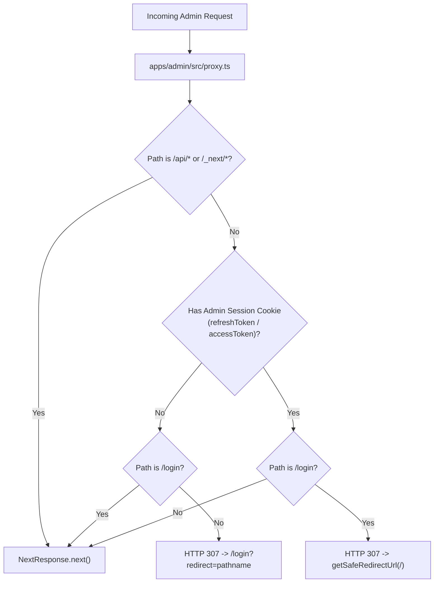

# 15 — Veyora Admin Proxy & Authentication Routing Architecture

## Overview & Administrative Routing Model

The back-office management console (`@veyora/admin`) implements the Next.js 16 **`proxy.ts` convention** ([apps/admin/src/proxy.ts](file:///c:/Users/Sanjay/Desktop/veyora/apps/admin/src/proxy.ts)) to enforce strict, zero-trust navigation control across administrative routes.

Unlike the customer storefront where public catalog browsing is permitted, the Admin application operates under a **Default-Deny Navigation Model**:

- **Every administrative page requires an active session cookie.**
- Unauthenticated requests to `/`, `/products`, `/orders`, `/inventory`, or `/customers` are immediately redirected to `/login` via HTTP 307.
- Authenticated operators accessing `/login` are bounced directly to the dashboard (`/`) or their safe return destination.

---

## Route Inventory & Behavior Matrix

| Route Pattern          | Target Surface            | Unauthenticated Operator                  | Authenticated Operator                                                                          |
| :--------------------- | :------------------------ | :---------------------------------------- | :---------------------------------------------------------------------------------------------- |
| `/login`               | Staff Authentication Form | Allowed (`200 OK`)                        | Allowed (`200 OK`) at proxy; client `AdminAuthProvider` redirects upon resolving active session |
| `/`                    | Management Dashboard      | **Redirect 307** -> `/login?redirect=%2F` | Allowed (`200 OK`)                                                                              |
| `/products/*`          | Catalog & Merchandising   | **Redirect 307** -> `/login?redirect=...` | Allowed (`200 OK`)                                                                              |
| `/categories/*`        | Departmental Taxonomies   | **Redirect 307** -> `/login?redirect=...` | Allowed (`200 OK`)                                                                              |
| `/collections/*`       | Seasonal Lookbooks        | **Redirect 307** -> `/login?redirect=...` | Allowed (`200 OK`)                                                                              |
| `/inventory/*`         | Warehouse & SKU Ledger    | **Redirect 307** -> `/login?redirect=...` | Allowed (`200 OK`)                                                                              |
| `/orders/*`            | Fulfillment & Shipments   | **Redirect 307** -> `/login?redirect=...` | Allowed (`200 OK`)                                                                              |
| `/customers/*`         | Customer Dossiers & CRM   | **Redirect 307** -> `/login?redirect=...` | Allowed (`200 OK`)                                                                              |
| `/staff/*`, `/roles/*` | Team Provisioning & RBAC  | **Redirect 307** -> `/login?redirect=...` | Allowed (`200 OK`)                                                                              |
| `/settings/*`          | Platform Configuration    | **Redirect 307** -> `/login?redirect=...` | Allowed (`200 OK`)                                                                              |

---

## Critical Architecture Rule: Proxy is NOT RBAC

In high-privilege administrative applications, conflating edge navigation routing with role-based authorization is a catastrophic architectural flaw:

1. **Routing Layer Only**: `proxy.ts` verifies only the _presence_ of session credentials to prevent unauthenticated users from seeing dashboard shells.
2. **Never Trust Unverified Claims**: Proxy never decodes JWT payloads to grant permissions or read operator roles.
3. **Authoritative RBAC in Express**: All operational authorization (`products:write`, `inventory:adjust`, `orders:cancel`, `customers:delete`) is enforced authoritatively on the Express backend via `requireRole("admin", "superadmin")` and `requirePermission(...)`.
4. **Server Component Guards**: Even if an operator bypasses Proxy, downstream Server Components in `apps/admin/src/app` query `serverAdminApi`, which transmits the operator cookie directly to Express. If the session is invalid or revoked, the backend rejects the request with HTTP 401/403.

---

## Return URL Validation & Session Restoration

When staff members click deep-links (e.g. `/orders/ord-98765` from an email or Slack alert) while logged out:

1. `proxy.ts` records the destination: `/login?redirect=%2Forders%2Ford-98765`.
2. Upon successful authentication, `getSafeRedirectUrl` validates the parameter, ensuring operators return seamlessly to their target dossier without allowing open redirect manipulation.
