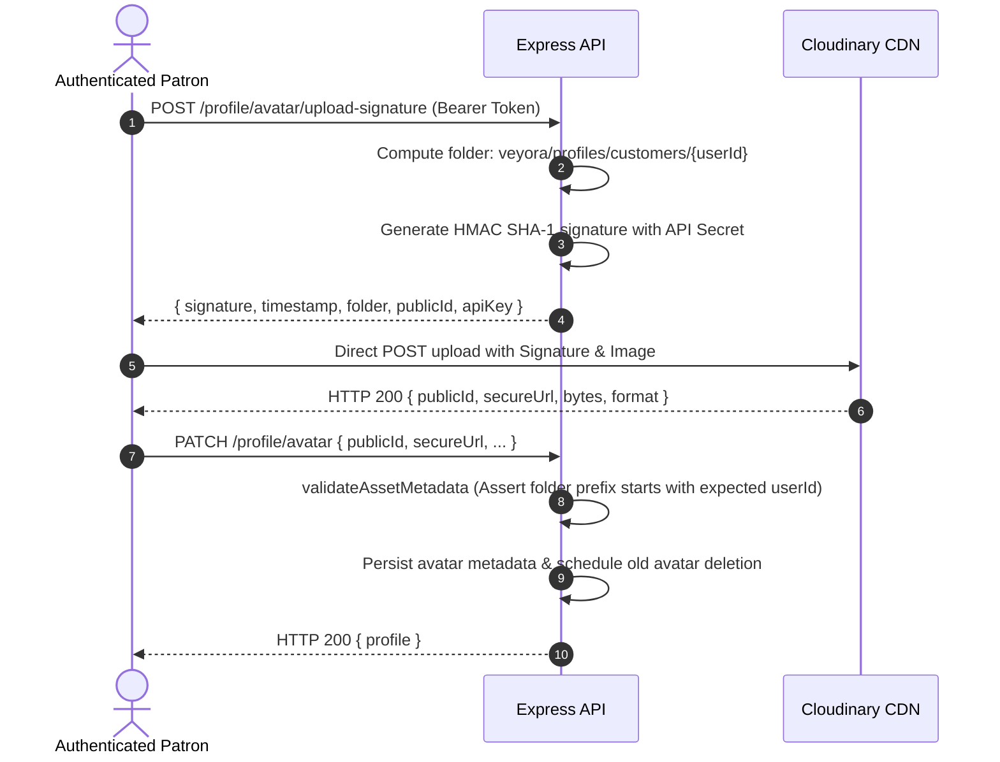

# 16 — Veyora API & Application Security Architecture

## Executive Overview & Defense-in-Depth

Veyora secures its backend and client applications against the OWASP Top 10 vulnerabilities through layered, proactive defenses spanning HTTP transport, origin verification, input boundaries, cryptographic webhook validation, and automated data redaction.

```mermaid
flowchart TD
    Client[Browser / Server Action / Webhook] --> Hdr[Helmet Security Headers]
    Hdr --> CORS[CORS Origin Validation & Credentials]
    CORS --> Limiter{Rate Limiting Tier}
    Limiter -->|Exceeded 429| BlockRate[HTTP 429 RATE_LIMIT_EXCEEDED]
    Limiter -->|Allowed| BodyGuard[Body Parser & Size Limit + rawBody Buffer]
    BodyGuard --> ZodVal{Zod Schema Validation}
    ZodVal -->|Invalid 400| BlockVal[HTTP 400 VALIDATION_ERROR]
    ZodVal -->|Valid| AuthGate[Authentication & RBAC Gate]
    AuthGate --> Controller[Controller & Domain Logic]
    Controller --> Logger[Pino Structured Logger with Automatic [REDACTED]]
    Controller --> DB[(MongoDB Sanitized Queries)]
```

---

## 1. HTTP Security Headers (Helmet)

Implemented in [apps/api/src/app.ts](file:///c:/Users/Sanjay/Desktop/veyora/apps/api/src/app.ts):

The Express application initializes `helmet()` with strict security configurations:

```typescript
app.use(
  helmet({
    contentSecurityPolicy: env.NODE_ENV === "production" ? undefined : false,
    crossOriginResourcePolicy: { policy: "cross-origin" },
  })
);
```

### Configured Protections:

- **`Strict-Transport-Security` (HSTS)**: Forces modern browsers to communicate exclusively over HTTPS, preventing SSL-stripping man-in-the-middle attacks.
- **`X-Content-Type-Options: nosniff`**: Prevents MIME-type sniffing, mitigating drive-by download attacks.
- **`X-Frame-Options: SAMEORIGIN`**: Eliminates clickjacking by preventing external origins from framing Veyora interfaces.
- **`Cross-Origin-Resource-Policy: cross-origin`**: Safely allows legitimate client apps to fetch shared static assets and API payloads while blocking unauthorized cross-origin reads.
- **`Content-Security-Policy`**: Enforced in production to restrict executable script origins and eliminate XSS attack surfaces.

---

## 2. Cross-Origin Resource Sharing (CORS)

Implemented in [apps/api/src/app.ts](file:///c:/Users/Sanjay/Desktop/veyora/apps/api/src/app.ts):

```typescript
const configuredOrigins =
  env.CORS_ORIGIN === "*" ? ["*"] : env.CORS_ORIGIN.split(",").map((o) => o.trim());

app.use(
  cors({
    origin: (origin, callback) => {
      // 1. Allow requests with no origin (e.g. mobile apps, curl, Next.js server-to-server)
      if (!origin) return callback(null, true);

      // 2. Exact allowlist matching
      if (configuredOrigins.includes("*") || configuredOrigins.includes(origin)) {
        return callback(null, true);
      }

      // 3. Development environment tunnel and loopback tolerance
      if (env.NODE_ENV !== "production") {
        const isLocalhostOrTunnel =
          /^https?:\/\/(localhost|127\.0\.0\.1)(:\d+)?$/.test(origin) ||
          origin.endsWith(".ngrok-free.dev") ||
          origin.endsWith(".ngrok.io") ||
          origin.endsWith(".ngrok-free.app");
        if (isLocalhostOrTunnel) return callback(null, true);
      }

      return callback(null, false);
    },
    credentials: true,
    methods: ["GET", "POST", "PUT", "PATCH", "DELETE", "OPTIONS"],
    exposedHeaders: ["X-Request-Id", "RateLimit-Limit", "RateLimit-Remaining", "RateLimit-Reset"],
  })
);
```

### Key Security Properties:

- **`credentials: true`**: Allows secure cookie exchange (`refreshToken`) exclusively with allowlisted storefront and administrative origins.
- **Disallowed Wildcard with Credentials**: In production, `env.CORS_ORIGIN` must specify exact origin URLs (`https://veyora.com,https://admin.veyora.com`), completely disallowing `*` with credentials.
- **Exposed Headers**: Safely exposes diagnostic request tracking (`X-Request-Id`) and standard rate-limit telemetry without exposing backend internals.

---

## 3. Multi-Tier Rate Limiting Architecture

Implemented in [apps/api/src/middleware/rate-limiter.ts](file:///c:/Users/Sanjay/Desktop/veyora/apps/api/src/middleware/rate-limiter.ts):

Veyora deploys granular rate limiters tailored to the security sensitivity of each API domain:

| Limiter Name             | Scope / Target Endpoints                | Threshold (15 min) | Attack Mitigation                                   |
| :----------------------- | :-------------------------------------- | :----------------- | :-------------------------------------------------- |
| **`apiRateLimiter`**     | Global API traffic (`/api/v1/*`)        | 300–1000 requests  | DoS / volumetric flooding                           |
| **`authRateLimiter`**    | `/auth/login`, `/auth/register`         | 10 attempts        | Credential stuffing & password brute-force          |
| **`refreshRateLimiter`** | `/auth/refresh`                         | 60 attempts        | Automated token rotation racing & family exhaustion |
| **`otpRateLimiter`**     | `/auth/otp/send`, `/auth/otp/verify`    | 5 attempts         | SMS/Email gateway toll fraud & OTP brute-force      |
| **`paymentRateLimiter`** | `/payments/initiate`, `/payments/retry` | 20 attempts        | Card testing & payment gateway abuse                |
| **`couponRateLimiter`**  | `/coupons/validate`                     | 15 attempts        | Voucher code dictionary enumeration                 |

All rate limiters emit RFC-compliant headers (`RateLimit-Limit`, `RateLimit-Remaining`, `RateLimit-Reset`) and return structured error codes (e.g. `AUTH_RATE_LIMIT_EXCEEDED`).

---

## 4. Request Body Parsers & Payload Boundary Controls

Implemented in [apps/api/src/app.ts](file:///c:/Users/Sanjay/Desktop/veyora/apps/api/src/app.ts):

### 1. Payload Size Constraints

```typescript
app.use(express.json({ limit: env.BODY_LIMIT }));
app.use(express.urlencoded({ extended: true, limit: env.BODY_LIMIT }));
```

- Rejects oversized payloads before JSON parsing completes, mitigating memory exhaustion and parser CPU starvation attacks.

### 2. Raw Body Buffer Preservation for Cryptographic Verification

```typescript
express.json({
  limit: env.BODY_LIMIT,
  verify: (req: express.Request & { rawBody?: string }, _res, buf) => {
    req.rawBody = buf.toString("utf8");
  },
});
```

- Captures the exact incoming byte stream into `req.rawBody` prior to JSON object deserialization. This guarantees that cryptographic signature verification (e.g. Razorpay HMAC SHA-256) operates on identical characters without whitespace reformatting discrepancies.

---

## 5. Input Validation & NoSQL Injection Prevention

### 1. Shared Zod Validation Pipeline

Implemented in [apps/api/src/middleware/validate-request.ts](file:///c:/Users/Sanjay/Desktop/veyora/apps/api/src/middleware/validate-request.ts):

- Every mutating request is validated against strict Zod schemas from `@veyora/validators`.
- Rejects unexpected extra fields and enforces data types, string lengths, regex patterns, and numeric ranges.

### 2. NoSQL Query Injection Defense

- **Mongoose Schema Typing**: Mongoose models strictly cast incoming arguments according to defined schema types (e.g. `String`, `ObjectId`, `Number`). Injected MongoDB operator objects (`{ "$gt": "" }`) are automatically rejected or converted to string literals rather than executed as query selectors.
- **ObjectId Casting**: All route parameters (`:id`) are explicitly checked with `mongoose.Types.ObjectId.isValid(id)` before reaching queries, throwing `BadRequestError("Invalid ID format")` on malformed inputs.
- **Regex Escaping**: User-provided search strings in queries (e.g. catalog searches or customer lookups) are sanitized through explicit escaping or bounded string queries before constructing regex patterns.

---

## 6. Cloudinary Signed Uploads & Storage Scoping

Implemented in [apps/api/src/infrastructure/cloudinary/cloudinary.service.ts](file:///c:/Users/Sanjay/Desktop/veyora/apps/api/src/infrastructure/cloudinary/cloudinary.service.ts):

Veyora utilizes a direct-to-CDN architecture that completely bypasses Node.js server memory while enforcing cryptographic tenant isolation:



### Boundary Guarantees:

- **Folder Scoping**: Upload signatures explicitly bind uploads to `veyora/profiles/customers/${userId}/...`. Cloudinary rejects uploads targeted at unauthorized directory trees.
- **Asset Metadata Validation**: `validateAssetMetadata` asserts:
  1. `publicId` starts strictly with `${CLOUDINARY_UPLOAD_FOLDER}/profiles/${roleFolder}/${userId}/`.
  2. `secureUrl` originates from legitimate HTTPS Cloudinary CDN (`https://res.cloudinary.com/`).
  3. Image format and file size adhere to allowlists (`jpg`, `png`, `webp`, max 5MB).
- **Previous Asset Purging**: Replaced avatars trigger asynchronous deletion (`cloudinaryService.deleteAsset`), preventing orphaned storage accumulation.

---

## 7. Webhook Signature Verification & Idempotency

Implemented in [apps/api/src/modules/payment/services/payment.service.ts](file:///c:/Users/Sanjay/Desktop/veyora/apps/api/src/modules/payment/services/payment.service.ts):

### 1. Cryptographic HMAC SHA-256 Signature Verification

```typescript
const isValidSignature = providerInstance.verifyWebhookSignature(rawBody, signature);
if (!isValidSignature) {
  logger.warn("WEBHOOK_SECURITY", "Received webhook with invalid signature.", { provider });
  throw new UnauthorizedError("Invalid webhook signature.");
}
```

Verifies that the `x-razorpay-signature` matches `crypto.createHmac("sha256", webhookSecret).update(rawBody).digest("hex")`.

### 2. Distributed Idempotent Execution Lock

```typescript
const eventId = eventPayload.id || `evt_${sha256(rawBody)}`;
const existingEvent = await WebhookEvent.findOne({ eventId });
if (existingEvent) {
  return { success: true, message: "Webhook already processed.", duplicate: true };
}

const webhookDoc = new WebhookEvent({
  eventId,
  provider,
  eventType,
  payload: eventPayload,
  status: "processed",
  processedAt: new Date(),
});
await webhookDoc.save();
```

Ensures that network retries or duplicate webhook dispatches never double-credit customer payments or execute redundant status transitions.

---

## 8. Structured Logging & Sensitive Data Redaction

Implemented in [apps/api/src/config/logger.ts](file:///c:/Users/Sanjay/Desktop/veyora/apps/api/src/config/logger.ts):

Veyora uses Pino with automated deep redaction for all sensitive fields:

```typescript
export const logger = pino({
  level: env.LOG_LEVEL,
  redact: {
    paths: [
      "req.headers.authorization",
      "req.headers.cookie",
      "req.headers['x-api-key']",
      "req.headers['x-internal-cache-secret']",
      "req.headers['x-razorpay-signature']",
      "password",
      "currentPassword",
      "newPassword",
      "confirmPassword",
      "token",
      "secret",
      "refreshToken",
      "accessToken",
      "otp",
      "signature",
      "razorpay_signature",
      "creditCard",
      "cvv",
    ],
    censor: "[REDACTED]",
  },
  timestamp: pino.stdTimeFunctions.isoTime,
});
```

### Security Benefits:

- Eliminates credential leakage into stdout, container logging drivers, Datadog/CloudWatch streams, or disk logs.
- Guarantees compliance with PCI-DSS and privacy regulations by censoring payment card fields and patron authentication secrets.
