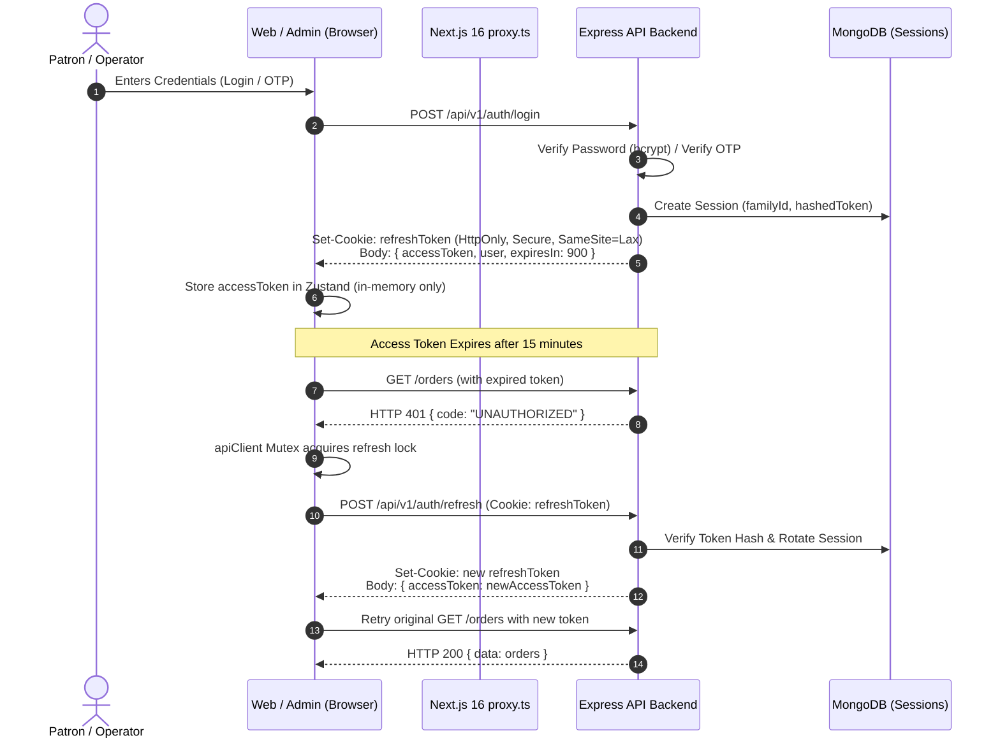

# 16 — Veyora Authentication & Session Security Architecture

## Executive Overview & Token Strategy

The Veyora platform implements a stateless, dual-token authentication model paired with server-side session tracking in MongoDB.

### Security Tenets:

1. **Short-Lived Access Tokens**: Signed using `HS256` with strict algorithm verification. Default TTL is 15 minutes (900 seconds). Carried via `Authorization: Bearer <token>` in API requests.
2. **Hashed, Rotated Refresh Tokens**: Delivered strictly via `HttpOnly` cookies. Never exposed to browser JavaScript or localStorage. Re-issued on every refresh cycle.
3. **Session Family Tracking & Reuse Detection**: Refresh tokens belong to cryptographic token families (`familyId`). If an already-consumed refresh token is replayed (indicating theft), the entire session family is automatically revoked immediately.
4. **Race-Condition Grace Window**: A 15-second grace window handles benign concurrent tab refreshes without false-positive session lockouts.



---

## Access Token Security Specifications

Implemented in [TokenService](file:///c:/Users/Sanjay/Desktop/veyora/apps/api/src/modules/auth/services/token.service.ts):

| Parameter             | Configuration                                      | Security Purpose                                                                                                                     |
| :-------------------- | :------------------------------------------------- | :----------------------------------------------------------------------------------------------------------------------------------- |
| **Algorithm**         | `HS256` (HMAC SHA-256)                             | Fixed algorithm enforcement in `jwt.verify({ algorithms: ["HS256"] })`. Rejects algorithm negotiation and unsigned (`none`) attacks. |
| **Secret Management** | `env.JWT_ACCESS_SECRET`                            | Kept strictly on the backend. Minimum 32-character high-entropy secret.                                                              |
| **Expiration**        | 15 minutes (`env.JWT_ACCESS_EXPIRES_IN`)           | Limits exposure window if an access token is intercepted in memory.                                                                  |
| **Payload Claims**    | `sub`, `email`, `role`, `permissions`, `sessionId` | Provides fast, stateless RBAC verification in middleware without DB lookup per request.                                              |
| **Revocation Check**  | Session ID lookup                                  | `requireAuth` verifies that `sessionId` exists and `isRevoked: false` in MongoDB, enabling immediate mid-session revocation.         |

---

## Refresh Token Rotation & Reuse Detection

Implemented in [AuthService.refreshTokens](file:///c:/Users/Sanjay/Desktop/veyora/apps/api/src/modules/auth/services/auth.service.ts):

### 1. Cryptographic Hash Storage

The database never stores plaintext refresh tokens. Refresh tokens are hashed via SHA-256 before persistence in `Session.refreshTokenHash`:

```typescript
newSession.refreshTokenHash = tokenService.hashToken(tokens.refreshToken);
```

### 2. Token Family Reuse Detection

Every session tree is tagged with an immutable `familyId`. When a refresh request arrives:

- **Known Valid Hash**: The old session is marked `isRevoked = true`, and a child session with a new token is created in the same family.
- **Unknown Hash with Valid Signature**: Indicates an attacker is attempting to reuse an already rotated token. The server immediately revokes all sessions sharing that `familyId`:
  ```typescript
  logger.warn(
    { familyId: payload.familyId, sub: payload.sub },
    "Security Alert: Refresh token reuse detected. Revoking entire token family."
  );
  await Session.updateMany({ familyId: payload.familyId }, { isRevoked: true });
  ```

### 3. Concurrent Refresh Race Mitigation (15s Grace Window)

When multiple browser tabs trigger `/auth/refresh` simultaneously, a network delay could cause Tab B to send the previous token just after Tab A rotated it.
To prevent sudden session crashes:

```typescript
const gracePeriodMs = 15000;
const isWithinGrace = session.updatedAt && Date.now() - session.updatedAt.getTime() < gracePeriodMs;
if (isWithinGrace) {
  // Re-issue active token without family invalidation
}
```

---

## Cookie Security Configuration

Defined in [auth-cookie.config.ts](file:///c:/Users/Sanjay/Desktop/veyora/apps/api/src/modules/auth/config/auth-cookie.config.ts):

```typescript
export function getRefreshTokenCookieOptions(): CookieOptions {
  const isProduction = env.NODE_ENV === "production";

  return {
    httpOnly: true,
    secure: isProduction,
    sameSite: "lax",
    path: "/",
    maxAge: env.JWT_REFRESH_EXPIRES_IN_DAYS * 24 * 60 * 60 * 1000,
  };
}
```

### Rules & Justification:

- **`httpOnly: true`**: Inaccessible to `document.cookie` or client JavaScript. XSS vulnerabilities cannot harvest refresh tokens.
- **`secure: isProduction`**: Enforces transmission strictly over HTTPS in production.
- **`sameSite: "lax"`**: Mitigates Cross-Site Request Forgery (CSRF) by withholding cookies on cross-origin POST/mutation requests while allowing top-level navigation.
- **`path: "/"`**: Ensures cookie clearing options on `/auth/logout` exactly match the setting scope:
  ```typescript
  export function clearRefreshTokenCookie(res: Response): void {
    res.clearCookie(AUTH_COOKIE_NAME, getClearRefreshTokenCookieOptions());
  }
  ```

---

## Client Session Lifecycle & Race-Condition Hardening

### 1. Single-Flight Deduplication Mutex

In [apps/web/src/lib/api/api-client.ts](file:///c:/Users/Sanjay/Desktop/veyora/apps/web/src/lib/api/api-client.ts) and [apps/admin/src/lib/api/api-client.ts](file:///c:/Users/Sanjay/Desktop/veyora/apps/admin/src/lib/api/api-client.ts):

```typescript
if (!this.refreshPromise) {
  this.refreshPromise = this.executeTokenRefresh().finally(() => {
    this.refreshPromise = null;
  });
}
const newToken = await this.refreshPromise;
```

If 10 concurrent queries encounter token expiration, exactly **one** `/auth/refresh` HTTP call is made. All 10 requests wait on the single promise and replay seamlessly with `_retry: true`.

### 2. Comprehensive Logout Cleanup

When logging out or encountering session expiration (`onSessionExpired`):

1. **Zustand Store Reset**: `status: "unauthenticated"`, `user: null`, `accessToken: null`.
2. **TanStack Query Eviction**: Calls `clearQueryClient()`, purging all cached orders, patron PII, and customer dossiers from memory.
3. **Socket.IO Disconnection**: `SocketProvider` detects `!isAuthenticated`, immediately calls `socket.disconnect()`, and removes all event listeners.
4. **Backend Revocation**: Calls `POST /auth/logout`, setting `Session.isRevoked = true` in MongoDB and clearing the HTTP cookie.
