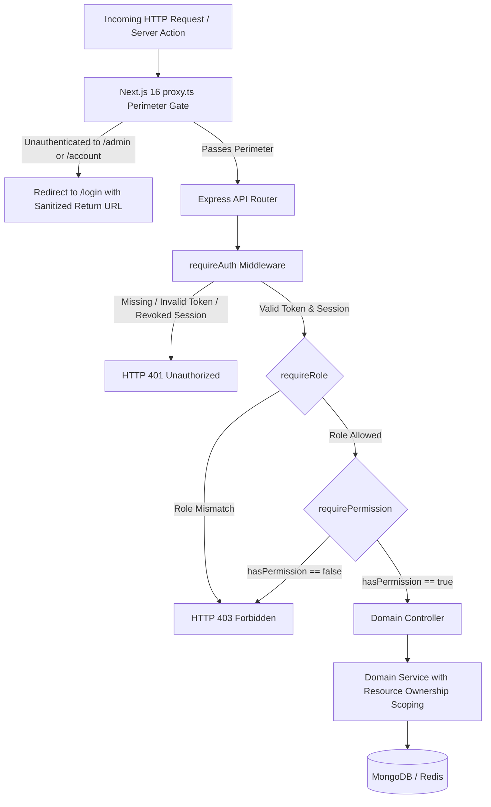
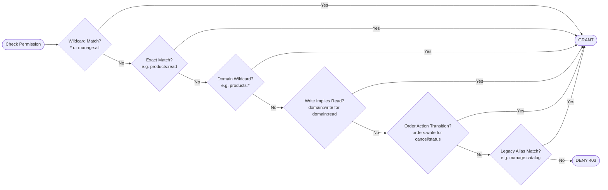

# 16 — Veyora Authorization & Role-Based Access Control (RBAC) Architecture

## Executive Overview & Authorization Principles

Veyora enforces a strict, defense-in-depth **deny-by-default** authorization model across all services. No route, Server Action, or API mutation executes without explicit authentication verification and permission clearance.

### Security Tenets:

1. **Deny-by-Default Execution**: Every protected route, controller, and Server Action rejects unauthenticated access unless explicitly marked public or wrapped in `optionalAuth`.
2. **Three-Tier Boundary Defense**:
   - **Layer 1: Edge / Request Routing (`proxy.ts`)**: Fast perimeter gate validating presence of session indicators and bouncing unauthenticated requests away from protected paths.
   - **Layer 2: API Middleware (`requireAuth`, `requireRole`, `requirePermission`)**: Cryptographic token signature verification, live session validation in MongoDB, and claim-based permission evaluation.
   - **Layer 3: Domain Service Scoping & IDOR Prevention**: Hard resource ownership filtering (`req.user.id`), preventing horizontal and vertical privilege escalation.
3. **Principle of Least Privilege**: Staff administrators can only execute operations explicitly granted through their assigned roles or direct custom permissions.
4. **Non-Escalation Guarantee**: Administrators cannot create or assign roles containing permissions they do not personally hold, and cannot delete or deactivate their own administrative accounts.



---

## Authorization Middleware Architecture

Implemented in [apps/api/src/middleware/auth.ts](file:///c:/Users/Sanjay/Desktop/veyora/apps/api/src/middleware/auth.ts):

### 1. `requireAuth`

- Extracts and strips `Bearer ` access token from `Authorization` header.
- Verifies `HS256` HMAC signature using backend-only `env.JWT_ACCESS_SECRET`.
- Validates that `sessionId` exists, `isRevoked: false`, and `expiresAt >= now` in MongoDB.
- Reconstructs `req.user` payload (`id`, `email`, `role`, `permissions`) and sets `req.sessionId`.

### 2. `optionalAuth`

- Used for storefront workflows accessible to both guests and registered patrons (catalog browsing, cart modifications, checkout initiation).
- If a valid Bearer token and active session exist, populates `req.user`.
- If unauthenticated or token is expired, resolves guest identity via `x-guest-id` header, falls back to `guest_id` cookie, or generates a cryptographically random UUID (`req.guestId`), returning `x-guest-id` header in response.

### 3. `requireRole(...allowedRoles: UserRole[])`

- Asserts `req.user` is present.
- Verifies that `req.user.role` matches at least one of the specified roles (e.g. `["admin", "superadmin"]`).
- Rejects unauthorized roles with HTTP 403 `ForbiddenError`.

### 4. `requirePermission(...requiredPermissions: UserPermission[])`

- Checks whether the authenticated user possesses **ALL** required permissions.
- **Superadmin Bypass**: Users with `role: "superadmin"` immediately bypass specific permission requirements.
- Evaluates permissions via the `hasPermission` engine.

### 5. `requireAnyPermission(...permissions: UserPermission[])`

- Checks whether the authenticated user possesses **AT LEAST ONE** of the required permissions.
- Useful for broad composite panels (e.g., viewing permission registries requires either `roles:read` or `staff:read`).

---

## Permission Evaluation Engine (`hasPermission`)

Implemented in [apps/api/src/modules/rbac/permission-registry.ts](file:///c:/Users/Sanjay/Desktop/veyora/apps/api/src/modules/rbac/permission-registry.ts):

The engine evaluates user-granted permissions against target requirements using a strict 6-stage precedence hierarchy:



### Hierarchy Specifications:

1. **Superadmin Wildcard**: `*` or `manage:all` satisfies any permission check.
2. **Exact String Match**: `products:read` satisfies `products:read`.
3. **Domain Wildcard**: `products:*` satisfies any action in the products domain (`products:read`, `products:write`, `products:delete`).
4. **Write-Implies-Read Semantics**: Having `products:write` inherently grants `products:read` without requiring explicit redundant assignment.
5. **Domain Action Specialization**: In the order fulfillment domain, possessing `orders:write` satisfies both `orders:update_status` and `orders:cancel`.
6. **Backward-Compatible Legacy Aliases**: Translates legacy umbrella privileges (`manage:catalog`, `manage:orders`, `manage:system`) to discrete granular permissions.

---

## Customer Resource Ownership & IDOR Defense

Insecure Direct Object Reference (IDOR) attacks are comprehensively prevented through domain-level resource scoping:

| Endpoint Domain                                  | Parameter Source       | Ownership Enforcement Mechanism                                                                     |
| :----------------------------------------------- | :--------------------- | :-------------------------------------------------------------------------------------------------- |
| **Profile Management** (`/profile`)              | None (no `:id` in URL) | Scoped strictly to `req.user.id`. Client cannot specify arbitrary target ID.                        |
| **Customer Orders** (`/orders`, `/orders/:id`)   | `:id` verified in DB   | Service asserts `order.userId.toString() === req.user.id` (or matches active `guestId`).            |
| **Customer Addresses** (`/addresses`)            | DB Query Filter        | Always filtered by `{ userId: req.user.id }`.                                                       |
| **Shopping Cart** (`/cart`)                      | In-memory session      | Bound strictly to `req.user.id` (registered) or `req.guestId` (guest).                              |
| **Admin Customer View** (`/admin/customers/:id`) | Param `:id`            | Strictly guarded by `requireRole("admin", "superadmin")` and `requirePermission("customers:read")`. |

---

## Administrative Governance & Privilege Escalation Defenses

Implemented in [apps/api/src/modules/rbac/services/staff.service.ts](file:///c:/Users/Sanjay/Desktop/veyora/apps/api/src/modules/rbac/services/staff.service.ts):

### 1. Privilege Escalation Prevention

A staff administrator with restricted permissions cannot elevate themselves or peer staff:

- When assigning roles to a user:
  ```typescript
  if (actor.role !== "superadmin") {
    const actorUser = await User.findById(actor.id).populate("assignedRoles");
    const actorPerms = actorUser?.permissions || [];
    for (const role of populatedRoles) {
      for (const perm of role.permissions || []) {
        if (!hasPermission(actorPerms, perm)) {
          throw new ForbiddenError(
            `Privilege escalation prevented. Role '${role.displayName}' contains permission '${perm}' which you do not possess.`
          );
        }
      }
    }
  }
  ```
- When assigning custom permissions:
  The actor cannot grant any permission string that they do not personally hold.

### 2. Superadmin Account Protection & Self-Demotion Prevention

- Only users with `role: "superadmin"` can alter administrative tiers (`input.role`).
- If a superadmin attempts to demote their own account to `admin`, the service checks total active superadmins:
  ```typescript
  const superadminCount = await User.countDocuments({ role: "superadmin", isActive: true });
  if (superadminCount <= 1) {
    throw new ForbiddenError("Cannot demote the only remaining active Superadmin account");
  }
  ```

### 3. Self-Deactivation & Self-Deletion Prevention

- **Self-Deactivation**: A staff member or administrator cannot set their own status to inactive (`isActive: false`):
  ```typescript
  if (!input.isActive && user._id.toString() === actor.id) {
    throw new ForbiddenError("Cannot deactivate your own staff account");
  }
  ```
- **Self-Deletion**: A staff member cannot delete their own administrative account (`DELETE /admin/staff/:id`):
  ```typescript
  if (id === actor.id) {
    throw new ForbiddenError("Cannot delete your own administrative account");
  }
  ```
- **Last Superadmin Deletion**: Cannot delete the final active superadmin in the system.

### 4. Security Audit Logging

Every mutation across roles and staff accounts triggers an asynchronous, immutable audit entry in the `AuditLog` collection via [AuditLogService](file:///c:/Users/Sanjay/Desktop/veyora/apps/api/src/modules/rbac/services/audit-log.service.ts):

- Events logged: `STAFF_CREATED`, `STAFF_UPDATED`, `STAFF_STATUS_UPDATED`, `STAFF_DELETED`, `ROLE_CREATED`, `ROLE_UPDATED`, `ROLE_DELETED`.
- Log records capture: `actorId`, `actorEmail`, `actorRole`, `targetResource`, `targetId`, `timestamp`, and detailed field diffs.
