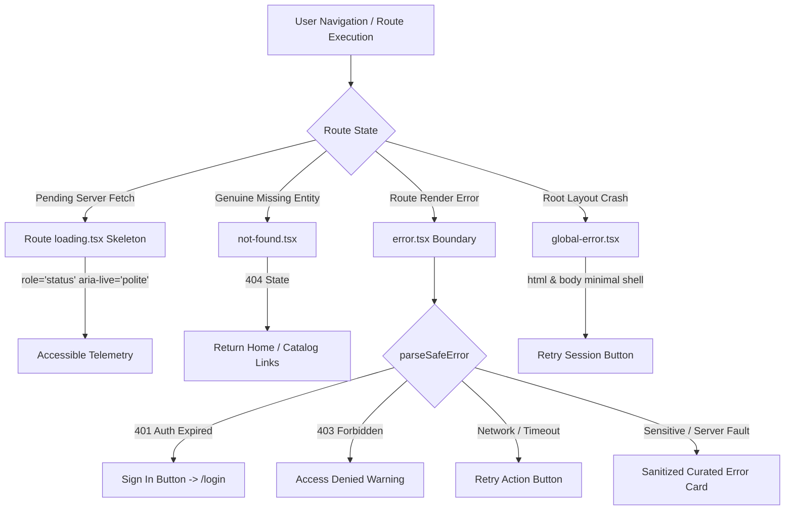

# 17 — Veyora Loading, Error & Not-Found Boundary Hardening Architecture

## 1. Executive Summary & Boundary Philosophy

Next.js App Router boundary components (`loading.tsx`, `error.tsx`, `global-error.tsx`, and `not-found.tsx`) establish the resilient foundation of user experience across `@veyora/web` and `@veyora/admin`.

This architecture hardening establishes:

1. **Predictable Failure Containment**: Errors occurring within specific route subtrees are trapped by route-level error boundaries, preventing entire application crashes while offering dedicated, accessible recovery actions (`reset()`, `Sign In`, or `Return Home`).
2. **Production-Grade Error Sanitization**: Error boundaries never display raw exception text, stack traces, database connection URIs, SQL/Mongo dialect snippets, authentication tokens, or internal endpoints. Production environments and sensitive strings are automatically converted into safe, curated messaging.
3. **Distinction Between Missing Resources and System Faults**: API failures (500), network drops, and timeouts are strictly prevented from masquerading as 404 Not Found errors. Genuine 404 states occur only when resources are verifiably absent.
4. **Layout-Shift Free Loading States**: Tailored skeleton structures closely match final page dimensions (breadcrumbs, headers, grids, and detail cards), decorated with WCAG-compliant screen reader attributes (`role="status"`, `aria-live="polite"`).
5. **Session-Aware Error Actions**: 401 Unauthorized exceptions present immediate authentication pathways (`Sign In to Atelier` / `Sign In to Console`), while 403 Forbidden states communicate permission boundaries without invalidating the user's active session.



---

## 2. Boundary Inventory & Route Audit

An exhaustive audit of existing App Router boundaries in `apps/web` and `apps/admin` was conducted:

| App       | Route / Scope         | Boundary File                        | Type   | Implementation Status & Hardening                                              |
| :-------- | :-------------------- | :----------------------------------- | :----- | :----------------------------------------------------------------------------- |
| **Web**   | `/` (Root Layout)     | `app/loading.tsx`                    | Server | Hardened with `role="status"`, `aria-live="polite"`, sr-only text.             |
| **Web**   | `/` (Root Layout)     | `app/error.tsx`                      | Client | Hardened with `parseSafeError`, `role="alert"`, 401 login remediation.         |
| **Web**   | `/` (Root Layout)     | `app/global-error.tsx`               | Client | Self-contained `<html>` / `<body>`, safe message redaction, `role="alert"`.    |
| **Web**   | `/` (Root Layout)     | `app/not-found.tsx`                  | Server | Hardened with `role="region"`, accessible landmarks, catalog return links.     |
| **Web**   | `/shop`               | `app/shop/loading.tsx`               | Server | Sized skeleton matching filter bar and 4-column product card grid.             |
| **Web**   | `/collections`        | `app/collections/loading.tsx`        | Server | **Created**: Curated lookbook hero header and 3-column card grid skeleton.     |
| **Web**   | `/collections/[slug]` | `app/collections/[slug]/loading.tsx` | Server | Curated editorial collection header and garment grid skeleton.                 |
| **Web**   | `/category/[slug]`    | `app/category/[slug]/loading.tsx`    | Server | Department category header and product grid skeleton.                          |
| **Web**   | `/products/[slug]`    | `app/products/[slug]/loading.tsx`    | Server | 2-column detail skeleton (media gallery left, purchasing dossier right).       |
| **Web**   | `/orders`             | `app/orders/loading.tsx`             | Server | Multi-card order history summary skeleton.                                     |
| **Web**   | `/orders/[id]`        | `app/orders/[id]/loading.tsx`        | Server | **Created**: Single order detail skeleton (status tracker, garments, address). |
| **Web**   | `/account`            | `app/account/loading.tsx`            | Server | Account tab navigation, avatar header, and profile form skeleton.              |
| **Admin** | `/` (Root Layout)     | `app/loading.tsx`                    | Server | Hardened with `role="status"`, `aria-live="polite"`, KPI grid placeholder.     |
| **Admin** | `/` (Root Layout)     | `app/error.tsx`                      | Client | Hardened with `parseSafeAdminError`, `role="alert"`, console login route.      |
| **Admin** | `/` (Root Layout)     | `app/global-error.tsx`               | Client | Dark console shell, sanitized messages, zero provider dependency.              |
| **Admin** | `/` (Root Layout)     | `app/not-found.tsx`                  | Server | Hardened with `role="region"`, executive dashboard escape route.               |
| **Admin** | `/products`           | `app/products/loading.tsx`           | Server | Catalog matrix, stats row, and table rows skeleton.                            |
| **Admin** | `/products/[id]`      | `app/products/[id]/loading.tsx`      | Server | **Created**: Product form skeleton (pricing, variants, media gallery).         |
| **Admin** | `/customers`          | `app/customers/loading.tsx`          | Server | Patron directory table and search bar skeleton.                                |
| **Admin** | `/customers/[id]`     | `app/customers/[id]/loading.tsx`     | Server | **Created**: Patron dossier skeleton (header, KPI bar, addresses, timeline).   |
| **Admin** | `/inventory`          | `app/inventory/loading.tsx`          | Server | Inventory stock balance table and status pills skeleton.                       |
| **Admin** | `/inventory/[id]`     | `app/inventory/[id]/loading.tsx`     | Server | **Created**: Stock ledger detail and movement audit table skeleton.            |
| **Admin** | `/orders`             | `app/orders/loading.tsx`             | Server | Order governance table and status pills skeleton.                              |

---

## 3. Loading State Architecture & Layout Shift Mitigation

### Core Improvements:

1. **Route-Specific Detail Skeletons**:
   - Previously, detail routes (`/orders/[id]`, `/customers/[id]`, `/products/[id]`, `/inventory/[id]`) inherited their parent list skeletons (tables or multiple cards). When data resolved, the entire layout shifted dramatically into detail views.
   - Dedicated detail `loading.tsx` skeletons were introduced for `/orders/[id]`, `/customers/[id]`, `/products/[id]`, and `/inventory/[id]`, ensuring the loading skeleton geometry precisely mirrors the resolved DOM layout.
2. **Curated Lookbook Skeleton (`/collections`)**:
   - Introduced `apps/web/src/app/collections/loading.tsx` matching the seasonal lookbook header, breadcrumbs, and 3-column collection card grid.
3. **WCAG Accessibility**:
   - All root and route-level loading skeletons now include `role="status"`, `aria-live="polite"`, and screen-reader only announcement spans (`<span className="sr-only">Loading...</span>`).

---

## 4. Error Boundary Hardening (`error.tsx` & `global-error.tsx`)

### 1. Safe Error Parsing Engine

Implemented in [apps/web/src/lib/error-utils.ts](file:///c:/Users/Sanjay/Desktop/veyora/apps/web/src/lib/error-utils.ts) and [apps/admin/src/lib/error-utils.ts](file:///c:/Users/Sanjay/Desktop/veyora/apps/admin/src/lib/error-utils.ts):

The parser evaluates incoming errors using regular expressions targeting known security risks:

```typescript
const SENSITIVE_PATTERNS = [
  /mongodb(\+srv)?:\/\/[^\s]+/i,
  /postgres(ql)?:\/\/[^\s]+/i,
  /mysql:\/\/[^\s]+/i,
  /redis:\/\/[^\s]+/i,
  /bearer\s+[a-z0-9._~+/-]+=*/i,
  /jwt\s+[a-z0-9._~+/-]+=*/i,
  /password\s*[:=]\s*[^\s]+/i,
  /secret\s*[:=]\s*[^\s]+/i,
  /api[_-]?key\s*[:=]\s*[^\s]+/i,
  /at\s+[a-z0-9_./\\-]+\.(js|ts|tsx):\d+:\d+/i,
  /select\s+.+\s+from\s+/i,
  /insert\s+into\s+/i,
  /mongo(error|servererror)/i,
  /econnrefused/i,
  /etimedout/i,
];
```

### 2. Error Categorization & Actions:

- **Authentication Failure (401 / Session Expired)**:
  - Title: `"Session Expired"` (Web) / `"Administrative Session Expired"` (Admin).
  - Remediation: Renders an immediate, primary `"Sign In to Atelier"` or `"Sign In to Console"` button pointing to `/login`.
- **Authorization Failure (403 / Forbidden)**:
  - Title: `"Access Restricted"` (Web) / `"Insufficient Administrative Privileges"` (Admin).
  - Remediation: Clearly communicates permission constraints without logging out or invalidating the valid session.
- **Network / Timeout (ECONNREFUSED / Timeout)**:
  - Title: `"Connection Interrupted"` (Web) / `"Backend API Connection Interrupted"` (Admin).
  - Remediation: Renders `"Try Again"` / `"Retry Action"` triggering `reset()`.
- **Production Sanitization**:
  - In production (`process.env.NODE_ENV === "production"`) or whenever `containsSensitiveData(message)` evaluates to true, the raw message is discarded and replaced with a clean, branded recovery prompt.
  - The App Router `digest` hash is displayed safely as `Diagnostic Digest: {error.digest}` without exposing internal server stack details.

### 3. Global Error Handling (`global-error.tsx`)

- When a failure occurs during root layout initialization (`src/app/layout.tsx`), Next.js invokes `global-error.tsx`, completely replacing the root HTML document.
- Both Web and Admin `global-error.tsx` files:
  1. Render complete `<html>` and `<body>` tags.
  2. Maintain zero external state or provider dependencies (no `ThemeProvider`, `QueryClientProvider`, or `AuthProvider`).
  3. Include `role="alert"` and `aria-live="assertive"` on the container.
  4. Redact database, auth, and credential patterns before rendering fallback messages.

---

## 5. Not-Found Behavior & Distinction from System Faults

### 1. Eliminating 500-to-404 Masking

In client-side data fetching components, a frequent anti-pattern is checking `if (isError || !data)` and displaying `"Resource Not Found"`.
This was audited and hardened across:

- **`CustomerOrderDetailClient`** ([apps/web/src/app/orders/[id]/order-detail-client.tsx](file:///c:/Users/Sanjay/Desktop/veyora/apps/web/src/app/orders/[id]/order-detail-client.tsx)):
  - Previously showed `"Order Not Found"` whenever `isError` was true.
  - Hardened to distinguish:
    - 404 Not Found: Shows `"Order Not Located"`.
    - 403 Forbidden: Shows `"Order Access Restricted"`.
    - Transient server or network error: Shows `"Order Telemetry Interrupted"` with an active `"Retry Sync"` button calling TanStack Query's `refetch()`.
- **`EditProductClient`** ([apps/admin/src/app/products/[id]/edit-product-client.tsx](file:///c:/Users/Sanjay/Desktop/veyora/apps/admin/src/app/products/[id]/edit-product-client.tsx)):
  - Hardened with a distinct `fetchError` state. Network/500 failures render `"Garment Retrieval Fault"` with a `"Retry Loading"` button, preventing false claims that the product does not exist.
- **`CustomerDetailClient`** ([apps/admin/src/app/customers/[id]/customer-detail-client.tsx](file:///c:/Users/Sanjay/Desktop/veyora/apps/admin/src/app/customers/[id]/customer-detail-client.tsx)):
  - Hardened with distinct `fetchError` handling and retry action.
- **`InventoryDetailClient`** ([apps/admin/src/app/inventory/[id]/inventory-detail-client.tsx](file:///c:/Users/Sanjay/Desktop/veyora/apps/admin/src/app/inventory/[id]/inventory-detail-client.tsx)):
  - Hardened with distinct `fetchError` handling and retry action.

### 2. Server Component `notFound()` Handling

- In Server Components (`/products/[slug]`, `/collections/[slug]`, `/category/[slug]`), `notFound()` is invoked exclusively when the query genuinely resolves to `null` or when the API client throws a verified `404 NOT_FOUND` error.
- All non-404 exceptions (500, network drops) are rethrown to be captured by `error.tsx`.

---

## 6. Authentication & Authorization Integration

- **No Infinite Refresh Loops**: When `error.tsx` intercepts a 401 Unauthorized, it does not re-invoke `apiClient.refreshTokens()`. Instead, it directs the user cleanly to `/login`.
- **Session Preservation on 403**: Forbidden responses do not reset the user's Zustand auth store or trigger logout. The user remains signed in with their current identity.
- **Guest Access Preservation**: Public routes (`/`, `/shop`, `/collections`, `/products/[slug]`, `/cart`, `/checkout`) continue operating seamlessly for unauthenticated guests.
- **No Premature Content Exposure**: Protected routes wrapped with `ProtectedRoute` or guarded by `proxy.ts` render only loading skeletons or redirect before any client DOM renders.

---

## 7. Verification Results & Test Telemetry

Targeted unit test suites and TypeScript verifications were executed:

### Test Suites:

1. `apps/web/src/test/web-layout-special-files.test.tsx` (8 tests passed)
2. `apps/web/src/test/error-boundary-hardening.test.tsx` (9 tests passed)
3. `apps/admin/src/test/admin-layout-special-files.test.tsx` (7 tests passed)
4. `apps/admin/src/test/error-boundary-hardening.test.tsx` (8 tests passed)

**Total Tests**: 32 passed (100% pass rate).

### TypeScript Verification:

- `npm run typecheck --workspace=@veyora/web`: 0 errors.
- `npm run typecheck --workspace=@veyora/admin`: 0 errors.

---

## 8. Known Limitations & Deferred Scope

- Full monorepo end-to-end integration tests (Playwright) and production builds (`next build`) are strictly reserved for **Task 24**.
- Skeletons assume standard viewport responsive breakpoints (`sm`, `md`, `lg`, `xl`).
- Dynamic route validation assumes standard MongoDB ObjectIds or URL-safe kebab-case slugs.
