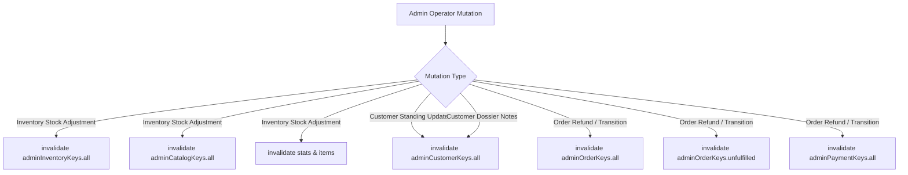

# Architecture Document: Admin Application Verification & Hardening

**Project**: Veyora Atelier — Haute Couture Commerce Platform  
**Workspace**: `apps/admin` (with supporting `apps/web`, `apps/api`, `apps/worker`)  
**Task**: Task 21 — Admin Application Verification & Hardening  
**Status**: Production Verified  
**Date**: November 2026

---

## 1. Executive Architecture Summary

This audit verified the production-readiness, security resilience, authentication lifecycle, and cache synchronization mechanics of the Veyora Admin Console (`apps/admin`).

The architecture reinforces the strict separation of concerns established across Tasks 09–20:

- **Client/Server Boundaries**: Next.js 16 App Router Server Component entrypoints deliver zero-bundle initial layouts, delegating interactive operational data grids, modal workflows, and mutation controls to Client Component boundaries.
- **In-Memory Token Isolation**: `accessToken` strictly resides in Zustand memory (`useAdminAuthStore`), never persisted to browser cookies, `localStorage`, or `sessionStorage`.
- **Session Renewal Hint**: The HttpOnly `refreshToken` cookie is treated strictly as an ambient session renewal hint. The Next.js Proxy (`apps/admin/src/proxy.ts`) checks for the existence of this cookie to prevent unnecessary server component round-trips for visitors with no session, but **never** validates authenticity or parses tokens. Authenticity is validated directly against Express API `/api/v1/auth/refresh`.
- **401 Token Refresh Deduplication**: `ApiClient` employs a single-flight mutex promise (`refreshPromise`) that coalesces concurrent 401 unauthorized errors into exactly one refresh call, retrying in-flight requests transparently upon token rotation.
- **Teardown Lifecycle**: On explicit logout or unrecoverable session expiration, `clearAdminAuth()` cancels all in-flight queries, wipes the TanStack Query cache (`clearQueryClient()`), resets Zustand state, and terminates authenticated Socket.IO connections.

---

## 2. Authentication & Session Lifecycle Verification

### 2.1 State Ownership & Token Flow

| Component / Layer               | Responsibility                                                         | Storage / Transport            |
| :------------------------------ | :--------------------------------------------------------------------- | :----------------------------- |
| **Zustand `useAdminAuthStore`** | Holds volatile user profile (`AuthUser`) and `accessToken`.            | Client JS Memory only          |
| **Express API Cookie**          | `refreshToken` HttpOnly, SameSite=Lax, Secure cookie.                  | Browser Cookie Jar             |
| **Next.js Proxy (`proxy.ts`)**  | Basic navigation gatekeeper; checks cookie hint only.                  | Server-side Request Inspection |
| **`AdminAuthProvider`**         | Initiates initial session hydration via `adminAuthApi.refreshToken()`. | Client Component Hook          |
| **`AdminProtectedRoute`**       | Redirects unauthenticated operators to `/login?redirect=...`.          | Client Component Wrapper       |
| **`ApiClient`**                 | Injects Bearer token into outgoing requests; deduplicates 401 retries. | Client HTTP Client             |

### 2.2 Open Redirect Defense

Login return URL validation was hardened in `apps/admin/src/app/login/page.tsx` using `getSafeRedirectUrl`:

- Rejects protocol-relative URLs (`//attacker.com`).
- Rejects backslash evasion (`/\\attacker.com` or `/%2fevil.com`).
- Rejects external protocol schemes (`https://`, `http://`, `javascript:`).
- Guards against redirect loops: if `redirectPath === "/login"`, falls back to `"/"`.

---

## 3. Operational Workflows & Cache Invalidation Matrix

To ensure that mutations in one operational domain immediately update dependent views without manual page refreshes:

### Invalidation Contracts:

1. **Inventory Adjustments (`InventoryListClient` & `InventoryDetailClient`)**:
   - `adminInventoryKeys.all`: Refreshes inventory table, available/reserved balances.
   - `adminCatalogKeys.all`: Refreshes product catalog listing stock badges and variant quantities.
   - `["admin-inventory", "stats"]`: Refreshes KPI summary cards.
2. **Customer Management (`CustomerDetailClient`)**:
   - `adminCustomerKeys.all`: Refreshes customer listing active/suspended standing and profile dossiers.
3. **Order Management (`OrdersListClient`)**:
   - `adminOrderKeys.all`: Updates multi-channel order tables.
   - `adminOrderKeys.unfulfilled()`: Updates pending fulfillment badge in the primary sidebar navigation.
   - `["admin-payments"]`: Refreshes gateway payment audit records.

---

## 4. Socket.IO Real-Time Synchronization

`AdminSocketProvider` maintains an event-driven connection exclusively when authenticated:

- **`ADMIN_ORDER_NEW`**: Triggers ambient toast notification with reservation total; invalidates `admin-orders` and `admin-unfulfilled-orders`.
- **`ORDER_UPDATED`**: Refreshes order lists.
- **`PAYMENT_UPDATED`**: Refreshes payment lists and transaction ledgers.
- **`SHIPMENT_UPDATED`**: Refreshes shipment dispatch tracking.
- **`ADMIN_INVENTORY_UPDATED`**: Refreshes inventory stock balances.
- **Teardown**: Disconnects socket and clears instance on logout or unauthenticated transition.

---

## 5. Failure Handling & Resilience

1. **Backend Unreachable (`net::ERR_CONNECTION_REFUSED`)**:
   `apiClient` catches network failures and generates typed `ApiClientError(..., 0, "NETWORK_ERROR")`. `AdminAuthProvider` catches this cleanly without throwing unhandled exceptions, transitioning state to `unauthenticated` so the operator sees the login console rather than an unhandled error screen.
2. **Loading Boundary Stability**:
   `AdminAuthLoadingScreen` height constrained to `min-h-[50vh]` to prevent vertical overflow and scrolling clipping when developer tools or mobile viewports constrain window height.
3. **Navigation Resilience**:
   Login form return URL automatically clears self-referential `/login` paths to prevent navigation loops.
