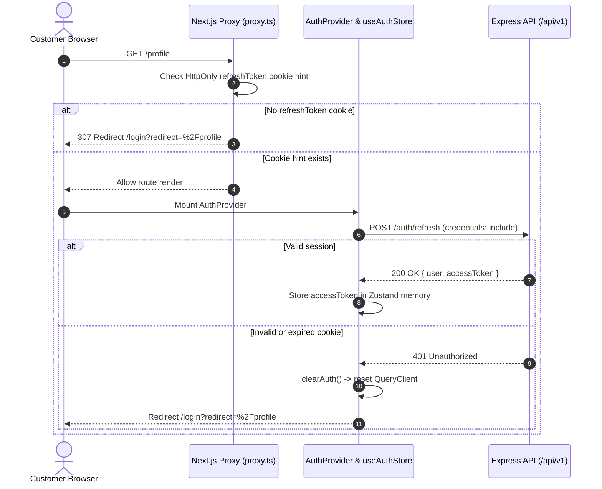

# Architecture Document: Web Storefront Verification & Hardening

**Project**: Veyora Atelier — Haute Couture Clothing E-commerce Platform  
**Workspace**: `apps/web` (supported by `apps/api`, `apps/worker`, shared packages)  
**Task**: Task 22 — Web Storefront Verification & Hardening  
**Status**: Completed with follow-ups  
**Date**: November 2026

---

## 1. Executive Summary

This architecture verification audited the customer-facing storefront (`apps/web`) following the Next.js 16.4.6, React 19, and Tailwind CSS v4 modernization. The review validated:

- **Route Resolution & Boundary Integrity**: All 20 customer routes resolve with predictable loading, error, and not-found states. Aliased routes (`/account`, `/account/profile`, `/categories/[slug]`) cleanly redirect to their canonical equivalents.
- **In-Memory Token Isolation**: The customer `accessToken` is strictly held in volatile Zustand memory (`useAuthStore`). The HttpOnly `refreshToken` cookie is never read by client components and serves only as an ambient session renewal hint.
- **Single-Flight Refresh Mutex**: Simultaneous 401 responses trigger exactly one token refresh request via `ApiClient.refreshPromise`, preventing concurrent refresh storms.
- **Payment Verification Integrity**: The storefront never assumes an order is paid based solely on browser callbacks; authoritative payment verification is executed by the Express backend API via cryptographic Razorpay signature validation.
- **Public vs Private Cache Partitioning**: Public catalog queries (`catalog-cache.ts`) leverage Next.js 16 Cache Components (`taxonomy`, `lookbook`, `garment`, `showcase`), while customer-specific data (cart, wishlist, profile, addresses, orders) is strictly excluded from server cache tags and managed in client memory.

---

## 2. Storefront Route Verification Matrix

| Route                 | Type                  | Auth Required          | Cache Policy            | Loading / Error Boundaries           |
| :-------------------- | :-------------------- | :--------------------- | :---------------------- | :----------------------------------- |
| `/`                   | Server Component      | No                     | Showcase (`use cache`)  | `loading.tsx` / `error.tsx`          |
| `/shop`               | Client Component      | No                     | Client Query            | Dynamic search grid & filters        |
| `/collections`        | Server Component      | No                     | Lookbook (`use cache`)  | `collections/loading.tsx`            |
| `/collections/[slug]` | Server Component      | No                     | Lookbook (`use cache`)  | `notFound()` on invalid slug         |
| `/categories/[slug]`  | Server Redirect       | No                     | None (Redirects 308)    | Redirects to `/category/[slug]`      |
| `/category/[slug]`    | Server Component      | No                     | Taxonomy (`use cache`)  | `notFound()` on invalid slug         |
| `/products/[slug]`    | Server Component      | No                     | Garment (`use cache`)   | `notFound()` on invalid slug         |
| `/new-arrivals`       | Client Component      | No                     | Client Query            | Skeleton pulse grid                  |
| `/search`             | Client Component      | No                     | Client Query            | Debounced autocomplete & empty state |
| `/cart`               | Client Component      | No                     | Client Query / Guest ID | Bag drawer & full-page bag           |
| `/wishlist`           | Client Component      | No                     | Client Query            | Empty collection placeholder         |
| `/login`              | Client Component      | No                     | None (Uncached)         | Open Redirect sanitized redirect     |
| `/register`           | Client Component      | No                     | None (Uncached)         | Zod validation & OTP prompt          |
| `/verify-otp`         | Client Component      | No                     | None (Uncached)         | 6-digit verification & resend        |
| `/forgot-password`    | Client Component      | No                     | None (Uncached)         | Reset code request                   |
| `/reset-password`     | Client Component      | No                     | None (Uncached)         | Password update with OTP             |
| `/profile`            | Client Component      | Yes (`ProtectedRoute`) | Client Query            | Breadcrumb, avatar, personal info    |
| `/account`            | Server Redirect       | Yes (via `/profile`)   | None (Redirects)        | Redirects to `/profile`              |
| `/account/profile`    | Server Redirect       | Yes (via `/profile`)   | None (Redirects)        | Redirects to `/profile`              |
| `/orders`             | Client Component      | Yes (`ProtectedRoute`) | Client Query            | Status badges, cancellation modal    |
| `/orders/[id]`        | Server Shell + Client | Yes (`ProtectedRoute`) | Client Query            | Tracking, garment line items         |
| `/checkout`           | Client Component      | Yes (for order save)   | Client Query            | Server totals, Razorpay gateway      |

---

## 3. Authentication & Session Architecture



### Security Defenses:

1. **Open Redirect Mitigation**: All post-login redirects are sanitized using `getSafeRedirectUrl(target, fallback = "/")`, ensuring attackers cannot redirect patrons to external phishing destinations.
2. **Redirect Loop Prevention**: `LoginForm` verifies that destination paths are never self-referential (`redirectPath === "/login" ? "/" : safe`).
3. **Session Teardown**: `clearAuth()` cancels active queries, clears `QueryClient` cache, purges volatile access tokens, and disconnects the authenticated socket.

---

## 4. Catalog, Cart & Checkout Integrity

### 4.1 Variant Selection & Out-of-Stock Protection

- `VariantSelector` validates combinations of Size and Color.
- Unavailable variants (`stock <= 0`) are disabled and visually struck through.
- Out-of-stock items cannot be submitted to `addToCartAsync`.
- WAI-ARIA radio group semantics applied (`role="radiogroup"`, `role="radio"`, `aria-checked={isSelected}`).

### 4.2 Cart Architecture

- Uses `x-guest-id` header (persisted in browser `localStorage`) for guest cart continuity.
- In-flight optimistic mutations roll back cleanly if API mutations fail.
- Subtotals, shipping, taxes, and promotional discounts are validated on the Express server.

### 4.3 Checkout & Razorpay Payment Security

- **Idempotency**: Generates an idempotency token per checkout attempt to prevent duplicate order submissions.
- **Server Authority**: Order creation (`POST /checkout/orders`) verifies pricing against MongoDB product records, disregarding client-side calculations.
- **Cryptographic Signature Verification**: Browser callbacks (`razorpay_payment_id`, `razorpay_order_id`, `razorpay_signature`) are sent to `POST /payments/verify`, where Express computes HMAC SHA-256 using the server-side `RAZORPAY_KEY_SECRET`. Orders are never marked paid based solely on frontend callbacks.

---

## 5. Cache Architecture & Data Isolation

```
Cache Isolation Matrix
┌───────────────────────────────────────┬───────────────────────────────────────┐
│ Public Shared Cache Tags (use cache)  │ Private Patron Data (Never Cached)    │
├───────────────────────────────────────┼───────────────────────────────────────┤
│ catalog:categories                    │ Cart items & totals                   │
│ catalog:category-slug:<slug>          │ Wishlist selections                   │
│ catalog:collections                   │ Customer dossiers & profiles          │
│ catalog:collection-slug:<slug>        │ Shipping & billing addresses          │
│ catalog:products                      │ Order histories & tracking            │
│ catalog:product-slug:<slug>           │ Authentication tokens & cookies       │
└───────────────────────────────────────┴───────────────────────────────────────┘
```

Next.js 16 Cache Components in `apps/web/src/lib/cache/catalog-cache.ts` only tag public catalogue endpoints. Server API requests inside cached functions omit dynamic `cookies()` calls, ensuring zero leakage of user session headers.
