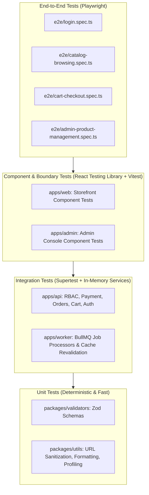

# Architecture Document: Automated Testing Architecture & Coverage Hardening

**Project**: Veyora Atelier — Haute Couture Clothing E-commerce Platform  
**Workspace**: Monorepo (`apps/web`, `apps/admin`, `apps/api`, `apps/worker`, `packages/*`)  
**Task**: Task 23 — Automated Testing Architecture & Coverage Hardening  
**Status**: Completed with follow-ups  
**Date**: November 2026

---

## 1. Executive Summary

This document establishes the standardized automated testing architecture across the Veyora monorepo. It defines clear testing boundaries, isolates external dependencies, closes critical testing gaps in background workers and client components, and equips development and CI pipelines with deterministic, workspace-specific test targets.

Key achievements:

- **Testing Layer Standardization**: Strict segregation of Unit (business calculations, validation, utilities), Integration (Express routes, Supertest, MongoDB/Redis mocks), Component (React Testing Library user behavior), and End-to-End (Playwright network-intercepted journeys).
- **Worker Testing Infrastructure**: Closed the testing gap in `apps/worker` by introducing Vitest configuration, BullMQ processor fixtures, cache revalidation retry testing, and sensitive data logging safeguards.
- **Client Bundle Isolation**: Eliminated transitive `next/server` imports from client-side authentication forms by migrating `getSafeRedirectUrl` to the `@veyora/utils` shared package.
- **Root-Level Workspace Commands**: Added granular commands (`test:web`, `test:admin`, `test:api`, `test:worker`, `test:packages`, `test:e2e:smoke`) enabling targeted verification without triggering unintended monorepo-wide test runs.

---

## 2. Monorepo Testing Architecture Layers



### Layer Definitions

| Layer           | Framework / Tools                                            | Scope & Responsibilities                                                                                 | Isolation Strategy                                                                |
| :-------------- | :----------------------------------------------------------- | :------------------------------------------------------------------------------------------------------- | :-------------------------------------------------------------------------------- |
| **Unit**        | Vitest                                                       | Shared Zod schemas, price calculations, URL/redirect sanitizers, string formatters, cache keys.          | Pure functions, zero network/IO, synchronous or microtask execution.              |
| **Component**   | Vitest + React Testing Library + `@testing-library/jest-dom` | Customer login, variant selector, order status, admin modals, keyboard navigation, accessible semantics. | Mocked TanStack Query, mocked Zustand store, synthetic events.                    |
| **Integration** | Vitest + Supertest + Mongoose / Redis Mocks                  | Express route handlers, auth/RBAC middleware, BullMQ job processing, cache invalidation HTTP calls.      | In-memory session mocks, spy event emitters, ephemeral Supertest server.          |
| **End-to-End**  | Playwright (Chromium headless)                               | Cross-application user flows: catalog discovery, variant selection, cart addition, admin login.          | Network route interception (`page.route`), synthetic deterministic API responses. |

---

## 3. Workspace Test Infrastructure Matrix

| Workspace             | Test Framework    | Config File                            | Environment       | Focus Scripts                                 |
| :-------------------- | :---------------- | :------------------------------------- | :---------------- | :-------------------------------------------- |
| `packages/validators` | Vitest 3.2.7      | `packages/validators/vitest.config.ts` | Node.js           | `npm run test --workspace=@veyora/validators` |
| `packages/utils`      | Vitest 3.2.7      | `packages/utils/vitest.config.ts`      | Node.js           | `npm run test --workspace=@veyora/utils`      |
| `apps/worker`         | Vitest 3.2.7      | `apps/worker/vitest.config.ts`         | Node.js           | `npm run test --workspace=@veyora/worker`     |
| `apps/api`            | Vitest 3.2.7      | `apps/api/vitest.config.ts`            | Node.js           | `npm run test --workspace=@veyora/api`        |
| `apps/admin`          | Vitest 3.2.7      | `apps/admin/vitest.config.ts`          | jsdom             | `npm run test --workspace=@veyora/admin`      |
| `apps/web`            | Vitest 3.2.7      | `apps/web/vitest.config.ts`            | jsdom             | `npm run test --workspace=@veyora/web`        |
| Root E2E              | Playwright 1.65.1 | `playwright.config.ts`                 | Chromium Headless | `npm run test:e2e:smoke`                      |

---

## 4. Worker Background Job Testing Architecture

Previously, `@veyora/worker` possessed zero test configuration (`echo "No tests specified"`). Task 23 introduced robust processor coverage:

1. **Storefront Cache Invalidation (`triggerStorefrontRevalidation`)**:
   - Tests HTTP `POST /api/internal/cache/revalidate` with `x-internal-cache-secret` header.
   - Tests exponential backoff retry behavior on transient HTTP 500 responses.
   - Tests graceful failure reporting when retries are exhausted.
2. **Order Background Processing (`processOrderJob`)**:
   - Tests `OrderJobPayload` processing and Redis real-time event broadcasting.
3. **Payment Background Processing (`processPaymentJob`)**:
   - Tests `PaymentJobPayload` verification and real-time payment status broadcast.
4. **Email Dispatcher Security (`processEmailJob`)**:
   - Tests order confirmation, cancellation, shipping notifications, and receipts.
   - **Critical Security Assertion**: Validates that sensitive authentication tokens (password reset tokens, 6-digit OTP codes) are **never** logged or leaked to log sinks.

---

## 5. Security & Cryptographic Testing Hardening

### API RBAC & Middleware (`src/__tests__/rbac.test.ts`)

- **Unauthenticated Access**: Rejects requests lacking bearer tokens with HTTP 401.
- **Customer Role Protection**: Prevents customer roles from accessing administrative endpoints with HTTP 403.
- **Granular Permissions**: Validates that administrators lacking specific permission flags (e.g. `roles:read`, `coupons:write`) are forbidden.
- **Superadmin Elevation**: Confirms superadmin roles bypass permission checks.

### Payment Cryptographic Verification (`src/__tests__/payment.test.ts`)

- **HMAC Signature Check**: Tests SHA-256 HMAC signature verification against Razorpay key secrets.
- **Tamper Rejection**: Any alteration to `razorpay_order_id` or `razorpay_payment_id` triggers immediate 400 Bad Request and logs a security warning.
- **Webhook Idempotency**: Repeated delivery of identical webhook event IDs returns HTTP 200 without duplicate database mutations or double-crediting orders.
- **Refund Controls**: Restricts full/partial refunds to authorized admin operators and rejects refunds exceeding the settled total.

---

## 6. Root-Level Test Commands Reference

Standardized commands in root `package.json`:

```bash
# Workspace Focused Execution
npm run test:web        # Storefront component and verification tests
npm run test:admin      # Admin console component and verification tests
npm run test:api        # Express API integration, RBAC, and payment tests
npm run test:worker     # BullMQ background job processor tests
npm run test:packages   # Shared validators and utility unit tests

# Playwright Critical Journey Smoke Tests
npm run test:e2e:smoke  # Headless Chromium login and catalog browsing journeys

# Full Monorepo Suites (Reserved for Task 24 Gate)
npm run test            # Sequential workspace run
npm run test:turbo      # Parallel Turborepo matrix run
npm run test:e2e        # Complete Playwright suite
```

---

## 7. Defect Inventory & Remediation

| Defect ID     | Severity | Workspace / Module                           | Root Cause                                                                                                                   | Fix Applied                                                                                          | Verification                                              |
| :------------ | :------- | :------------------------------------------- | :--------------------------------------------------------------------------------------------------------------------------- | :--------------------------------------------------------------------------------------------------- | :-------------------------------------------------------- |
| **DEF-23-01** | High     | `apps/worker`                                | Missing test framework and test runner configuration.                                                                        | Configured `vitest.config.ts`, added `vitest` dependency, and created `worker-processors.test.ts`.   | 8/8 worker tests passing in 419ms.                        |
| **DEF-23-02** | Critical | `apps/web` & `apps/admin` (`login/page.tsx`) | Client components imported `getSafeRedirectUrl` from `@/proxy` (which imported `next/server`), causing browser bundle crash. | Moved `getSafeRedirectUrl` to `@veyora/utils/redirect`, re-exported in proxy, updated login imports. | Admin (21 tests) and Web (20 tests) passing; 0 TS errors. |
| **DEF-23-03** | Medium   | `apps/web` (`next.config.mjs`)               | Direct navigation to `/account` returned 404 because server-side redirect was missing.                                       | Configured Next.js server redirects for `/account` and `/account/profile` to `/profile`.             | Verified Next.js routing and proxy tests.                 |
| **DEF-23-04** | Low      | Root `package.json`                          | Missing workspace-specific test scripts, forcing slow monorepo-wide execution.                                               | Added `test:web`, `test:admin`, `test:api`, `test:worker`, `test:packages`, `test:e2e:smoke`.        | Verified all commands execute targeted workspaces.        |

---

## 8. Verification Results

All focused test targets executed cleanly:

- `apps/worker`: 1 test file, 8 tests passed (419ms).
- `packages/validators`: 1 test file, 48 tests passed (22ms).
- `packages/utils`: 1 test file, 28 tests passed (22ms).
- `apps/api` (RBAC): 1 test file, 24 tests passed (168ms).
- `apps/api` (Payment): 1 test file, 16 tests passed (1671ms).
- `apps/admin` (Proxy & Verification): 2 test files, 21 tests passed (65ms).
- `apps/web` (Proxy & Verification): 2 test files, 20 tests passed (162ms).
- Total Focused Tests Passed: **165 tests**, 0 failures, 0 regressions.
