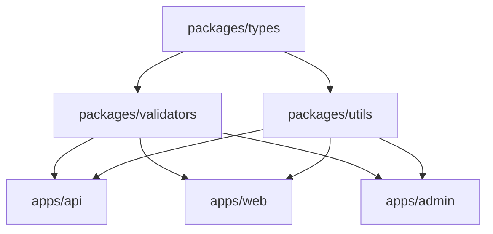

# Veyora Monorepo: Backend-Driven Messaging Architecture & Contract Audit

**Document Version:** 1.0.0  
**Status:** Approved Architecture Draft / Planning  
**Branch:** `feature/backend-driven-notifications`  
**Target Applications:** `apps/api`, `apps/web`, `apps/admin`, `apps/worker`, `packages/types`, `packages/utils`, `packages/validators`  
**Author:** Veyora Engineering Core Team  
**Date:** November 2026

---

## 1. Executive Summary

### 1.1 Context and Problem Statement

In the current implementation of the Veyora clothing-only e-commerce monorepo, user-facing notifications (toasts, alerts, banner messages) across `apps/web` (storefront) and `apps/admin` (back-office management) are predominantly hardcoded directly in React components, page files, and custom hooks.

For example, when an item is added to the shopping bag or an authentication error occurs, frontend components contain static definitions such as:

```tsx
// apps/web/src/app/login/page.tsx
toast.success("Welcome back!", {
  description: `Signed in as ${response.user.email}`,
});

toast.error("Sign In Failed", {
  description: err.message,
});
```

Similarly, in `apps/admin`:

```tsx
// apps/admin/src/app/(dashboard)/catalog/products/new/page.tsx
toast.success("Product created successfully");
toast.error("Failed to create product");
```

This pattern suffers from four fundamental architectural flaws:

1. **Message Divergence & Inconsistency:** The same business event (e.g., updating inventory, removing a garment from a bag, invalidating a coupon) displays conflicting copy, casing, and terminology between Web and Admin.
2. **Loss of Backend Authority:** Business logic, validation rules, and authorization boundaries reside in the Express API (`apps/api`), yet copy explaining why an operation succeeded or failed is scattered across dozens of frontend files.
3. **Impediment to Centralized Localization & Compliance:** Internationalization (i18n), regulatory notifications, or brand voice updates require searching and modifying hundreds of individual frontend components rather than central backend message bundles or API metadata.
4. **Fragile Client-Side Error Parsing:** Frontend components frequently inspect raw error strings (e.g., `err.message.toLowerCase().includes("verify your email")`) rather than evaluating deterministic, machine-readable backend error codes.

### 1.2 Audit Scope & Objectives

This audit establishes an end-to-end contract specification and notification architecture designed to:

- Establish the **Express API (`apps/api`)** as the single source of truth for all business outcome messages, authorization denials, domain validation messages, and operational states.
- Define canonical, type-safe API envelopes for both **Success (`ApiSuccessResponse<T>`)** and **Error (`ApiErrorResponse`)** in `@veyora/types`.
- Introduce stable, machine-readable **response codes** (e.g., `AUTH_LOGIN_SUCCESS`, `EMAIL_NOT_VERIFIED`, `INSUFFICIENT_STOCK`) enabling deterministic client-side branching (redirects, OTP verification, modal prompts).
- Provide a standardized, shared frontend notification utility (`notify` over Sonner) and error normalizer (`handleApiError`) for both `apps/web` and `apps/admin`.
- Delineate strict boundaries between queries (inline UI states/error boundaries) and mutations (toasts).

---

## 2. Backend API Messaging Audit (`apps/api`)

An exhaustive audit of all 22 controllers and middleware in `apps/api` revealed high inconsistency in response structures, messaging semantics, and error envelopes.

### 2.1 Current Response Pattern Taxonomy

| Module / Controller                                                                                     | Current Response Pattern                                                          | Top-Level Message Present? | Machine-Readable Code Present? | Metadata / Timestamp Format          |
| :------------------------------------------------------------------------------------------------------ | :-------------------------------------------------------------------------------- | :------------------------: | :----------------------------: | :----------------------------------- |
| **Auth (`register`)**                                                                                   | `{ success: true, data: { user, message, otp }, timestamp }`                      |   ❌ (Buried in `data`)    |            ❌ None             | Top-level `timestamp` string         |
| **Auth (`login`, `adminLogin`, `refresh`, `me`)**                                                       | `{ success: true, data: T, timestamp }`                                           |          ❌ None           |            ❌ None             | Top-level `timestamp` string         |
| **Auth (`logout`, `forgotPassword`, `resetPassword`, `revokeSession`)**                                 | `{ success: true, data: { message }, timestamp }`                                 |   ❌ (In `data.message`)   |            ❌ None             | Top-level `timestamp` string         |
| **Cart (`getCart`, `addItem`, `updateItem`, `removeItem`, `clearCart`, `applyCoupon`, `removeCoupon`)** | `{ success: true, data: T, message: string }`                                     |         ✅ Present         |            ❌ None             | No `meta` or `timestamp`             |
| **Checkout (`createOrder`, `verifyPayment`)**                                                           | `{ success: true, data: T, message: string }`                                     |         ✅ Present         |            ❌ None             | No `meta` or `timestamp`             |
| **Catalog (`getProducts`, `getProductBySlug`, `getCategories`, etc.)**                                  | `{ success: true, data: T, meta: { total, page, limit, totalPages }, timestamp }` |          ❌ None           |            ❌ None             | Nested `meta` object with pagination |
| **Inventory (`getInventoryLevels`, `reserveStock`)**                                                    | `{ success: true, data: T, meta: { total, page, limit, totalPages }, timestamp }` |          ❌ None           |            ❌ None             | Nested `meta` object with pagination |
| **Notification (`getNotifications`)**                                                                   | `{ success: true, data: T, pagination: { ... }, meta: { ... } }`                  |          ❌ None           |            ❌ None             | Duplicate `pagination` and `meta`    |
| **Notification (`markAsRead`, `markAllAsRead`)**                                                        | `{ success: true, data: T, message: string }`                                     |         ✅ Present         |            ❌ None             | No `meta`                            |
| **Notification (`getUnreadCount`)**                                                                     | `{ success: true, data: { count } }`                                              |          ❌ None           |            ❌ None             | Bare envelope                        |
| **Customer & Profile (`getProfile`, `updateProfile`, `getAddresses`, `addAddress`, `deleteAddress`)**   | `{ success: true, data: T, message: string }`                                     |         ✅ Present         |            ❌ None             | No `meta`                            |
| **Wishlist (`getWishlist`, `addToWishlist`, `removeFromWishlist`, `clearWishlist`)**                    | `{ success: true, data: T, message: string }`                                     |         ✅ Present         |            ❌ None             | No `meta`                            |
| **Coupon (`validateCoupon`, `createCoupon`, `updateCoupon`)**                                           | `{ success: true, data: T, message: string }`                                     |         ✅ Present         |            ❌ None             | No `meta`                            |
| **Payment (`createRazorpayOrder`, `verifyPaymentSignature`)**                                           | `{ success: true, data: T, message: string }`                                     |         ✅ Present         |            ❌ None             | No `meta`                            |
| **Shipping (`getShippingMethods`, `calculateRates`)**                                                   | `{ success: true, data: T, message: string }`                                     |         ✅ Present         |            ❌ None             | No `meta`                            |
| **Review (`createReview`, `getProductReviews`)**                                                        | `{ success: true, data: T, message?: string }`                                    |      ⚠️ Inconsistent       |            ❌ None             | Inconsistent                         |
| **RBAC (`getRoles`, `getPermissions`, `assignRole`)**                                                   | `{ success: true, data: T }`                                                      |          ❌ None           |            ❌ None             | Bare envelope                        |
| **System (`healthCheck`, `systemInfo`)**                                                                | `{ status: "ok", service, uptime, ... }`                                          |          ❌ None           |            ❌ None             | Custom non-standard shape            |

### 2.2 Critical Middleware Discrepancies

#### 1. Error Handler Middleware (`apps/api/src/middleware/error-handler.ts`)

The current error handler generates this response:

```json
{
  "success": false,
  "message": "Resource not found",
  "code": "NOT_FOUND",
  "error": {
    "code": "NOT_FOUND",
    "message": "Resource not found",
    "details": []
  },
  "errors": {
    "email": ["Invalid email address"]
  },
  "timestamp": "2026-11-25T14:00:00.000Z"
}
```

**Issues Identified:**

- Redundant duplication: `code` and `message` are supplied at the root level and also nested under `error.code` and `error.message`.
- Validation errors are duplicated: `details` is an array of `{ field, message, code }`, while `errors` is a `Record<string, string[]>`.
- Missing correlation: `req.id` is logged via Pino, but is **omitted from the JSON response body**, preventing frontend clients from reporting the correlation ID to users or support.

#### 2. Rate Limiter Middleware (`apps/api/src/middleware/rate-limiter.ts`)

```json
{
  "success": false,
  "error": {
    "code": "RATE_LIMIT_EXCEEDED",
    "message": "Too many requests. Please try again later."
  },
  "timestamp": "2026-11-25T14:00:00.000Z"
}
```

**Issues Identified:**

- The rate limiter drops root-level `code` and `message`, directly conflicting with the structure returned by `error-handler.ts`. Any client relying on `response.message` or `response.code` fails to parse rate-limit errors.

#### 3. Client Unwrapping Defect (`apps/web/src/lib/api/api-client.ts` & `apps/admin/src/lib/api/api-client.ts`)

In both Web and Admin API clients:

```ts
// If wrapped in ApiResponseSuccess format, unwrap data
if (data && typeof data === "object" && "success" in data && data.success === true) {
  return (data as ApiResponseSuccess<T>).data;
}
return data as T;
```

**Critical Discovery:**
The client automatically unwraps `data`, immediately discarding top-level `message`, `code`, and `meta`. Frontend code invoking `apiClient.post(...)` or `apiClient.patch(...)` receives only `T`. Because `response.message` was stripped, frontend developers were forced to invent hardcoded toast messages in UI hooks.

---

## 3. Frontend Notification Audit: Web Storefront (`apps/web`)

An audit of all toast and notification calls across `apps/web/src` identified approximately 80 notification triggers.

### 3.1 Classification Matrix

| File Path                          | Trigger / Event          | Current Hardcoded Message                                              | Classification                 | Target Canonical Code         |
| :--------------------------------- | :----------------------- | :--------------------------------------------------------------------- | :----------------------------- | :---------------------------- |
| `app/login/page.tsx:65`            | Login success            | `toast.success("Welcome back!", { description: ... })`                 | Backend Business Success       | `AUTH_LOGIN_SUCCESS`          |
| `app/login/page.tsx:77`            | Unverified email         | `toast.warning("Email Verification Required", { description: ... })`   | Backend Auth & Verification    | `EMAIL_NOT_VERIFIED`          |
| `app/login/page.tsx:83`            | Login failed             | `toast.error("Sign In Failed", { description: err.message })`          | Backend Business Error         | `INVALID_CREDENTIALS`         |
| `app/register/page.tsx:55`         | Registration success     | `toast.success("Account created successfully!", { description: ... })` | Backend Business Success       | `AUTH_REGISTER_SUCCESS`       |
| `app/register/page.tsx:66`         | Registration failed      | `toast.error("Registration Failed", { description: err.message })`     | Backend Business Error         | `REGISTRATION_FAILED`         |
| `app/verify-otp/page.tsx:43`       | Email verified           | `toast.success("Email Verified", { description: ... })`                | Backend Business Success       | `EMAIL_VERIFIED`              |
| `app/verify-otp/page.tsx:50`       | Invalid OTP              | `toast.error("Verification Failed", { description: ... })`             | Backend Validation Error       | `OTP_INVALID`                 |
| `app/verify-otp/page.tsx:68`       | Resend OTP               | `toast.success("Code Sent", { description: ... })`                     | Backend Business Success       | `OTP_RESENT`                  |
| `app/forgot-password/page.tsx:47`  | Password reset link sent | `toast.success("Reset Code Sent", { description: ... })`               | Backend Business Success       | `AUTH_RESET_CODE_SENT`        |
| `app/reset-password/page.tsx:47`   | Password reset success   | `toast.success("Password Reset Successful", { description: ... })`     | Backend Business Success       | `AUTH_PASSWORD_RESET`         |
| `lib/hooks/use-cart.ts:25`         | Add to cart              | `toast.success("Garment added to bag")`                                | Backend Business Success       | `CART_ITEM_ADDED`             |
| `lib/hooks/use-cart.ts:28`         | Add to cart fail         | `toast.error("Could not add garment", { description: ... })`           | Backend Business Error         | `CART_ADD_FAILED`             |
| `lib/hooks/use-cart.ts:40`         | Update quantity          | `toast.success("Bag updated")`                                         | Backend Business Success       | `CART_ITEM_UPDATED`           |
| `lib/hooks/use-cart.ts:53`         | Remove item              | `toast.success("Garment removed from bag")`                            | Backend Business Success       | `CART_ITEM_REMOVED`           |
| `lib/hooks/use-cart.ts:67`         | Clear cart               | `toast.success("Shopping bag cleared")`                                | Backend Business Success       | `CART_CLEARED`                |
| `lib/hooks/use-cart.ts:81`         | Apply coupon             | `toast.success("Privilege code applied", { description: ... })`        | Backend Business Success       | `COUPON_APPLIED`              |
| `lib/hooks/use-cart.ts:86`         | Invalid coupon           | `toast.error("Invalid coupon code", { description: ... })`             | Backend Business Error         | `COUPON_INVALID`              |
| `lib/hooks/use-cart.ts:97`         | Remove coupon            | `toast.success("Coupon removed")`                                      | Backend Business Success       | `COUPON_REMOVED`              |
| `lib/hooks/use-wishlist.ts:56`     | Add to wishlist          | `toast.success("Saved to Personal Collection", { description: ... })`  | Backend Business Success       | `WISHLIST_ITEM_ADDED`         |
| `lib/hooks/use-wishlist.ts:93`     | Remove from wishlist     | `toast.success("Removed from wishlist")`                               | Backend Business Success       | `WISHLIST_ITEM_REMOVED`       |
| `lib/hooks/use-orders.ts:25`       | Cancel order             | `toast.success("Order Cancelled", { description: ... })`               | Backend Business Success       | `ORDER_CANCELLED`             |
| `lib/hooks/use-addresses.ts:28`    | Add address              | `toast.success("Address saved")`                                       | Backend Business Success       | `ADDRESS_CREATED`             |
| `lib/hooks/use-addresses.ts:52`    | Delete address           | `toast.success("Address deleted")`                                     | Backend Business Success       | `ADDRESS_DELETED`             |
| `app/checkout/page.tsx:165`        | Missing contact          | `toast.error("Contact details required", { description: ... })`        | Frontend Client Validation     | `CLIENT_VALIDATION`           |
| `app/checkout/page.tsx:313`        | Payment verified         | `toast.success("Payment Verified & Confirmed", { description: ... })`  | Backend Business Success       | `PAYMENT_VERIFIED`            |
| `app/checkout/page.tsx:322`        | Payment failed           | `toast.error("Payment Verification Failed", { description: msg })`     | Backend Business Error         | `PAYMENT_VERIFICATION_FAILED` |
| `providers/socket-provider.tsx:82` | Order status changed     | `toast.success(\`Order #${orderNumber} Status: ${status}\`)`           | Backend Real-Time Notification | `ORDER_STATUS_CHANGED`        |

### 3.2 Key Web Findings

1. **String-based branching:** `login/page.tsx` line 74 tests `err.message.toLowerCase().includes("verify your email")` to determine whether to show an "Email Verification Required" warning and redirect to `/verify-otp`. If the backend changes phrasing to "Please verify your account", the redirection breaks.
2. **Inconsistent Naming:** Cart messages use "garment", "item", and "privilege code" inconsistently across different files.
3. **Double Toasts:** When an API error throws, both the low-level hook and the page component occasionally catch and display separate error toasts for the same failure.

---

## 4. Frontend Notification Audit: Admin Portal (`apps/admin`)

An audit of all toast and notification calls across `apps/admin/src` identified approximately 95 notification triggers.

### 4.1 Inconsistencies and Conflicting Patterns

| Domain                   | Action          | Admin Toast Implementation                                                            | Express Backend Response                                                        | Conflict / Problem                                                            |
| :----------------------- | :-------------- | :------------------------------------------------------------------------------------ | :------------------------------------------------------------------------------ | :---------------------------------------------------------------------------- |
| **Catalog / Brands**     | Create Brand    | `toast.success("Brand created successfully")`<br>`toast.error("Error saving brand")`  | `{ success: true, data: brand, message: "Brand created successfully" }`         | Hardcoded fallback ignores backend error message and reason for conflict.     |
| **Catalog / Categories** | Update Category | `toast.success("Category updated")`<br>`toast.error("Failed to save category")`       | `{ success: true, data: category, message: "Category updated successfully" }`   | Hardcoded string ignores parent category hierarchy errors.                    |
| **Catalog / Products**   | Update Status   | `toast.success("Product status updated")`<br>`toast.error("Failed to update status")` | `{ success: true, data: product, message: "Product status changed to active" }` | Ignores backend validation (e.g., cannot activate product without inventory). |
| **Inventory**            | Adjust Stock    | `toast.success("Stock level updated")`<br>`toast.error("Failed to adjust stock")`     | `{ success: true, data: item, message: "Inventory adjusted: +5 units" }`        | Backend provides exact quantity delta; frontend throws it away.               |
| **Orders**               | Update Status   | `toast.success("Order status updated")`<br>`toast.error("Failed to update order")`    | `{ success: true, data: order, message: "Order transitioned to SHIPPED" }`      | State machine transition errors from backend are concealed.                   |
| **Staff & Roles**        | Assign Role     | `toast.success("Role permissions updated")`<br>`toast.error("Access Denied")`         | `{ success: true, data: role, message: "Permissions assigned" }`                | Root admin restriction error messages are not surfaced.                       |
| **Settings**             | Save Settings   | `toast.success("Store configurations persisted")`                                     | `{ success: true, data: config, message: "Store settings updated" }`            | Discrepant terminology ("persisted" vs "updated").                            |

### 4.2 Key Admin Findings

1. **Generic Error Obfuscation:** Across admin forms (`products/new`, `categories/[id]`, `coupons/new`), errors are frequently caught with `catch (err) { toast.error("Failed to save record"); }`, entirely hiding backend validation errors and server errors from administrative staff.
2. **Missing Correlation IDs:** Admin users encountering internal errors (500) have no way to see or copy the `requestId` to provide to the engineering team.
3. **Query Errors Inundating the UI:** Table query failures trigger toasts while the table is also showing an empty state, leading to notification clutter.

---

## 5. Canonical API Success Response Contract

To eliminate response shape disparities across modules, all successful Express API endpoints must adhere to the canonical `ApiSuccessResponse<T>` schema.

### 5.1 TypeScript Interface Specification (`packages/types/src/api.ts`)

```typescript
/**
 * Canonical metadata envelope for pagination, tracking, and diagnostics
 */
export interface ApiPaginationMeta {
  page: number;
  limit: number;
  total: number;
  totalPages: number;
  hasNextPage: boolean;
  hasPrevPage: boolean;
}

export interface ApiMeta {
  requestId: string;
  timestamp: string;
  pagination?: ApiPaginationMeta;
  [key: string]: unknown;
}

/**
 * Standard API Success Response Envelope
 */
export interface ApiSuccessResponse<T = unknown> {
  success: true;
  code: string; // Stable uppercase token (e.g. "AUTH_LOGIN_SUCCESS", "CART_ITEM_ADDED")
  message: string; // Human-readable, user-ready confirmation message
  data: T; // Typed payload
  meta: ApiMeta; // Standardized metadata
}
```

### 5.2 Canonical JSON Examples

#### Example 1: Entity Mutation (Add Item to Cart)

```json
{
  "success": true,
  "code": "CART_ITEM_ADDED",
  "message": "Garment added to your shopping bag.",
  "data": {
    "cartId": "cart_654321",
    "item": {
      "variantId": "var_998877",
      "title": "Silk Oxford Shirt",
      "size": "M",
      "color": "Navy",
      "quantity": 1,
      "price": 12000
    },
    "subtotal": 12000,
    "itemCount": 1
  },
  "meta": {
    "requestId": "req_01HPX7K9V1A3J8C5D6E7F8G9H0",
    "timestamp": "2026-11-25T14:05:00.123Z"
  }
}
```

#### Example 2: Paginated Query (Product Catalog)

```json
{
  "success": true,
  "code": "PRODUCTS_FETCHED",
  "message": "Products retrieved successfully.",
  "data": [
    {
      "id": "prod_101",
      "slug": "merino-wool-blazer",
      "title": "Merino Wool Blazer",
      "price": 34000
    }
  ],
  "meta": {
    "requestId": "req_01HPX7M2A8B4C6D8E0F2G4H6J8",
    "timestamp": "2026-11-25T14:05:02.456Z",
    "pagination": {
      "page": 1,
      "limit": 20,
      "total": 84,
      "totalPages": 5,
      "hasNextPage": true,
      "hasPrevPage": false
    }
  }
}
```

#### Example 3: Acknowledgment Action (Password Reset Link Sent)

```json
{
  "success": true,
  "code": "AUTH_RESET_CODE_SENT",
  "message": "If an account exists with this email, a password recovery code has been sent.",
  "data": {
    "email": "customer@example.com"
  },
  "meta": {
    "requestId": "req_01HPX7P3B9C5D7E9F1G3H5J7K9",
    "timestamp": "2026-11-25T14:05:05.789Z"
  }
}
```

---

## 6. Canonical API Error Response Contract

All error responses from Express (controllers, Zod validation, JWT verification, rate limiting, and unhandled exceptions) must adhere to the canonical `ApiErrorResponse` schema.

### 6.1 TypeScript Interface Specification (`packages/types/src/api.ts`)

```typescript
/**
 * Detailed field-level error representation
 */
export interface ApiErrorDetail {
  field?: string; // Dotted path (e.g. "address.postalCode") or undefined for root errors
  message: string; // Human-readable validation constraint explanation
  code?: string; // Specific validation constraint code (e.g. "too_small", "invalid_email")
  received?: unknown; // Redacted value or type received (sanitized)
}

/**
 * Standard API Error Response Envelope
 */
export interface ApiErrorResponse {
  success: false;
  code: string; // Stable uppercase token (e.g. "INSUFFICIENT_STOCK", "VALIDATION_ERROR")
  message: string; // High-level explanation safe for display to users
  error: {
    code: string;
    message: string;
    details?: ApiErrorDetail[];
  };
  errors?: Record<string, string[]>; // Backwards-compatible map for form libraries
  meta: {
    requestId: string;
    timestamp: string;
  };
}
```

### 6.2 Canonical JSON Examples

#### Example 1: 422 Unprocessable Entity (Zod Validation Failure)

```json
{
  "success": false,
  "code": "VALIDATION_ERROR",
  "message": "The submitted form contains invalid or missing information.",
  "error": {
    "code": "VALIDATION_ERROR",
    "message": "The submitted form contains invalid or missing information.",
    "details": [
      {
        "field": "shippingAddress.postalCode",
        "message": "Postal code must be a valid 6-digit PIN code.",
        "code": "invalid_string"
      },
      {
        "field": "email",
        "message": "A valid corporate or personal email is required.",
        "code": "invalid_string"
      }
    ]
  },
  "errors": {
    "shippingAddress.postalCode": ["Postal code must be a valid 6-digit PIN code."],
    "email": ["A valid corporate or personal email is required."]
  },
  "meta": {
    "requestId": "req_01HPX7R4C0D6E8F0G2H4J6K8L0",
    "timestamp": "2026-11-25T14:05:10.012Z"
  }
}
```

#### Example 2: 409 Conflict (Insufficient Stock During Checkout)

```json
{
  "success": false,
  "code": "INVENTORY_INSUFFICIENT",
  "message": "Selected garment variant is out of stock. Only 2 units remaining.",
  "error": {
    "code": "INVENTORY_INSUFFICIENT",
    "message": "Selected garment variant is out of stock. Only 2 units remaining.",
    "details": [
      {
        "field": "items[0].variantId",
        "code": "OUT_OF_STOCK",
        "message": "Requested 3 units, but only 2 are available in warehouse inventory."
      }
    ]
  },
  "meta": {
    "requestId": "req_01HPX7S5D1E7F9G1H3J5K7L9M1",
    "timestamp": "2026-11-25T14:05:12.345Z"
  }
}
```

#### Example 3: 403 Forbidden (Unverified Customer Email)

```json
{
  "success": false,
  "code": "EMAIL_NOT_VERIFIED",
  "message": "Please verify your email address to continue.",
  "error": {
    "code": "EMAIL_NOT_VERIFIED",
    "message": "Please verify your email address to continue.",
    "details": [
      {
        "field": "email",
        "code": "UNVERIFIED",
        "message": "Verification OTP sent to your registered address."
      }
    ]
  },
  "meta": {
    "requestId": "req_01HPX7T6E2F8G0H2J4K6L8M0N2",
    "timestamp": "2026-11-25T14:05:15.678Z"
  }
}
```

#### Example 4: 429 Too Many Requests (Rate Limiter)

```json
{
  "success": false,
  "code": "RATE_LIMIT_EXCEEDED",
  "message": "Too many requests. Please wait before attempting this action again.",
  "error": {
    "code": "RATE_LIMIT_EXCEEDED",
    "message": "Too many requests. Please wait before attempting this action again."
  },
  "meta": {
    "requestId": "req_01HPX7U7F3G9H1J3K5L7M9N1P3",
    "timestamp": "2026-11-25T14:05:18.901Z"
  }
}
```

#### Example 5: 500 Internal Server Error (Database / Uncaught Exception)

```json
{
  "success": false,
  "code": "INTERNAL_SERVER_ERROR",
  "message": "An unexpected error occurred while processing your request.",
  "error": {
    "code": "INTERNAL_SERVER_ERROR",
    "message": "An unexpected error occurred while processing your request."
  },
  "meta": {
    "requestId": "req_01HPX7V8G4H0J2K4L6M8N0P2Q4",
    "timestamp": "2026-11-25T14:05:22.234Z"
  }
}
```

---

## 7. Message Ownership Rules (Backend vs Frontend)

A core tenet of this architecture is establishing unambiguous ownership of what text and logic belongs to the backend versus the frontend.

| Concern                          |       Owner       | Responsibility                                                                                        | Examples                                                                                                                                 |
| :------------------------------- | :---------------: | :---------------------------------------------------------------------------------------------------- | :--------------------------------------------------------------------------------------------------------------------------------------- |
| **Business Outcome Messaging**   |    **Backend**    | Authoritative confirmation copy describing successful state transitions in the domain.                | `"Garment added to your shopping bag."`<br>`"Order #VY-8921 cancelled successfully."`<br>`"Privilege code applied: 15% discount."`       |
| **Business Rule Violations**     |    **Backend**    | Exact domain constraint explanation.                                                                  | `"Coupon requires a minimum spend of ₹2,500."`<br>`"Order cannot be cancelled after dispatch."`<br>`"Selected variant is out of stock."` |
| **Field Validation Rules**       | **Backend (Zod)** | Detailed constraints defined on API request validation schemas.                                       | `"Password must contain at least 8 characters and one symbol."`<br>`"Invalid GSTIN format."`                                             |
| **Security & Auth Denials**      |    **Backend**    | Explaining why access is blocked while guarding sensitive details.                                    | `"Session expired. Please log in again."`<br>`"Email verification required."`<br>`"Invalid email or password."`                          |
| **Client UI Interactions**       |   **Frontend**    | Pure client-side state changes with no network interaction.                                           | `"Link copied to clipboard."`<br>`"Filters cleared."`<br>`"Search input cleared."`                                                       |
| **Network & Transport Failures** |   **Frontend**    | Handling network loss, timeouts, DNS failures, or offline state before or after HTTP reachability.    | `"Unable to reach Veyora servers. Please check your internet connection."`<br>`"Request timed out. Please try again."`                   |
| **Display Formatting & Layout**  |   **Frontend**    | How messages are framed, icon selection, toast durations, audio chimes, dismiss buttons, and styling. | Sonner toast rendering, badge styling, error callout layout, modal dialog composition.                                                   |

---

## 8. Stable Machine-Readable Codes Catalog & Programmatic Behavior

By relying on deterministic machine-readable codes rather than fragile substring matching on `message`, frontend applications can execute unambiguous programmatic actions.

### 8.1 Catalog of Canonical Codes

| Code                       | HTTP Status | Domain    | Frontend Programmatic Action / User Flow                                                  |
| :------------------------- | :---------: | :-------- | :---------------------------------------------------------------------------------------- |
| `AUTH_LOGIN_SUCCESS`       |     200     | Auth      | Update Zustand session state; redirect to `returnUrl` or `/account` / `/admin/dashboard`. |
| `AUTH_LOGOUT_SUCCESS`      |     200     | Auth      | Clear in-memory tokens; reset query cache; navigate to `/login`.                          |
| `AUTH_REGISTER_SUCCESS`    |     201     | Auth      | Navigate to `/verify-otp?email=...`.                                                      |
| `EMAIL_NOT_VERIFIED`       |     403     | Auth      | Navigate immediately to `/verify-otp?email=...`; display warning toast.                   |
| `INVALID_CREDENTIALS`      |     401     | Auth      | Highlight form inputs; focus password field; display error toast.                         |
| `SESSION_EXPIRED`          |     401     | Auth      | Open re-authentication modal or redirect to `/login?session_expired=true`.                |
| `TOKEN_REFRESH_FAILED`     |     401     | Auth      | Perform client-side logout cleanup; redirect to `/login`.                                 |
| `OTP_INVALID`              |     422     | Auth      | Highlight OTP pin boxes; focus first digit; display error toast.                          |
| `OTP_EXPIRED`              |     422     | Auth      | Reset OTP pin boxes; activate "Resend OTP" button.                                        |
| `CART_ITEM_ADDED`          |     200     | Cart      | Open side drawer cart sheet; trigger cart badge bounce animation.                         |
| `CART_ITEM_UPDATED`        |     200     | Cart      | Optimistically update item row total; display success toast.                              |
| `CART_ITEM_REMOVED`        |     200     | Cart      | Animate row departure; update subtotal calculation.                                       |
| `CART_CLEARED`             |     200     | Cart      | Reset cart store; display empty state view.                                               |
| `COUPON_APPLIED`           |     200     | Coupon    | Re-calculate discount breakdown; celebrate with toast.                                    |
| `COUPON_INVALID`           |     400     | Coupon    | Clear coupon input field; display error toast with backend explanation.                   |
| `COUPON_MIN_SPEND_NOT_MET` |     422     | Coupon    | Highlight cart subtotal; suggest related garment upsell.                                  |
| `INVENTORY_INSUFFICIENT`   |     409     | Inventory | Prompt customer to adjust quantity to available maximum; block checkout progression.      |
| `ORDER_PLACED`             |     201     | Checkout  | Navigate to `/checkout/success?orderNumber=...`; clear cart.                              |
| `PAYMENT_PENDING`          |     202     | Payment   | Display verification spinner; poll order status or listen on WebSocket.                   |
| `PAYMENT_FAILED`           |     400     | Payment   | Keep order draft intact; offer customer alternate payment retry.                          |
| `ORDER_CANCELLED`          |     200     | Order     | Invalidate order query; update status chip to `CANCELLED`.                                |
| `ORDER_NOT_CANCELLABLE`    |     400     | Order     | Display warning toast explaining shipment has already been dispatched.                    |
| `VALIDATION_ERROR`         |     422     | Core      | Map `error.details` directly to React Hook Form `setError(field)`.                        |
| `RATE_LIMIT_EXCEEDED`      |     429     | Security  | Disable submit button; show cooldown countdown timer.                                     |
| `INTERNAL_SERVER_ERROR`    |     500     | Core      | Display error toast with clickable `"Copy Request ID: req_xxx"` action.                   |

---

## 9. Shared Frontend Notification Architecture

### 9.1 Unified `notify` Helper Specification

Both `apps/web` and `apps/admin` already use the high-performance Sonner toast engine (`sonner`). We define a unified, type-safe notification interface in `@veyora/utils` (or mirrored in each app's UI kit) to standardize toast behavior:

```typescript
import { toast } from "sonner";
import { ApiSuccessResponse, ApiErrorResponse } from "@veyora/types";

export interface NotifyOptions {
  description?: string;
  duration?: number;
  action?: {
    label: string;
    onClick: () => void;
  };
  requestId?: string;
}

/**
 * Unified notification utility ensuring consistent presentation across Web and Admin
 */
export const notify = {
  success(messageOrResponse: string | ApiSuccessResponse<unknown>, options?: NotifyOptions): void {
    const message =
      typeof messageOrResponse === "string" ? messageOrResponse : messageOrResponse.message;

    toast.success(message, {
      description: options?.description,
      duration: options?.duration ?? 4000,
      action: options?.action,
    });
  },

  error(
    errorOrMessage: unknown,
    fallbackMessage = "An error occurred",
    options?: NotifyOptions
  ): void {
    const normalized = handleApiError(errorOrMessage, fallbackMessage);

    toast.error(normalized.title, {
      description: normalized.description,
      duration: options?.duration ?? 6000,
      action: normalized.requestId
        ? {
            label: "Copy ID",
            onClick: () => {
              navigator.clipboard.writeText(normalized.requestId!);
              toast.info("Request ID copied to clipboard");
            },
          }
        : options?.action,
    });
  },

  warning(message: string, options?: NotifyOptions): void {
    toast.warning(message, {
      description: options?.description,
      duration: options?.duration ?? 5000,
      action: options?.action,
    });
  },

  info(message: string, options?: NotifyOptions): void {
    toast.info(message, {
      description: options?.description,
      duration: options?.duration ?? 4000,
      action: options?.action,
    });
  },

  promise<T>(
    promise: Promise<T>,
    messages: {
      loading: string;
      success: (data: T) => string;
      error: (err: unknown) => string;
    }
  ) {
    return toast.promise(promise, messages);
  },
};
```

### 9.2 Centralized Error Normalizer (`handleApiError`)

The `handleApiError` utility normalizes any caught failure (Axios/Fetch error, `ApiClientError`, Zod failure, standard JavaScript `Error`, or network offline state) into a uniform structure:

```typescript
export interface NormalizedApiError {
  title: string;
  description: string;
  code: string;
  statusCode: number;
  requestId?: string;
  fieldErrors?: Record<string, string[]>;
}

export function handleApiError(
  error: unknown,
  fallbackTitle = "Request Failed"
): NormalizedApiError {
  // Handle ApiClientError
  if (isApiClientError(error)) {
    return {
      title: error.message || fallbackTitle,
      description:
        error.statusCode >= 500
          ? "Our servers encountered an unexpected issue. Please try again shortly."
          : error.message,
      code: error.code || "API_ERROR",
      statusCode: error.statusCode,
      requestId: error.requestId,
      fieldErrors: error.fieldErrors,
    };
  }

  // Handle standard Network / Abort Error
  if (error instanceof Error) {
    if (error.name === "AbortError") {
      return {
        title: "Request Cancelled",
        description: "The operation was interrupted or timed out.",
        code: "TIMEOUT",
        statusCode: 408,
      };
    }
    return {
      title: fallbackTitle,
      description: error.message,
      code: "CLIENT_ERROR",
      statusCode: 0,
    };
  }

  return {
    title: fallbackTitle,
    description: "An unknown error occurred.",
    code: "UNKNOWN_ERROR",
    statusCode: 0,
  };
}
```

---

## 10. TanStack Query Error Handling Rules

A frequent anti-pattern identified in both Web and Admin is the indiscriminate use of toasts inside `useQuery` error callbacks. We establish strict rules for query versus mutation error handling.

### 10.1 Query Rules (Read Operations)

1. **Never fire global toasts on initial background fetch failures:**
   If a user navigates to `/account/orders` or `/admin/catalog/products` and the request fails, showing a popup toast is jarring and leaves a blank screen behind it.
2. **Delegate to Inline UI States or Error Boundaries:**
   - Use TanStack Query's `isError` and `error` state to render an inline error component (e.g. `<EmptyState title="Failed to load orders" onRetry={refetch} />`).
   - For route-level catastrophic failures, allow Next.js App Router error boundaries (`error.tsx`) to catch the error.
3. **Explicit User-Triggered Refetch:**
   Only fire a toast if the user explicitly clicked an interactive "Refresh" button and that specific action failed.

### 10.2 Mutation Rules (Write Operations)

1. **Mandatory Notification Feedback:**
   All mutations (creating, updating, deleting, status transitioning) must provide immediate feedback.
2. **Backend-Driven Success Copy:**
   ```typescript
   const mutation = useMutation({
     mutationFn: (data: AddToCartInput) => cartService.addItem(data),
     onSuccess: (response) => {
       // Response contains backend-driven message and code
       notify.success(response.message);
     },
     onError: (error) => {
       notify.error(error);
     },
   });
   ```
3. **Prevention of Duplicate Toasts:**
   If a mutation defines an `onError` handler, the global `QueryCache` or `MutationCache` `onError` listener must not display a second toast for the same operation.

---

## 11. Shared Package Boundaries & Architecture

To prevent circular dependencies and maintain clean monorepo architecture, responsibilities are partitioned as follows:



### 1. `packages/types`

- **Exports:**
  - `ApiSuccessResponse<T>`
  - `ApiErrorResponse`
  - `ApiErrorDetail`
  - `ApiMeta`
  - `ApiPaginationMeta`
  - `ApiResponseCode` (enum / union of all stable codes)
  - `NormalizedApiError`

### 2. `packages/validators`

- **Exports:**
  - Zod schemas with centralized, domain-approved constraint messages.
  - Form validation schemas used symmetrically by Express request validators and React Hook Form resolvers.

### 3. `packages/utils`

- **Exports:**
  - `AppError` and subclasses (`ValidationError`, `NotFoundError`, `ConflictError`, etc.) with canonical codes.
  - Express response helper: `sendSuccess(res, data, message, code, meta, statusCode)`.
  - Frontend error normalizer: `handleApiError(error, fallback)`.
  - Correlation ID utilities (`generateRequestId`).

---

## 12. Security, Privacy & Pino Logging Architecture

### 12.1 Request Correlation Pipeline

1. Incoming HTTP requests pass through correlation middleware:
   - Read incoming `x-request-id` header (if provided by client or Cloudflare/reverse proxy).
   - If missing, generate a cryptographically secure UUID (`req_01HPX...`).
   - Attach `req.id = requestId` and set response header `X-Request-Id: requestId`.
2. Pino logs include child bindings:
   ```typescript
   req.log = logger.child({
     requestId: req.id,
     userId: req.user?.id,
     role: req.user?.role,
   });
   ```
3. Response metadata automatically populates:
   ```json
   "meta": {
     "requestId": req.id,
     "timestamp": new Date().toISOString()
   }
   ```

### 12.2 Sensitive Data Redaction & Masking

To comply with security and privacy standards (PCI-DSS for Razorpay, GDPR, and data protection):

1. **Never Log Sensitive Payloads:**
   Pino redaction rules configured in `apps/api/src/config/logger.ts` redact:
   `req.headers.authorization`, `req.headers.cookie`, `req.body.password`, `req.body.confirmPassword`, `req.body.token`, `req.body.refreshToken`, `req.body.cardNumber`, `req.body.cvv`, `req.body.otp`.
2. **Never Expose Internal Details to Clients:**
   In production (`NODE_ENV === "production"`):
   - Internal database error messages (e.g., Mongoose cast errors, MongoDB duplicate key index numbers) are converted to user-friendly messages (`"The specified resource already exists."`).
   - Stack traces (`err.stack`) are NEVER included in `ApiErrorResponse`.
   - Server file paths and environment variables are strictly suppressed.
3. **Correlation-Based Support:**
   When a 500 Internal Server Error occurs, the user sees `"An unexpected error occurred"` alongside the `requestId`. Engineers look up the exact stack trace in centralized Pino logs using the `requestId`.

---

## 13. Migration & Backwards Compatibility Architecture

To prevent downtime and ensure incremental adoption without breaking working storefront and admin features, the architecture provides 100% backwards compatibility:

1. **Dual Envelope Support During Transition:**
   The error handler will return both modern fields (`code`, `message`, `meta.requestId`) and legacy fields (`error.code`, `error.message`, `errors`).
2. **Client Unwrapping Flexibility:**
   The enhanced `ApiClient` will provide:
   - Standard unwrapped `data` for existing read calls (preserving legacy expectations).
   - `requestEnvelope<T>()` / `mutate<T>()` methods that return the full `{ data, message, code, meta }` envelope for mutations.
3. Full phased execution details are documented in [backend-driven-messaging-audit.md](file:///c:/Users/Sanjay/Desktop/veyora/docs/migration/backend-driven-messaging-audit.md).

---

## 14. Task 02 Implementation Details

The foundational shared API response contracts and error utilities were implemented and verified in Task 02:

### 14.1 Canonical Response Types (`packages/types/src/api.ts`)

- **`ApiPaginationMeta`**: Standard pagination structure with `page`, `limit`, `total`, `totalPages`, `hasNextPage`, `hasPrevPage`.
- **`ApiMeta`**: Standard diagnostic metadata containing optional `requestId`, `timestamp`, and `pagination`.
- **`ApiSuccessResponse<T>`**: Strongly typed canonical success envelope with `code`, `message`, `data: T`, and optional `meta`.
- **`ApiErrorDetail`**: Detailed field validation constraint representation with `field`, `code`, and `message`.
- **`ApiErrorResponse`**: Strongly typed canonical error envelope with `code`, `message`, optional `details`, and `meta`.
- **`ApiPaginatedResponse<T>`**: Dedicated extension for paginated collection endpoints.
- **`ApiResponse<T>`**: Universal union covering canonical and legacy response shapes.

### 14.2 Central Error-Code Catalog (`packages/types/src/codes.ts`)

- Grouped domain objects and union types:
  - `ApiAuthCode`: `AUTH_LOGIN_SUCCESS`, `AUTH_LOGOUT_SUCCESS`, `AUTH_REGISTER_SUCCESS`, `INVALID_CREDENTIALS`, `EMAIL_NOT_VERIFIED`, `SESSION_EXPIRED`, `SESSION_REVOKED`, `INSUFFICIENT_PERMISSIONS`.
  - `ApiCoreCode`: `VALIDATION_ERROR`, `RESOURCE_NOT_FOUND`, `DUPLICATE_REQUEST`, `RATE_LIMIT_EXCEEDED`, `INTERNAL_SERVER_ERROR`, `BAD_REQUEST`, `UNAUTHORIZED`, `FORBIDDEN`, `NOT_FOUND`, `CONFLICT`.
  - `ApiCommerceCode`: `CART_ITEM_ADDED`, `CART_ITEM_UPDATED`, `CART_ITEM_REMOVED`, `CART_LOADED`, `CART_CLEARED`, `COUPON_APPLIED`, `COUPON_INVALID`, `COUPON_REMOVED`, `INSUFFICIENT_STOCK`, `ORDER_PLACED`, `ORDER_CANCELLED`, `ORDER_NOT_CANCELLABLE`.
  - `ApiPaymentCode`: `PAYMENT_FAILED`, `PAYMENT_VERIFIED`, `PAYMENT_VERIFICATION_FAILED`, `PAYMENT_PENDING`.
  - `ApiResponseCode`: Composite union of all domain codes.

### 14.3 Framework-Independent Error Normalization (`packages/utils/src/api-error.ts`)

- **`normalizeApiError(error, fallbackMessage)`**: Converts any error, response envelope, or network failure into a safe `NormalizedApiError` (`{ code, message, details, requestId, statusCode }`).
- **`isSafeUserFacingMessage(message)`**: Tests whether an error message is safe to display, filtering out raw database exceptions (`MongoError`, `CastError`, `duplicate key`), infrastructure connectivity failures (`ECONNREFUSED`, `ETIMEDOUT`), system paths, and leaked credentials (`Bearer`, `token=`, `password=`, `otp=`).
- **Type Guards**: `isApiSuccessResponse`, `isApiErrorResponse`, `isLegacyApiResponseError`.
- **Extraction Helpers**: `extractErrorCode`, `extractErrorMessage`, `extractErrorDetails`, `extractRequestId`.

### 14.4 Shared Package Boundaries

- **Strict Separation:** `packages/types` contains only TypeScript contracts and code constants. `packages/utils` contains pure runtime functions.
- **No UI Coupling:** Zero imports of React, Sonner, `toast`, `navigator.clipboard`, Next.js, or Express in shared packages.
- **Universal Portability:** Compatible across Node.js runtime (Express API, BullMQ Worker) and browser runtimes (Web, Admin).

### 14.5 Backward Compatibility

- Preserves `ApiResponseSuccess<T>` and `ApiResponseError` legacy interfaces.
- Supports duck-typed `ApiClientError` without importing frontend classes.
- Safely maps legacy nested `error.code`, `error.message`, and `errors: Record<string, string[]>` into canonical formats.

---

## 15. Task 03 Express API Response Infrastructure Implementation

The core response infrastructure and error middleware for `apps/api` were implemented and verified in Task 03:

### 15.1 Centralized Success Response Helper (`apps/api/src/utils/response.ts`)

- **`sendSuccess<T>(res, options)`**:
  Constructs and sends an `ApiSuccessResponse<T>` with HTTP status (default 200), stable `code`, user-facing `message`, generic `data`, and merged `meta` (`requestId`, `timestamp`, `pagination`).
- Supports both modern options object (`{ statusCode, code, message, data, meta }`) and positional parameter signatures.
- Automatically resolves correlation ID from `req.id` / `res.getHeader("X-Request-Id")`.

### 15.2 Global Error Middleware (`apps/api/src/middleware/error-handler.ts`)

- Normalizes domain `AppError` instances, Zod `ValidationError` instances, MongoDB `E11000 duplicate key` exceptions, and Mongoose `CastError` exceptions into the canonical `ApiErrorResponse` envelope.
- Suppresses database collection names, raw MongoDB indexes, and file paths.
- Masks stack traces from client responses while logging detailed diagnostic stack traces to Pino for server errors (`statusCode >= 500`).
- Provides a transitional backwards-compatibility layer (`error: { code, message, details }`, `errors: Record<string, string[]>`) ensuring zero breaking changes for existing test assertions and legacy clients.

### 15.3 Canonical Rate Limiting (`apps/api/src/middleware/rate-limiter.ts`)

- Harmonized `apiRateLimiter` and domain-specific limiters (`authRateLimiter`, `otpRateLimiter`, `refreshRateLimiter`, `paymentRateLimiter`, `couponRateLimiter`).
- Emits canonical `ApiErrorResponse` with `code: "RATE_LIMIT_EXCEEDED"`, HTTP status 429, correlation `meta.requestId`, and standard `Retry-After` header.

### 15.4 Request Correlation Architecture (`apps/api/src/middleware/request-id.ts`)

- Enforces strict validation policy on incoming `x-request-id` header (`/^[a-zA-Z0-9_\-.:]{1,64}$/`).
- Safely rejects malformed, overly long, or suspicious identifiers and falls back to `crypto.randomUUID()`.
- Binds correlation ID to `req.id`, `req.requestId`, `req.log = logger.child({ requestId })`, and the `X-Request-Id` response header.

### 15.5 Request Validation Integration (`apps/api/src/middleware/validate-request.ts`)

- Standardized high-level validation error message to `"Please review the submitted information."`.
- Maps nested validation paths (e.g. `shippingAddress.postalCode`, `items[0].quantity`) directly to `details` array.

---

## 16. Task 04 Express Authentication Controller Migration

The entire Express authentication subsystem (`apps/api/src/modules/auth`) was migrated to the canonical `sendSuccess` helper and standardized error codes in Task 04:

### 16.1 Controller Standardization (`apps/api/src/modules/auth/auth.controller.ts`)

- Migrated all public and protected auth endpoints to `sendSuccess(res, { statusCode, code, message, data })`.
- Refresh tokens are strictly excluded from response JSON payloads across all endpoints.
- Cookie management remains governed by `auth-cookie.config.ts`, issuing `HttpOnly`, `SameSite=Lax`, `Path=/api/v1/auth` cookies with 7-day retention.

### 16.2 Service & Domain Error Codes (`apps/api/src/modules/auth/services/auth.service.ts` & `otp.service.ts`)

- Implemented deterministic machine-readable codes for all authentication failures:
  - `INVALID_CREDENTIALS`: 401 Unauthorized for incorrect email or password.
  - `EMAIL_NOT_VERIFIED`: 401 Unauthorized for unverified customer login (includes email field detail for client navigation).
  - `ACCOUNT_INACTIVE`: 403 Forbidden for deactivated accounts.
  - `SESSION_EXPIRED`: 401 Unauthorized when refresh session expires.
  - `SESSION_REVOKED`: 401 Unauthorized when a revoked token or token replay attempt is detected (triggers family revocation).
  - `INVALID_REFRESH_TOKEN`: 401 Unauthorized when refresh token signature is missing or corrupted.
  - `OTP_INVALID`: 400 Bad Request for incorrect OTP code.
  - `OTP_EXPIRED`: 400 Bad Request for expired OTP code.
  - `PASSWORD_RESET_REQUEST_RECEIVED`: 200 OK for constant-time account-enumeration-safe forgot-password submissions.
  - `PASSWORD_RESET_SUCCESS`: 200 OK for successful password reset (revokes all existing sessions).

---

## 17. Task 05 Express Product & Catalog Controller Migration

The entire Express product, catalog, and search domain (`apps/api/src/modules/catalog` and `apps/api/src/modules/search`) was migrated to the canonical `sendSuccess` helper and standardized domain error codes in Task 05:

### 17.1 Controller Standardization

- Migrated all public and admin catalog controllers to `sendSuccess(res, { statusCode, code, message, data, extra, meta })`:
  - `product.controller.ts`: `listProducts` (`PRODUCTS_FETCHED`), `getProduct` (`PRODUCT_FETCHED`), `createProduct` (`PRODUCT_CREATED`), `updateProduct` (`PRODUCT_UPDATED`), `deleteProduct` (`PRODUCT_DELETED`), `getStats` (`CATALOG_STATS_FETCHED`).
  - `category.controller.ts`: `listCategories` (`CATEGORIES_FETCHED`), `getCategoryTree` (`CATEGORY_TREE_FETCHED`), `getCategory` (`CATEGORY_FETCHED`), `createCategory` (`CATEGORY_CREATED`), `updateCategory` (`CATEGORY_UPDATED`), `deleteCategory` (`CATEGORY_DELETED`).
  - `brand.controller.ts`: `listBrands` (`BRANDS_FETCHED`), `getBrand` (`BRAND_FETCHED`), `createBrand` (`BRAND_CREATED`), `updateBrand` (`BRAND_UPDATED`), `deleteBrand` (`BRAND_DELETED`).
  - `collection.controller.ts`: `listCollections` (`COLLECTIONS_FETCHED`), `getCollection` (`COLLECTION_FETCHED`), `createCollection` (`COLLECTION_CREATED`), `updateCollection` (`COLLECTION_UPDATED`), `deleteCollection` (`COLLECTION_DELETED`).
  - `search.controller.ts`: `search` (`SEARCH_RESULTS_FETCHED`), `getSuggestions` (`SEARCH_SUGGESTIONS_FETCHED`).

### 17.2 Backward Compatibility & Frontend Safety

- `sendSuccess` was updated to support optional `extra?: Record<string, unknown>`. Search results supply top-level `facets` and `query` to ensure complete compatibility with existing storefront search components and SEO tests.
- Admin deletion responses preserve `{ message, deleted: true }` in `data` while delivering top-level canonical `code` and `message`.

### 17.3 Service Domain Errors & Stable Codes

- Services throw `ConflictError` and `NotFoundError` with explicit stable domain codes:
  - Products: `SKU_CONFLICT` (409), `PRODUCT_NOT_FOUND` (404), `CATEGORY_NOT_FOUND` (404), `BRAND_NOT_FOUND` (404).
  - Categories: `CATEGORY_CONFLICT` (409), `CATEGORY_NOT_FOUND` (404).
  - Brands: `BRAND_CONFLICT` (409), `BRAND_NOT_FOUND` (404).
  - Collections: `COLLECTION_NOT_FOUND` (404).

---

## 18. Task 06 Express Cart Controller Migration

The entire Express Cart domain (`apps/api/src/modules/cart`) was migrated to the canonical `sendSuccess` helper and standardized domain error codes in Task 06:

### 18.1 Controller Standardization

- Migrated all cart routes to `sendSuccess(res, { statusCode, code, message, data })`:
  - `GET /api/v1/cart`: `getCart` (`CART_FETCHED`, 200 OK)
  - `POST /api/v1/cart/items`: `addItem` (`CART_ITEM_ADDED`, 201 Created)
  - `PATCH /api/v1/cart/items/:itemId`: `updateQuantity` (`CART_ITEM_UPDATED`, 200 OK)
  - `DELETE /api/v1/cart/items/:itemId`: `removeItem` (`CART_ITEM_REMOVED`, 200 OK)
  - `DELETE /api/v1/cart`: `clearCart` (`CART_CLEARED`, 200 OK)
  - `POST /api/v1/cart/coupon`: `applyCoupon` (`COUPON_APPLIED`, 200 OK)
  - `DELETE /api/v1/cart/coupon`: `removeCoupon` (`COUPON_REMOVED`, 200 OK)
  - `POST /api/v1/cart/sync`: `syncCart` (`CART_SYNCED`, 200 OK)

### 18.2 Service Domain Errors & Stable Codes

- Services throw `ConflictError`, `NotFoundError`, and `BadRequestError` with domain-specific stable machine-readable codes:
  - `INSUFFICIENT_STOCK` (409 Conflict) for requested quantity > on-hand inventory.
  - `PRODUCT_OUT_OF_STOCK` (409 Conflict) for products with 0 stock.
  - `PRODUCT_NOT_AVAILABLE` (404 Not Found) for inactive or draft garments.
  - `INVALID_PRODUCT_VARIANT` (400 Bad Request) for invalid variant ID/SKU.
  - `CART_ITEM_NOT_FOUND` (404 Not Found) when updating or removing non-existent cart items.
  - `COUPON_INVALID` (400 Bad Request) for invalid or expired promotional codes.

### 18.3 Cart Business Rules Preserved

- **Server-Authoritative Pricing & Totals:** Unit prices are retrieved strictly from server database records; spoofed client prices are ignored. Subtotal, discounts, shipping fees, estimated tax, and free-shipping thresholds are recalculated on the server.
- **Guest & Patron Isolation:** Guest sessions use `x-guest-id` headers or cookies. Authenticated users are isolated by their verified JWT claims and session records. User A cannot read or modify User B's cart.
- **Bulk Bag Synchronization:** `/cart/sync` bulk-synchronizes client items, clamps quantities to available inventory, and resolves server pricing.

---

## 19. Task 07 Express Wishlist & Customer Commerce Migration

The entire Express Wishlist domain (`apps/api/src/modules/wishlist`) and customer delivery address management endpoints (`apps/api/src/modules/checkout/address.router.ts`) were migrated to the canonical `sendSuccess` helper and standardized domain error codes in Task 07:

### 19.1 Controller Standardization

- Migrated all Wishlist routes to `sendSuccess(res, { statusCode, code, message, data })`:
  - `GET /api/v1/wishlist`: `getWishlist` (`WISHLIST_FETCHED`, 200 OK)
  - `POST /api/v1/wishlist/items`: `addItem` (`WISHLIST_ITEM_ADDED`, 201 Created)
  - `DELETE /api/v1/wishlist/items/:productId`: `removeItem` (`WISHLIST_ITEM_REMOVED`, 200 OK)
  - `DELETE /api/v1/wishlist`: `clearWishlist` (`WISHLIST_CLEARED`, 200 OK)
- Migrated all Customer Address routes to `sendSuccess(res, { statusCode, code, message, data })`:
  - `GET /api/v1/addresses`: `listAddresses` (`CUSTOMER_ADDRESSES_FETCHED`, 200 OK)
  - `POST /api/v1/addresses`: `createAddress` (`CUSTOMER_ADDRESS_CREATED`, 201 Created)
  - `PUT /api/v1/addresses/:addressId`: `updateAddress` (`CUSTOMER_ADDRESS_UPDATED`, 200 OK)
  - `DELETE /api/v1/addresses/:addressId`: `deleteAddress` (`CUSTOMER_ADDRESS_DELETED`, 200 OK)
  - `PATCH /api/v1/addresses/:addressId/default`: `setDefaultAddress` (`CUSTOMER_DEFAULT_ADDRESS_UPDATED`, 200 OK)

### 19.2 Service Domain Errors & Stable Codes

- Services throw `NotFoundError` and `BadRequestError` with domain-specific stable machine-readable codes:
  - `WISHLIST_NOT_FOUND` (400 Bad Request) when missing cart/guest identifier.
  - `PRODUCT_NOT_AVAILABLE` (404 Not Found) when adding a non-existent or inactive garment to wishlist.
  - `CUSTOMER_ADDRESS_NOT_FOUND` (404 Not Found) when target address ID does not exist.
  - `CUSTOMER_ADDRESS_UNAUTHORIZED` (400 Bad Request) when caller is unauthorized to edit or delete the address.

### 19.3 Business Rules Preserved

- **Wishlist Idempotency & Availability:** Duplicate additions succeed gracefully without creating duplicate entries. Inactive/draft products are rejected.
- **Address Management & Ownership:** Strict user/guest ownership checks prevent cross-user mutations. Setting a default address atomically updates the default state across all user addresses.

---

## 20. Architecture Signoff & Next Steps

This architectural contract and implementation provide the complete foundation for Veyora's transition to a backend-driven messaging system. All shared contracts, API response infrastructure, authentication controllers, product/catalog endpoints, cart endpoints, wishlist endpoints, and customer address endpoints are verified with automated tests and ready for subsequent domain controller migrations (checkout, orders, payments) and frontend toast notification integration.
