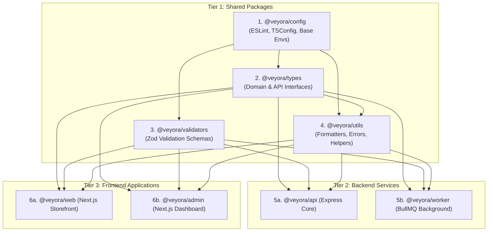

# Architecture Document: Monorepo Dependency Order & CI/CD Stabilization

**Project**: Veyora Atelier — Haute Couture Clothing E-commerce Platform  
**Scope**: CI/CD Pipelines (`.github/workflows/ci.yml`, `.github/workflows/cd.yml`), Turborepo & npm workspaces  
**Branch**: `fix/ci-monorepo-dependency-order`  
**Status**: Fixed and Verified  
**Date**: November 2026

---

## 1. Executive Summary & Problem Diagnosis

Following commit `ffdae1e`, the GitHub Actions CI/CD workflows failed on GitHub runners while local commits appeared to succeed:

1. **CI Job: TypeScript Strict Typecheck**: Failed with TS2307:
   ```
   packages/utils/src/errors.ts(1,32): error TS2307: Cannot find module '@veyora/types' or its corresponding type declarations.
   packages/utils/src/profile-completion.ts(1,61): error TS2307: Cannot find module '@veyora/types' or its corresponding type declarations.
   ```
2. **CI Job: Unit & Integration Tests**: Failed with module entry resolution errors:
   ```
   Error: Failed to resolve entry for package "@veyora/config". The package may have incorrect main/module/exports specified in its package.json.
   Error: Failed to resolve entry for package "@veyora/utils". The package may have incorrect main/module/exports specified in its package.json.
   ```
3. **CD Job: Pre-Deployment Quality Gates**: Failed at `npm run typecheck` and `npm run test` before reaching AWS deployment.

---

## 2. Root Cause Analysis

### 2.1. TypeScript Compilation Order & Ephemeral Runner State

- Shared packages (`@veyora/config`, `@veyora/types`, `@veyora/validators`, `@veyora/utils`) build via `tsup` into their respective `dist/` directories.
- In `packages/types/package.json` and other shared packages, package exports point to compiled artifacts:
  ```json
  "main": "./dist/index.js",
  "module": "./dist/index.mjs",
  "types": "./dist/index.d.ts",
  "exports": {
    ".": {
      "types": "./dist/index.d.ts",
      "import": "./dist/index.mjs",
      "require": "./dist/index.js",
      "default": "./dist/index.js"
    }
  }
  ```
- Because `dist/` folders are gitignored, fresh GitHub Actions runner checkouts do not contain them.
- In `.github/workflows/ci.yml`, the `typecheck` job previously ran:
  ```yaml
  - run: npm ci
  - run: npm run typecheck
  ```
- Without executing `npm run build:packages` first, TypeScript attempted to resolve `@veyora/types` for `@veyora/utils`, found no `./dist/index.d.ts`, and threw `error TS2307`.

### 2.2. Unit & Integration Test Entry Resolution

- Vitest resolves workspace packages using the `exports` and `main` fields defined in their `package.json`.
- Because the `test-suite` CI job ran `npm run test` immediately after `npm ci` without compiling package outputs, Vitest could not resolve the unbuilt entry files (`dist/index.js` / `dist/index.mjs`), leading to failure across test files in `@veyora/admin` and `@veyora/api`.

---

## 3. Package Dependency Graph & Topological Build Order

The internal package and application dependency graph requires strict topological ordering:



### Deterministic Build Order

1. `@veyora/config`: Foundation with zero internal dependencies.
2. `@veyora/types`: Depends on `@veyora/config`; supplies core TypeScript types.
3. `@veyora/validators`: Depends on `@veyora/config`; supplies Zod schemas.
4. `@veyora/utils`: Depends on `@veyora/config` and `@veyora/types`; imports `ApiErrorDetail` and `ProfileCompletionDto`.
5. `@veyora/api` & `@veyora/worker`: Consume all shared packages.
6. `@veyora/web` & `@veyora/admin`: Consume all shared packages.

---

## 4. Turborepo & CI/CD Pipeline Architecture

### 4.1. Turborepo Configuration (`turbo.json`)

The Turborepo pipeline defines the topological dependencies:

- `"build"`: `"dependsOn": ["^build"]` — builds upstream dependencies first.
- `"typecheck"`: `"dependsOn": ["^build"]` — compiles required package declarations before running typecheck.
- `"test"`: `"dependsOn": ["^build"]` — ensures built packages exist before test runners initialize.

### 4.2. GitHub Actions Workflow Execution Sequence

To ensure reliable, deterministic execution on clean runners:

1. **`quality-gate`** (Runs independently):
   - `npm ci`
   - `npm run lint:check`
   - `npm run format:check`

2. **`typecheck`** (Hardened):
   - `npm ci`
   - `npm run build:packages` (builds config $\rightarrow$ types $\rightarrow$ validators $\rightarrow$ utils)
   - `npm run typecheck` (`tsc --noEmit` across all 8 projects)

3. **`test-suite`** (Hardened):
   - `npm ci`
   - `npm run build:packages`
   - `npm run test` (Vitest across all workspaces)

4. **`build`** (Downstream production build):
   - Runs `npm run build`, which internally runs `npm run build:packages` followed by applications.

5. **`docker-build`**:
   - Each Dockerfile utilizes multi-stage builds and explicitly runs `npm run build:packages` in the builder stage.
   - Guarded with `mkdir -p apps/web/public` and `mkdir -p apps/admin/public` along with `.gitkeep` placeholders to prevent missing-path errors during multi-stage artifact copies.

6. **`e2e` (Playwright E2E Tests)**:
   - Configured `webServer` block in `playwright.config.ts` targeting both Web (`localhost:3000`) and Admin (`localhost:3001`).

7. **`cd.yml` (`validate-and-gate`)**:
   - Explicitly runs `npm run build:packages` prior to `npm run typecheck` and `npm run test`.
