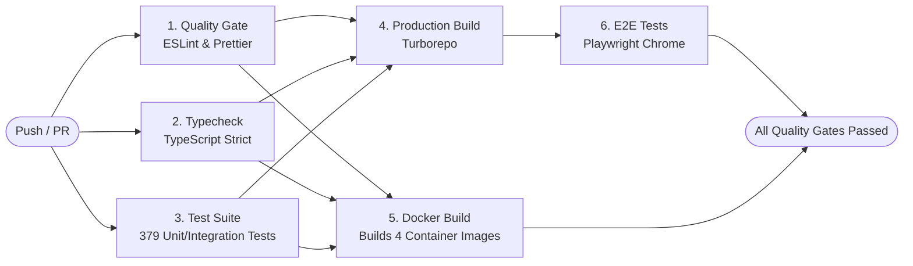

# CI/CD Pipeline & GitHub Actions Guide

## 1. Continuous Integration (CI) Workflow

File: [.github/workflows/ci.yml](file:///C:/Users/Sanjay/Desktop/veyora/.github/workflows/ci.yml)

The CI workflow triggers on every push and pull request to `main`, `develop`, and `feat/**` branches.

### Pipeline Jobs:

1. **`quality-gate`**: Validates ESLint rules across all workspaces and checks 100% Prettier formatting compliance.
2. **`typecheck`**: Runs strict TypeScript compilation checks (`tsc --noEmit`) across all 8 packages and applications.
3. **`test-suite`**: Executes all 379 Vitest unit and integration tests with zero failures.
4. **`build`**: Compiles shared packages (`@veyora/config`, `@veyora/types`, `@veyora/validators`, `@veyora/utils`) and builds the Next.js and API applications.
5. **`docker-build`**: Builds all 4 production Docker images concurrently with Docker Buildx and GitHub Actions layer caching.
6. **`e2e`**: Runs Playwright end-to-end tests in headless Chromium and uploads test reports as artifacts.

---

## 2. Continuous Delivery (CD) Workflow

File: [.github/workflows/cd.yml](file:///C:/Users/Sanjay/Desktop/veyora/.github/workflows/cd.yml)

The CD workflow automates container publishing to Amazon ECR and zero-downtime rolling deployments to Amazon ECS Fargate.

### Authentication via GitHub OpenID Connect (OIDC):

- **Zero static AWS keys**: No `AWS_ACCESS_KEY_ID` or `AWS_SECRET_ACCESS_KEY` stored in GitHub repository secrets.
- GitHub assumes the IAM role `arn:aws:iam::<ACCOUNT_ID>:role/veyora-production-github-deployer-role` using short-lived tokens via AWS STS.

### CD Steps:

1. **Pre-Deployment Gate**: Executes linting, typecheck, formatting, and unit tests before touching cloud resources.
2. **AWS ECR Login**: Authenticates Docker with Amazon ECR.
3. **Build & Tag Images**: Tags each container with the exact Git commit SHA (`veyora-api:<commit-sha>`) and updates `latest`.
4. **Push Images**: Uploads images to private ECR repositories with layer caching.
5. **Render Task Definitions**: Updates ECS task definitions with the new image URIs.
6. **Deploy to ECS**: Performs rolling deployment with circuit breakers:
   - `minimumHealthyPercent: 100` (maintains full capacity during deployment).
   - `maximumPercent: 200` (spins up new containers alongside existing ones).
   - Circuit breaker monitors health checks; if new containers fail, ECS automatically rolls back to the previous healthy task definition.
7. **CloudFront Invalidation**: Invalidates CloudFront edge caches for instant frontend asset refreshes.

---

## 3. Required GitHub Secrets & Variables

### Repository Secrets:

| Secret Name               | Description                                                                                                 |
| ------------------------- | ----------------------------------------------------------------------------------------------------------- |
| `AWS_DEPLOYMENT_ROLE_ARN` | The ARN of the IAM OIDC Role (e.g. `arn:aws:iam::123456789012:role/veyora-production-github-deployer-role`) |

### Repository Variables:

| Variable Name                | Description                                       | Default     |
| ---------------------------- | ------------------------------------------------- | ----------- |
| `AWS_REGION`                 | Target AWS deployment region                      | `us-east-1` |
| `CLOUDFRONT_DISTRIBUTION_ID` | CloudFront distribution ID for cache invalidation | Optional    |
