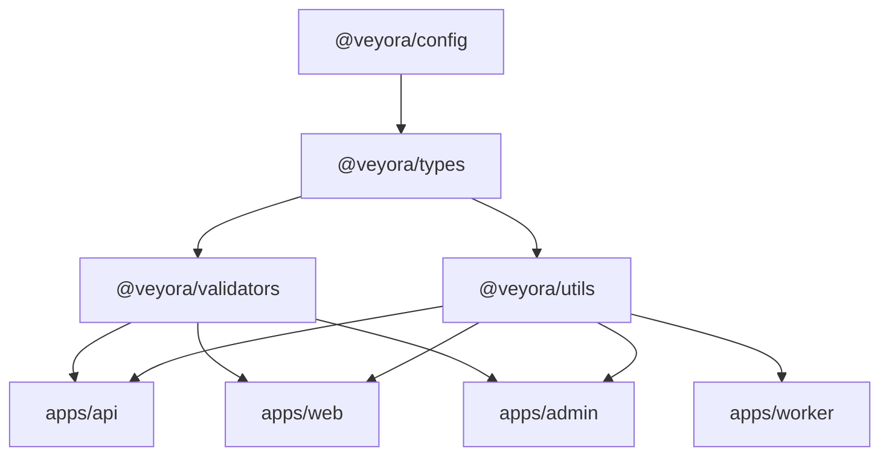

# Task 02 Migration Record: Shared API Contracts & Error Utilities

**Status:** Completed and Verified  
**Branch:** `feature/backend-driven-notifications`  
**Workspaces:** `packages/types`, `packages/utils`  
**Dependencies:** [backend-driven-messaging-audit.md](file:///c:/Users/Sanjay/Desktop/veyora/docs/architecture/backend-driven-messaging-audit.md)  
**Date:** November 2026

---

## 1. Summary of Changes

In Task 02, the foundational, framework-independent API response and error-handling contracts were implemented in `@veyora/types` and `@veyora/utils`. These contracts establish a strongly typed, deterministic communication standard across `apps/api`, `apps/web`, `apps/admin`, and `apps/worker`.

### 1.1 Strict Boundary Guarantee

- No React components, browser APIs, or UI libraries (e.g. Sonner, `navigator.clipboard`, `toast`) were introduced into shared packages.
- No Node-only modules or server-specific dependencies were imported into universal code.
- Pure TypeScript contracts live in `packages/types`; pure runtime normalization utilities live in `packages/utils`.

---

## 2. Files Changed and Created

| Workspace        | File                              | Change Type | Description                                                                                                                                                                                                                                     |
| :--------------- | :-------------------------------- | :---------: | :---------------------------------------------------------------------------------------------------------------------------------------------------------------------------------------------------------------------------------------------- |
| `packages/types` | `src/codes.ts`                    | **Created** | Defined central catalog of stable machine-readable codes (`ApiAuthCode`, `ApiCoreCode`, `ApiCommerceCode`, `ApiPaymentCode`, `ApiResponseCode`).                                                                                                |
| `packages/types` | `src/api.ts`                      | **Updated** | Implemented `ApiPaginationMeta`, `ApiMeta`, `ApiSuccessResponse<T>`, `ApiErrorDetail`, `ApiErrorResponse`, `ApiPaginatedResponse<T>`, and unified `ApiResponse<T>`. Preserved legacy interfaces `ApiResponseSuccess<T>` and `ApiResponseError`. |
| `packages/types` | `src/index.ts`                    | **Updated** | Exported `./codes` alongside existing modules.                                                                                                                                                                                                  |
| `packages/utils` | `src/api-error.ts`                | **Created** | Implemented `normalizeApiError`, `isApiSuccessResponse`, `isApiErrorResponse`, `isLegacyApiResponseError`, `isSafeUserFacingMessage`, `extractErrorCode`, `extractErrorMessage`, `extractErrorDetails`, and `extractRequestId`.                 |
| `packages/utils` | `src/index.ts`                    | **Updated** | Re-exported all utilities and types from `./api-error`.                                                                                                                                                                                         |
| `packages/utils` | `src/__tests__/api-error.test.ts` | **Created** | 29 unit tests covering canonical contracts, legacy envelopes, network failures, timeouts, request ID extraction, credential suppression, and safe error masking.                                                                                |

---

## 3. New Exports

### 3.1 From `@veyora/types`

```typescript
// Metadata and Envelopes
export interface ApiPaginationMeta;
export interface ApiMeta;
export interface ApiSuccessResponse<T = unknown>;
export interface ApiErrorDetail;
export interface ApiErrorResponse;
export interface ApiPaginatedResponse<T = unknown>;
export type ApiResponse<T = unknown>;

// Centralized Response and Error Codes
export const ApiAuthCode: Record<string, string>;
export const ApiCoreCode: Record<string, string>;
export const ApiCommerceCode: Record<string, string>;
export const ApiPaymentCode: Record<string, string>;
export const ApiResponseCode: Record<string, string>;

export type ApiAuthCode;
export type ApiCoreCode;
export type ApiCommerceCode;
export type ApiPaymentCode;
export type ApiResponseCode;
```

### 3.2 From `@veyora/utils`

```typescript
export interface NormalizedApiError {
  code: string;
  message: string;
  details: ApiErrorDetail[];
  requestId?: string;
  statusCode?: number;
}

export function isSafeUserFacingMessage(message: unknown): message is string;
export function isApiSuccessResponse<T = unknown>(value: unknown): value is ApiSuccessResponse<T>;
export function isApiErrorResponse(value: unknown): value is ApiErrorResponse;
export function isLegacyApiResponseError(value: unknown): value is ApiResponseError;
export function extractRequestId(error: unknown): string | undefined;
export function extractErrorDetails(error: unknown): ApiErrorDetail[];
export function extractErrorCode(error: unknown, defaultCode?: string): string;
export function extractErrorMessage(error: unknown, fallbackMessage?: string): string;
export function normalizeApiError(error: unknown, fallbackMessage?: string): NormalizedApiError;
```

---

## 4. Package Build Order & CI Dependency Resolution

### 4.1 Dependency Graph



### 4.2 Build Sequence

In root `package.json`, `"build:packages"` executes strictly in topological order:

```bash
npm run build --workspace=@veyora/config && \
npm run build --workspace=@veyora/types && \
npm run build --workspace=@veyora/validators && \
npm run build --workspace=@veyora/utils
```

Similarly, `turbo.json` configures `"dependsOn": ["^build"]` for `typecheck`, `lint`, and `test` tasks. This guarantees that `@veyora/types` outputs `dist/index.d.ts` and `dist/index.mjs` before `@veyora/utils` or downstream applications compile, preventing any `Cannot find module '@veyora/types'` regressions.

---

## 5. Compatibility Decisions

1. **Dual Envelope Compatibility:**
   - Existing code importing `ApiResponseSuccess<T>` and `ApiResponseError` continues to work with 100% type compatibility.
   - Legacy fields (`error: { code, message, details }`, `errors: Record<string, string[]>`) are preserved on `ApiResponseError`.
   - The universal `ApiResponse<T>` union includes both modern and legacy shapes.
2. **Duck-Typed `ApiClientError` Support:**
   - `normalizeApiError` recognizes errors with `statusCode`, `code`, and `details` without directly coupling to `apps/web` or `apps/admin` class instances.
3. **Internal Error Suppression:**
   - Raw database driver exceptions (e.g. MongoDB `E11000 duplicate key`, `CastError`, `connect ECONNREFUSED`) and file paths are masked to safe fallback messages.
   - Credential strings matching bearer tokens, leaked passwords, and OTP values are suppressed to avoid security vulnerabilities.

---

## 6. Verification and Test Results

### 6.1 Unit Tests

- `@veyora/utils`:
  - `src/__tests__/api-error.test.ts`: 29 passed (20ms)
  - `src/__tests__/utils.test.ts`: 28 passed (21ms)
  - Total: **57 tests passed** across 2 test files.
- `@veyora/validators`:
  - `src/__tests__/schemas.test.ts`: **48 tests passed** (26ms).

### 6.2 Monorepo Typecheck

Executed `npm run typecheck` across all 8 projects in strict mode:

```bash
tsc --noEmit -p packages/config && \
tsc --noEmit -p packages/types && \
tsc --noEmit -p packages/validators && \
tsc --noEmit -p packages/utils && \
tsc --noEmit -p apps/api && \
tsc --noEmit -p apps/worker && \
tsc --noEmit -p apps/web && \
tsc --noEmit -p apps/admin
```

**Result:** Code exited with code 0 (zero errors).

---

## 7. Remaining Migration Work (Future Tasks)

1. **Task 03:** Implement Express `sendSuccess` helper and update `errorHandler` & `rateLimiter` in `apps/api`.
2. **Task 04:** Migrate Auth module in `apps/api` to return canonical success and error codes.
3. **Task 05:** Migrate Commerce controllers (Cart, Checkout, Coupons, Wishlist, Payments).
4. **Task 06:** Migrate Catalog, Inventory, and Admin management controllers.
5. **Task 07:** Implement frontend `notify` UI adapter over Sonner in `apps/web` and `apps/admin`.
6. **Task 08:** Migrate storefront (`apps/web`) and admin (`apps/admin`) hooks and forms to consume backend-driven messages.
