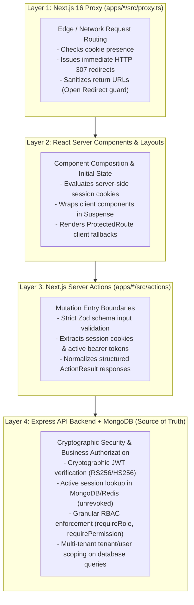

# 15 — Veyora Proxy Security Boundaries & Defense-in-Depth

## Overview & The 4-Layer Defense-in-Depth Model

A fundamental security principle of the Veyora platform is **Defense-in-Depth**. Security is never entrusted to a single perimeter check.

The addition of Next.js 16 **`proxy.ts`** completes a comprehensive 4-layer security model where each layer operates with distinct, uncompromised responsibilities:

---

## Verification of 10 Critical Security Scenarios

### Scenario 1: Unauthenticated Visitor Accessing Account Data

- **Layer 1 (Proxy)**: Intercepts request to `/account/profile` or `/orders` due to absent `refreshToken` cookie. Issues immediate HTTP 307 redirect to `/login?redirect=...`. Protected page tree never executes.
- **Layer 2 (Server Component)**: If Proxy were bypassed, `serverFetch` verifies session cookie. If missing, throws `ServerApiClientError("UNAUTHORIZED", 401)`.
- **Layer 4 (Express API)**: If an API endpoint is hit directly, `requireAuth` throws HTTP 401.

### Scenario 2: Customer Attempting to Access Another Customer's Orders

- **Layer 3 (Server Action)**: Server Action does not accept user IDs from client payloads. Identity is derived strictly from the verified session.
- **Layer 4 (Express API)**: The Express controller filters orders with `where: { userId: req.user.id, orderId }`. Even if a user knows an order ID belonging to another patron, the query returns 404/403.

### Scenario 3: Admin Operator Performing Operations Without Required RBAC

- **Layer 1 (Proxy)**: Proxy does **not** evaluate roles or permissions.
- **Layer 4 (Express API)**: The Express router enforces `requirePermission("products:write")`. If a `SUPPORT_AGENT` attempts to call `createProductAction`, Express rejects the operation with HTTP 403 Forbidden.

### Scenario 4: Manipulated Role Value in Client Cookies

- **Layer 1 (Proxy)**: Role cookies are completely ignored by Proxy.
- **Layer 4 (Express API)**: Operator role and permission sets are derived strictly from the verified, tamper-evident cryptographic JWT signature generated by `tokenService`. Client-modified cookies have zero authority.

### Scenario 5: Forged or Expired JWT Token

- **Layer 4 (Express API)**: `tokenService.verifyAccessToken(token)` validates cryptographic signature against `JWT_SECRET`. If expired or signature mismatch occurs, Express rejects the request with HTTP 401.
- Furthermore, Express checks `Session.findById(payload.sessionId)` to verify the session has not been revoked.

### Scenario 6: Open Redirect Attacks via `redirect` Query Parameter

- **Layer 1 (Proxy)**: `getSafeRedirectUrl` strictly enforces relative local paths. Payloads such as `https://evil.com`, `//attacker.com`, `/\evil.com`, and `%5Cattacker.com` are neutralized to safe default fallbacks (`/account` or `/`).

### Scenario 7: Logout State & Stale Sessions

- When an operator or patron logs out, `authApi.logout()` is called:
  1. Express revokes the session record in MongoDB.
  2. Express clears the HTTP-only `refreshToken` cookie (`clearCookie`).
  3. Client Zustand store clears the in-memory access token.
  4. Subsequent requests to protected routes lack cookies and are immediately redirected by Proxy to `/login`.

### Scenario 8: Prevention of Redirect Loops

- Strict path exclusivity is maintained:
  - Auth routes (`/login`, `/register`, etc.) only redirect when cookies **are present**.
  - Protected routes (`/account`, `/orders`, etc.) only redirect when cookies **are absent**.
  - Public routes (`/`, `/shop`, `/products/*`, `/cart`) never redirect.
- Because the auth target and protected target have disjoint conditions, infinite redirect loops are mathematically impossible.

### Scenario 9: Server Actions Maintain Independent Security

- Server Actions do not rely on Proxy having executed. Every Server Action independently validates input shape via Zod, verifies active authentication, and forwards credentials to the backend.

### Scenario 10: Absolute Preservation of Express API Authority

- The Express API and MongoDB remain the sole authority for data persistence, inventory calculations, payment validation, and transactional integrity.
