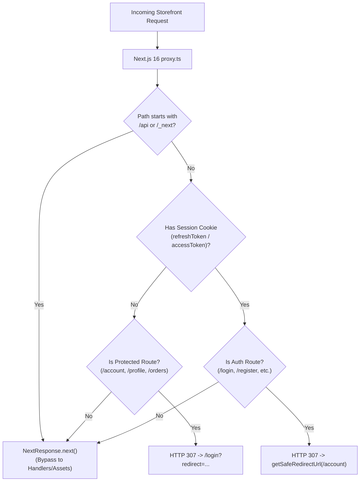

# 15 — Veyora Web Proxy & Authentication Routing Architecture

## Overview & Next.js 16 `proxy.ts` Convention

With Next.js 16.4.6, the framework officially supersedes the legacy `middleware.ts` file convention in favor of **`proxy.ts`** located at the convention level ([apps/web/src/proxy.ts](file:///c:/Users/Sanjay/Desktop/veyora/apps/web/src/proxy.ts)).

The Storefront Proxy serves as an **early request routing and navigation layer** executing at the server/edge boundary before React Server Components or page layouts mount. Its core objectives are:

1. **Eliminate Client-Side Redirect Flash**: Intercept unauthenticated access to protected account trees and redirect via HTTP 307 before transmitting HTML payloads or executing component trees.
2. **Prevent Stale Auth Re-entry**: Redirect already-authenticated patrons away from `/login`, `/register`, and recovery flows directly to `/account` or their target destination.
3. **Preserve Open Storefront Access**: Guarantee unhindered guest access to the catalog, curated collections, product specifications, shopping cart (`/cart`), and guest checkout (`/checkout`).
4. **Prevent Open Redirect Vulnerabilities**: Strict sanitization of all `redirect` query parameters to prevent phishing or credential extraction.



---

## Route Category Inventory & Matcher Design

### 1. Route Categories

| Category              | Routes / Prefixes                                                                  | Unauthenticated Visitor                   | Authenticated Patron                         |
| :-------------------- | :--------------------------------------------------------------------------------- | :---------------------------------------- | :------------------------------------------- |
| **Public Storefront** | `/`, `/shop`, `/products/*`, `/category/*`, `/collections/*`, `/cart`, `/checkout` | Allowed (`200 OK`)                        | Allowed (`200 OK`)                           |
| **Protected Account** | `/account`, `/account/*`, `/profile`, `/orders`, `/orders/*`                       | **Redirect 307** -> `/login?redirect=...` | Allowed (`200 OK`)                           |
| **Auth Entry**        | `/login`, `/register`, `/verify-otp`, `/forgot-password`, `/reset-password`        | Allowed (`200 OK`)                        | **Redirect 307** -> `/account` or return URL |
| **API & Internals**   | `/api/*`, `/_next/*`, static assets                                                | Allowed (Bypassed by Proxy)               | Allowed (Bypassed by Proxy)                  |

### 2. Matcher Optimization

To maximize server throughput and prevent execution on static files, the matcher explicitly bypasses static asset pipelines in [apps/web/src/proxy.ts](file:///c:/Users/Sanjay/Desktop/veyora/apps/web/src/proxy.ts):

```typescript
export const config = {
  matcher: [
    /*
     * Match all request paths except:
     * - _next/static (static chunks, css, media)
     * - _next/image (image optimization metadata)
     * - favicon.ico, robots.txt, sitemap.xml
     * - Static asset file extensions (.svg, .png, .jpg, .webp, .avif, etc.)
     */
    "/((?!_next/static|_next/image|favicon.ico|robots.txt|sitemap.xml|.*\\.(?:svg|png|jpg|jpeg|gif|webp|avif|ico|css|js)).*)",
  ],
};
```

---

## Open Redirect Protection (`getSafeRedirectUrl`)

A critical security vulnerability in authentication navigation is the **Open Redirect**, where malicious actors construct phishing URLs such as `https://veyora.store/login?redirect=https://evil.com`.

Veyora enforces strict sanitization in `getSafeRedirectUrl`:

1. **Leading Slash Requirement**: Destination must start with a single `/`.
2. **Protocol Exclusion**: Paths containing `://` are rejected.
3. **Protocol-Relative Evasion Prevention**: Paths starting with `//` or `/\\` are rejected.
4. **URL-Encoded Evasion Prevention**: Decodes percent-encoded characters (e.g. `%2F%2F`, `%5C`) to ensure evasion payloads cannot bypass validation.

```typescript
export function getSafeRedirectUrl(
  target: string | null | undefined,
  fallback = "/account"
): string {
  if (!target || typeof target !== "string") return fallback;
  const trimmed = target.trim();

  if (
    !trimmed.startsWith("/") ||
    trimmed.startsWith("//") ||
    trimmed.startsWith("/\\") ||
    trimmed.includes("://") ||
    trimmed.includes("\r") ||
    trimmed.includes("\n") ||
    trimmed.includes("\0")
  ) {
    return fallback;
  }

  try {
    const decoded = decodeURIComponent(trimmed);
    if (decoded.startsWith("//") || decoded.startsWith("/\\") || decoded.includes("://")) {
      return fallback;
    }
  } catch {
    return fallback;
  }

  return trimmed;
}
```

---

## Token and Cookie Handling

1. **Lightweight Routing Hint**: Proxy checks for the presence of the `refreshToken` or `accessToken` cookie. It does **not** decode JWT claims or make blocking network calls on every request.
2. **No Second Token Lifecycle**: Proxy never attempts to refresh tokens or invoke `/auth/refresh`. Refresh logic remains centralized in the client `apiClient` handler.
3. **Defense-in-Depth**: If an attacker forges an empty or malformed cookie to bypass Proxy, the downstream Server Component or Server Action invokes `serverFetch` which fails authentication against the Express API (`401 Unauthorized`).
