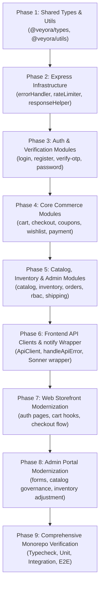

# Veyora Monorepo: Backend-Driven Messaging Migration Plan

**Document Version:** 1.0.0  
**Status:** Approved Migration Plan / Ready for Execution  
**Branch:** `feature/backend-driven-notifications`  
**Dependencies:** [backend-driven-messaging-audit.md](file:///c:/Users/Sanjay/Desktop/veyora/docs/architecture/backend-driven-messaging-audit.md)  
**Target Workspaces:** `packages/types`, `packages/utils`, `packages/validators`, `apps/api`, `apps/web`, `apps/admin`  
**Author:** Veyora Engineering Core Team  
**Date:** November 2026

---

## 1. Migration Strategy Overview

The migration to a centralized, backend-driven messaging architecture represents a fundamental improvement across the entire Veyora monorepo. To eliminate risk and prevent regressions in working customer checkout, payment flows, and administrative management, this migration follows a **zero-downtime, strictly phased rollout**.

### 1.1 Core Principles

1. **Zero Breaking Changes During Rollout:** Existing frontend components expecting legacy response structures must continue operating without failure during the migration.
2. **Bottom-Up Package Propagation:** Shared types and utility helpers must be stabilized and tested before modifying Express controllers or frontend hooks.
3. **Module-by-Module Isolation:** Endpoints are transitioned module by module (Auth -> Commerce -> Catalog -> Admin), each backed by unit and integration tests.
4. **Verifiable Quality Gates:** Each phase requires clean compilation (`pnpm build`), typecheck (`pnpm typecheck`), unit tests (`pnpm test:unit`), and end-to-end verification (`pnpm test:e2e`).

---

## 2. Phased Rollout Plan

---

### Phase 1: Shared Type Definitions & Utility Functions

**Workspaces:** `packages/types`, `packages/utils`, `packages/validators`  
**Goal:** Define and export canonical response types, error classes, and error normalizer helpers without altering runtime behavior.

#### Actions:

1. Update `packages/types/src/api.ts`:
   - Add `ApiPaginationMeta` and `ApiMeta`.
   - Update `ApiSuccessResponse<T>` to include `code: string`, `message: string`, `meta: ApiMeta`.
   - Update `ApiErrorResponse` ensuring `code`, `message`, `error: { code, message, details }`, `errors`, and `meta: { requestId, timestamp }` are defined.
   - Define canonical `ApiResponseCode` string literal union / enum covering all standard response codes.
2. Update `packages/utils/src/errors.ts`:
   - Ensure all `AppError` subclasses pass canonical codes (`NOT_FOUND`, `BAD_REQUEST`, `UNAUTHORIZED`, `FORBIDDEN`, `CONFLICT`, `VALIDATION_ERROR`, `INTERNAL_SERVER_ERROR`).
   - Add `isApiClientError` type guard and `handleApiError` normalizer utility.
3. Build packages and verify workspace type exports:
   - Run `pnpm --filter @veyora/types build && pnpm --filter @veyora/utils build`.

---

### Phase 2: Express Core Infrastructure & Helpers

**Workspace:** `apps/api`  
**Goal:** Equip Express with standard response helpers and harmonize error handlers.

#### Actions:

1. Create response helper utility (`apps/api/src/utils/response.ts`):
   - Export `sendSuccess<T>(res: Response, data: T, message: string, code: string, meta?: Partial<ApiMeta>, statusCode = 200)`:
     - Automatically injects `req.id` into `meta.requestId`.
     - Automatically attaches ISO timestamp.
     - Ensures standard `{ success: true, code, message, data, meta }` structure.
2. Refactor `apps/api/src/middleware/error-handler.ts`:
   - Ensure every error response includes root `code`, root `message`, nested `error: { code, message, details }`, `errors: Record<string, string[]>`, and `meta: { requestId: req.id, timestamp }`.
   - Ensure Pino logs the error with `requestId: req.id`, `path`, `method`, `statusCode`, and `code`.
3. Harmonize `apps/api/src/middleware/rate-limiter.ts`:
   - Update rate limit handler to return standard `ApiErrorResponse` with `code: "RATE_LIMIT_EXCEEDED"`, root `message`, and `meta.requestId`.
4. Validate with existing test suite:
   - Run `pnpm --filter @veyora/api test`.

---

### Phase 3: Express Auth Module & Verification

**Workspace:** `apps/api`  
**Goal:** Standardize authentication responses and eliminate nested message inconsistencies.

#### Actions:

1. Migrate `auth.controller.ts`:
   - `login`: Return `sendSuccess(res, { user, tokens }, "Signed in successfully.", "AUTH_LOGIN_SUCCESS")`.
   - `adminLogin`: Return `sendSuccess(res, { user, tokens }, "Admin access authenticated.", "AUTH_LOGIN_SUCCESS")`.
   - `register`: Eliminate nested `data.message`; return `sendSuccess(res, { user }, "Account created. Please verify your email.", "AUTH_REGISTER_SUCCESS", undefined, 201)`.
   - `verifyEmail`: Return `sendSuccess(res, { verified: true }, "Email verified successfully.", "EMAIL_VERIFIED")`.
   - `resendOtp`: Return `sendSuccess(res, { sent: true }, "Verification code sent to your email.", "OTP_RESENT")`.
   - `forgotPassword`: Return `sendSuccess(res, { email }, "Password reset instructions sent.", "AUTH_RESET_CODE_SENT")`.
   - `resetPassword`: Return `sendSuccess(res, { success: true }, "Password has been successfully updated.", "AUTH_PASSWORD_RESET")`.
   - `logout`: Return `sendSuccess(res, null, "Signed out successfully.", "AUTH_LOGOUT_SUCCESS")`.
2. Ensure Auth error handling throws standard `AppError` with explicit codes:
   - `EMAIL_NOT_VERIFIED` (HTTP 403)
   - `INVALID_CREDENTIALS` (HTTP 401)
   - `OTP_INVALID` / `OTP_EXPIRED` (HTTP 422)

---

### Phase 4: Express Core Commerce Modules

**Workspace:** `apps/api`  
**Goal:** Standardize Cart, Checkout, Coupon, Wishlist, and Payment controllers.

#### Actions:

1. `cart.controller.ts`:
   - `getCart`: `sendSuccess(res, cart, "Shopping bag loaded.", "CART_LOADED")`
   - `addItem`: `sendSuccess(res, cart, "Garment added to your bag.", "CART_ITEM_ADDED")`
   - `updateItem`: `sendSuccess(res, cart, "Shopping bag updated.", "CART_ITEM_UPDATED")`
   - `removeItem`: `sendSuccess(res, cart, "Garment removed from your bag.", "CART_ITEM_REMOVED")`
   - `clearCart`: `sendSuccess(res, emptyCart, "Shopping bag cleared.", "CART_CLEARED")`
2. `coupon.controller.ts`:
   - `applyCoupon`: `sendSuccess(res, cart, "Privilege coupon applied successfully.", "COUPON_APPLIED")`
   - `removeCoupon`: `sendSuccess(res, cart, "Coupon removed from order.", "COUPON_REMOVED")`
3. `checkout.controller.ts` & `payment.controller.ts`:
   - `createOrder`: `sendSuccess(res, order, "Order placed successfully.", "ORDER_PLACED", undefined, 201)`
   - `verifyPayment`: `sendSuccess(res, order, "Payment confirmed and verified.", "PAYMENT_VERIFIED")`
4. `wishlist.controller.ts`:
   - `addToWishlist`: `sendSuccess(res, wishlist, "Saved to Personal Collection.", "WISHLIST_ITEM_ADDED")`
   - `removeFromWishlist`: `sendSuccess(res, wishlist, "Removed from wishlist.", "WISHLIST_ITEM_REMOVED")`

---

### Phase 5: Express Catalog, Inventory, Shipping & Admin Governance

**Workspace:** `apps/api`  
**Goal:** Modernize catalog queries, inventory adjustments, and back-office management.

#### Actions:

1. `catalog.controller.ts` & `inventory.controller.ts`:
   - Standardize pagination under `meta.pagination`.
   - `getProducts`: `sendSuccess(res, products, "Catalog products retrieved.", "PRODUCTS_FETCHED", { pagination })`
   - `adjustStock`: `sendSuccess(res, inventory, "Inventory levels successfully adjusted.", "INVENTORY_ADJUSTED")`
2. `orders.controller.ts`:
   - `updateOrderStatus`: `sendSuccess(res, order, \`Order status updated to ${status}.\`, "ORDER_STATUS_UPDATED")`
   - `cancelOrder`: `sendSuccess(res, order, "Order cancelled successfully.", "ORDER_CANCELLED")`
3. `rbac.controller.ts` & `customer.controller.ts`:
   - Standardize role assignment, customer status updates, and address management.

---

### Phase 6: Frontend API Clients & Unified Notification Wrapper

**Workspaces:** `apps/web`, `apps/admin`  
**Goal:** Enhance frontend API clients to preserve response metadata and introduce the unified `notify` utility.

#### Actions:

1. Enhance `apps/web/src/lib/api/api-client.ts` and `apps/admin/src/lib/api/api-client.ts`:
   - Maintain backwards-compatible default `apiClient.request<T>()` unwrapping `data`.
   - Add `apiClient.mutate<T>()` or `apiClient.envelope<T>()` returning `{ data: T, message: string, code: string, meta: ApiMeta }`.
   - Enhance `ApiClientError` to capture `code`, `details`, and `requestId: errorData?.meta?.requestId`.
2. Implement `notify` wrapper in `apps/web/src/lib/notify.ts` and `apps/admin/src/lib/notify.ts`:
   - Wrap Sonner with `notify.success`, `notify.error`, `notify.warning`, `notify.info`.
   - Integrate `handleApiError` to automatically extract backend `message`, `code`, and attach `"Copy Request ID"`.

---

### Phase 7: Web Storefront Hook & Page Modernization

**Workspace:** `apps/web`  
**Goal:** Replace hardcoded strings and string-based branching with backend messages and stable codes.

#### Actions:

1. `apps/web/src/app/login/page.tsx`:
   - Replace `err.message.toLowerCase().includes("verify your email")` with `err.code === "EMAIL_NOT_VERIFIED"`.
   - Use `notify.error(err)` and `notify.success(res.message)`.
2. `apps/web/src/lib/hooks/use-cart.ts`:
   - In mutations (`addItem`, `removeItem`, `updateQuantity`, `applyCoupon`):
     - Pass backend `res.message` to `notify.success(res.message)`.
     - Pass caught error to `notify.error(err)`.
3. `apps/web/src/lib/hooks/use-wishlist.ts`, `use-orders.ts`, `use-addresses.ts`:
   - Eliminate hardcoded strings; forward backend response messages.
4. `apps/web/src/app/checkout/page.tsx`:
   - Clean up checkout submission error handling.

---

### Phase 8: Admin Portal Hook & Page Modernization

**Workspace:** `apps/admin`  
**Goal:** Elevate error visibility, remove silent failures, and standardize back-office notification copy.

#### Actions:

1. Catalog management (`products/new`, `products/[id]`, `categories`, `brands`):
   - Replace generic `"Failed to save"` toasts with `notify.error(err)` exposing backend validation and conflict details.
   - Use `notify.success(res.message)` on record creation and updates.
2. Inventory management:
   - Surface exact backend stock update descriptions.
3. Order fulfillment & shipment dispatch:
   - Surface state-machine error messages from Express when invalid transitions are attempted.
4. TanStack Query audits:
   - Ensure table read queries render inline error states rather than spamming toasts on background refetch.

---

### Phase 9: Comprehensive Monorepo Verification & Quality Gate

**Workspaces:** Monorepo Root  
**Goal:** Validate all tests pass, builds succeed, and no regressions exist.

#### Quality Gate Checklist:

- [ ] Strict TypeScript check: `pnpm typecheck`
- [ ] Linter validation: `pnpm lint`
- [ ] Unit & integration test suite: `pnpm test:unit`
- [ ] Playwright E2E verification: `pnpm test:e2e`
- [ ] Docker build validation: `docker compose build`

---

## 3. Backwards Compatibility Guarantees

To ensure continuous operation of storefront and administrative workflows during migration:

| Component                | Legacy Behavior                                                       | Modern Contract                                                                                      | Compatibility Guarantee                                                                                                                               |
| :----------------------- | :-------------------------------------------------------------------- | :--------------------------------------------------------------------------------------------------- | :---------------------------------------------------------------------------------------------------------------------------------------------------- |
| **API Error Response**   | `{ success: false, error: { code, message }, errors: { field: [] } }` | `{ success: false, code, message, error: { ... }, errors: { ... }, meta: { requestId, timestamp } }` | **100% Compatible:** Legacy properties `error` and `errors` are fully populated. Existing clients reading `error.message` continue working unchanged. |
| **API Success Response** | `{ success: true, data: T }`                                          | `{ success: true, code, message, data: T, meta }`                                                    | **100% Compatible:** Legacy clients inspecting `response.data` receive the exact expected payload.                                                    |
| **ApiClient Unwrapping** | Returns `data as T`                                                   | Returns `data as T` (with `mutate()` opt-in for envelopes)                                           | **100% Compatible:** Existing calls to `apiClient.get<T>()` and `apiClient.post<T>()` continue returning `T`.                                         |
| **Form Error Resolvers** | Reads `response.errors`                                               | Reads `response.errors` or `response.error.details`                                                  | **100% Compatible:** Both structures exist in the error payload.                                                                                      |

---

## 4. Risk Analysis & Mitigation Strategy

### Risk 1: Frontend Breaks on Missing Backend `message`

- **Likelihood:** Low
- **Impact:** Medium
- **Mitigation:** The `notify.success(messageOrResponse, options)` helper tests `typeof messageOrResponse === "string"` and falls back to `options.defaultMessage || "Operation completed successfully"` if `message` is null or undefined.

### Risk 2: Double Toasts on TanStack Query Mutations

- **Likelihood:** Medium
- **Impact:** Low (UI annoyance)
- **Mitigation:** Global `MutationCache` `onError` handler is configured to skip toast notifications if `mutation.meta?.suppressGlobalToast === true` or if the mutation has a local `onError` defined.

### Risk 3: Rate Limiter Error Signature Mismatch

- **Likelihood:** High (if skipped)
- **Impact:** High (users see raw blank errors)
- **Mitigation:** Standardize `apiRateLimiter` and `authRateLimiter` in Phase 2 using the centralized error response format before touching auth endpoints.

---

## 5. Rollback Strategy

If an unexpected defect occurs during any migration phase:

1. **Branch Isolation:** All changes reside on `feature/backend-driven-notifications`. Neither `develop` nor `main` is modified until full test suite signoff.
2. **Phase Reversibility:** Because backend changes are strictly additive (adding `code`, `message`, `meta` while preserving `data`), API updates can be deployed without requiring immediate frontend updates.
3. **Commit Granularity:** Every phase (Phases 1 through 8) is committed individually with clear semantic commit messages (e.g. `feat(api): standardize auth response envelope`). Any problematic commit can be reverted cleanly using `git revert` without impacting other modules.
