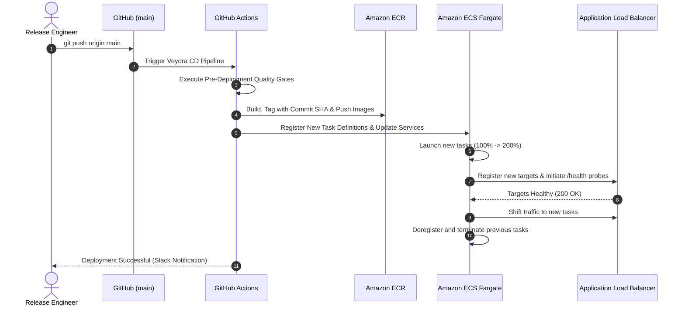

# Production Deployment Runbook

## 1. Deployment Windows & Schedules

- **Standard Releases**: Tuesday and Thursday, 09:00 - 12:00 UTC (during low-traffic European/Asian off-peak).
- **Prohibited Deployment Windows**:
  - Fridays after 14:00 UTC (No Friday Deploys).
  - High-traffic flash sales or holiday shopping events (Black Friday, Cyber Monday).
- **Emergency Hotfixes**: Permitted at any time with explicit approval from the Incident Commander.

---

## 2. Pre-Flight Deployment Checklist

Before deploying any change to production:

- [ ] All 381 automated tests pass cleanly (`npm run test`).
- [ ] TypeScript strict compilation passes across all 8 workspaces (`npm run typecheck`).
- [ ] ESLint passes with 0 errors and 0 warnings (`npm run lint:check`).
- [ ] Prettier formatting check passes 100% (`npm run format:check`).
- [ ] Docker builds validate for all 4 container targets (`api`, `worker`, `web`, `admin`).
- [ ] Any required database migrations or indexing changes are verified backward-compatible.
- [ ] New environment variables or secrets are populated in AWS Secrets Manager _before_ deploying code that depends on them.

---

## 3. Deployment Execution Steps



---

## 4. Post-Deployment Verification Smoke Tests

Within 10 minutes of deployment:

1. **API Health**:
   ```bash
   curl -s -o /dev/null -w "%{http_code}" https://api.veyora.com/health
   # Expected: 200
   ```
2. **Deep Readiness**:
   ```bash
   curl -s https://api.veyora.com/health/ready | jq .status
   # Expected: "ready"
   ```
3. **Prometheus Metrics**:
   ```bash
   curl -s https://api.veyora.com/metrics | grep "veyora_database_connected"
   # Expected: mongodb 1, redis 1
   ```
4. **Customer Storefront**:
   - Open `https://veyora.com`
   - Browse catalog, verify product images load via CloudFront CDN
   - Add item to cart, proceed to checkout
5. **Admin Operations**:
   - Open `https://admin.veyora.com`
   - Log in with administrative credentials
   - Verify Analytics Dashboard metrics render

---

## 5. Rollback Decision Triggers

Initiate immediate rollback if within 15 minutes of deployment:

- HTTP 5xx error rate on ALB exceeds 1% of total traffic.
- Checkout or payment initiation failure rate exceeds 2%.
- Memory or CPU utilization on ECS tasks saturates > 85% with no traffic increase.
- Unhandled crash loops observed in `/ecs/veyora-api` CloudWatch logs.
