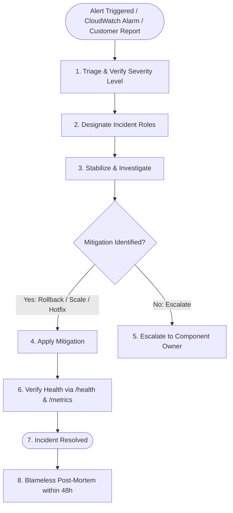

# Production Incident Response Guide

## 1. Incident Severity Classification

| Severity Level       | Definition                                                                                                         | Response SLA     | Update Cadence | Escalation Contact                    |
| -------------------- | ------------------------------------------------------------------------------------------------------------------ | ---------------- | -------------- | ------------------------------------- |
| **SEV-1 (Critical)** | Core platform outage: checkout down, database unreachable, customer unable to purchase.                            | **< 15 minutes** | Every 30 mins  | Engineering Lead, CTO, On-Call DevOps |
| **SEV-2 (Major)**    | Major feature degraded: payment webhooks failing, search broken, admin console down, elevated 5xx rate (> 2%).     | **< 30 minutes** | Hourly         | On-Call Lead, Tech Lead               |
| **SEV-3 (Moderate)** | Minor feature failure: review submissions delayed, coupon validation glitch, non-critical background jobs delayed. | **< 2 hours**    | Daily          | Assigned Feature Team                 |
| **SEV-4 (Minor)**    | Cosmetic bug, minor UI styling defect, non-blocking admin layout anomaly.                                          | Next sprint      | As needed      | Backlog Triage                        |

---

## 2. Incident Response Workflow



---

## 3. Incident Team Roles

- **Incident Commander (IC)**:
  - Owns incident resolution lifecycle, coordinates communications, makes go/no-go decisions on emergency rollbacks or hotfixes.
- **Technical Lead (TL)**:
  - Leads diagnostics, inspects CloudWatch logs/metrics, executes mitigation commands.
- **Communications Lead (CL)**:
  - Updates customer status page (`status.veyora.com`) and notifies internal customer support stakeholders.

---

## 4. Triage & Emergency Actions Checklist

### Step 1: Health Verification

```bash
# Verify API HTTP Health & Database Connectivity
curl -I https://api.veyora.com/health
curl https://api.veyora.com/health/ready
```

### Step 2: Log Inspection

```bash
# Query CloudWatch logs for critical errors in the last 15 minutes
aws logs filter-log-events \
  --log-group-name /ecs/veyora-api \
  --filter-pattern '?"statusCode":500 ?"code":"INTERNAL_SERVER_ERROR"' \
  --start-time $(date -u -d '15 minutes ago' +%s000)
```

### Step 3: Emergency Action Options

1. **Bad Deployment**: Trigger immediate ECS rollback ([docs/operations/ROLLBACK_STRATEGY.md](file:///C:/Users/Sanjay/Desktop/veyora/docs/deployment/ROLLBACK_STRATEGY.md)).
2. **High Load / CPU Saturation**: Scale ECS task count immediately:
   ```bash
   aws ecs update-service --cluster veyora-production-cluster --service veyora-api-service --desired-count 4
   ```
3. **Redis / BullMQ Stalling**: Restart stalled worker tasks:
   ```bash
   aws ecs update-service --cluster veyora-production-cluster --service veyora-worker-service --force-new-deployment
   ```

---

## 5. Blameless Post-Mortem Template

Every SEV-1 and SEV-2 incident requires a post-mortem document completed within 48 hours:

```markdown
# Incident Post-Mortem: [Brief Description]

**Date**: YYYY-MM-DD  
**Duration**: X hours Y minutes  
**Severity**: SEV-1 / SEV-2  
**Incident Commander**: [Name]  
**Lead Engineer**: [Name]

### 1. Summary

High-level summary of what happened, user impact, and resolution.

### 2. Impact

- Total failed requests: X
- Impacted users: Y
- Estimated financial impact: $Z

### 3. Timeline (UTC)

- 14:02 - CloudWatch alarm triggers high 5xx rate.
- 14:05 - On-call engineer acknowledges alert.
- 14:15 - Root cause identified as connection pool saturation.
- 14:22 - Scaling applied / mitigation deployed.
- 14:28 - Health probes return 200 OK across all tasks.
- 14:35 - Incident declared resolved.

### 4. Root Cause Analysis (5 Whys)

1. Why did the API return 500s? Database connection pool timed out.
2. Why did it time out? ...

### 5. Preventative Action Items

| Action Item                          | Type    | Owner      | Target Date |
| ------------------------------------ | ------- | ---------- | ----------- |
| Increase connection pool minimums    | Prevent | [Engineer] | YYYY-MM-DD  |
| Add connection pool exhaustion alarm | Detect  | [DevOps]   | YYYY-MM-DD  |
```
