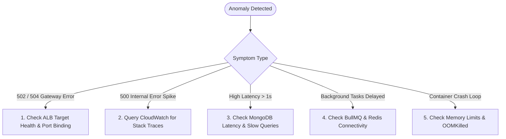

# Production Operational Troubleshooting Guide

## 1. Diagnostic Decision Tree



---

## 2. Common Failure Modes & Runbooks

### Runbook 1: 502 Bad Gateway / 504 Gateway Timeout

- **Symptoms**: ALB returns `502 Bad Gateway` or `504 Gateway Timeout` to web/admin visitors.
- **Root Causes**:
  - The ECS task crashed or is restarting.
  - The process is blocked on a synchronous operation and failed the ALB `/health` check.
  - The security group is blocking traffic between ALB and ECS task.
- **Diagnostic Commands**:
  ```bash
  # Check ALB Target Group health
  aws elbv2 describe-target-health --target-group-arn <TARGET_GROUP_ARN>

  # Check ECS task status
  aws ecs list-tasks --cluster veyora-production-cluster --service-name veyora-api-service
  ```
- **Remediation**:
  - If targets are unhealthy, inspect container exit codes in CloudWatch.
  - If container died with exit code `137`, it was killed due to Out of Memory (OOM). Increase memory reservation in task definition.

---

### Runbook 2: MongoDB Connection Pool Exhaustion / Timeout

- **Symptoms**: Requests fail with `MongoServerSelectionError: Server selection timed out after 30000 ms`.
- **Root Causes**:
  - Database connection spikes exceeding cluster limits.
  - Long-running unindexed aggregation queries holding open connections.
  - Database maintenance or primary failover event.
- **Diagnostic Commands**:
  ```bash
  # Check database readiness latency
  curl https://api.veyora.com/health/ready
  ```
- **Remediation**:
  - Inspect active connections on MongoDB Atlas dashboard.
  - Identify unindexed queries in MongoDB Profiler:
    ```javascript
    db.system.profile
      .find({ millis: { $gt: 100 } })
      .sort({ ts: -1 })
      .limit(10);
    ```
  - Kill long-running blocking operations:
    ```javascript
    db.killOp(<opId>);
    ```

---

### Runbook 3: BullMQ Worker Stalling & Redis Queue Backlog

- **Symptoms**: Customer notifications (order confirmation emails, shipment tracking updates) are delayed; worker CPU is idle while queue count rises.
- **Root Causes**:
  - BullMQ job lock expired due to a stalled asynchronous promise.
  - Redis memory limit hit maxmemory with no eviction policy.
- **Diagnostic Commands**:
  ```bash
  # Connect to Redis CLI and check BullMQ queue lengths
  redis-cli -h $REDIS_HOST -p $REDIS_PORT -a $REDIS_PASSWORD
  LLEN "bull:veyora-orders:wait"
  LLEN "bull:veyora-notifications:wait"

  # Inspect memory usage
  INFO memory
  ```
- **Remediation**:
  - If `used_memory` is near `maxmemory`, configure eviction policy:
    ```text
    CONFIG SET maxmemory-policy volatile-lru
    ```
  - Restart the worker tasks to clear stalled job locks:
    ```bash
    aws ecs update-service --cluster veyora-production-cluster --service veyora-worker-service --force-new-deployment
    ```

---

### Runbook 4: Container Out-Of-Memory (`OOMKilled` Exit Code 137)

- **Symptoms**: ECS repeatedly restarts tasks with `StoppedReason: Essential container in task exited (code: 137)`.
- **Root Causes**:
  - Node.js heap memory usage exceeded the Fargate task allocation (1024 MiB).
  - Unbounded memory consumption in image processing or huge catalog query payloads without cursor pagination.
- **Remediation**:
  - Verify heap metrics from `/metrics`: `process_heap_bytes{type="used"}`.
  - Temporary fix: Bump task memory allocation in `infra/terraform/ecs.tf` from 1024 to 2048 MiB.
  - Permanent fix: Audit recent code changes for memory leaks (unclosed sockets, event listener leaks, or unbounded in-memory arrays).

---

### Runbook 5: Payment Webhook Signature Failures

- **Symptoms**: Razorpay webhooks fail with `401 Unauthorized: Invalid webhook signature`.
- **Root Causes**:
  - Webhook secret mismatch between Razorpay Dashboard and `RAZORPAY_WEBHOOK_SECRET` in AWS Secrets Manager.
  - Body parser mutated the raw incoming payload before HMAC SHA-256 verification.
- **Remediation**:
  - Confirm raw body parsing is active in `app.ts` (`req.rawBody = buf.toString("utf8")`).
  - Retrieve the configured secret from AWS Secrets Manager:
    ```bash
    aws secretsmanager get-secret-value --secret-id "veyora/production/api-secrets" --query SecretString --output text
    ```
  - Verify the secret in the Razorpay Webhook settings matches exactly.
